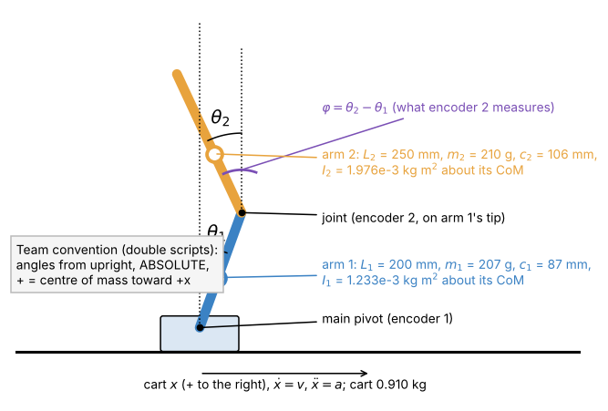

# 1. Variables: every symbol, its value, and its name in the code

[Back to Double](README.md) · Next: [2. Equations of motion](02_equations_of_motion.md)



## 1.1 Sign convention (read this first)

The double scripts measure both angles **from upright**, as **absolute** angles (each arm against the vertical, not against the other arm), with **positive = centre of mass toward +x**. This is the opposite sign to the single script (there, positive = CoM toward -x, see [Single 1](../Single/01_variables.md)). Every equation and number on these pages uses the double convention.

Hanging is $`\theta = \pi`$ (180°). The swing-up plan starts at $`\theta_1 = \theta_2 = \pi`$ and ends at $`0`$.

## 1.2 State, input, measurements

| Symbol | Meaning | Unit | Code name (PythonMaster2_swingup.py) |
| --- | --- | --- | --- |
| $`\theta_1`$ | arm 1 angle from upright (absolute) | rad | `z[0]`, `x_hat[0]`, `th1` |
| $`\omega_1 = \dot\theta_1`$ | arm 1 rate | rad/s | `z[1]`, `w1` |
| $`\theta_2`$ | arm 2 angle from upright (absolute) | rad | `z[2]`, `th2` |
| $`\omega_2 = \dot\theta_2`$ | arm 2 rate | rad/s | `z[3]`, `w2` |
| $`x`$ | cart position from where it started | m | `z[4]`, `cart_m`, `cart_now` |
| $`v = \dot x`$ | cart speed | m/s | `z[5]`, `v_state` |
| $`a = \ddot x`$ | cart acceleration (the **input** in the stepper model) | m/s² | `a` (the CSV's "force" columns hold it) |
| $`F`$ | force on the cart (the input in the **force** model only) | N | `force` in `PythonMaster2_auto.py` |
| $`a_{\text{prev}}`$ | acceleration decided one cycle earlier (delay state) | m/s² | `a_prev` |
| $`\varphi = \theta_2 - \theta_1`$ | joint angle, what encoder 2 measures | rad | `jt_m`, `joint_meas` |
| $`T_s`$ | control period | s | `SAMPLE_PERIOD_S` = 0.01 |
| $`\tau`$ | delay from the sample to the motor changing speed | s | `CONTROL_LATENCY_MS` (8 ms swing, 9 ms balance) |

State vector (same order in every double script):

```math
\mathbf z = [\theta_1,\ \omega_1,\ \theta_2,\ \omega_2,\ x,\ v]^T
```

The balance and swing-up LQR add $`a_{\text{prev}}`$ as a seventh state ([3.6](03_linear_model.md#36-adding-the-delay)).

**What the sensors give.** Encoder 1 (TX1) sits on the main pivot and reads arm 1 against the cart. Encoder 2 (TX2) sits on the joint and reads arm 2 **against arm 1**, so the script builds the absolute angle as $`\theta_2 = \theta_1 + \varphi`$. Each is 14-bit: one count is $`2\pi/16384`$ = 0.000383 rad = 0.022°. The cart position is the Arduino's step count times 0.638175/6400 = 99.7 µm per step.

**Calibration.** With both arms hanging still, 50 readings are averaged on the circle (`circular_mean_counts`). Arm 1's upright reference is that hanging value + 8192 counts (half a turn); the joint's zero is its hanging value (arms aligned). In code: `th1_m = -signed_count_delta(raw1, upright1) * RAD_PER_COUNT - off1`; the minus sign flips the encoder's direction into the team convention, and `off1` is the auto-trim.

## 1.3 Arm constants (physical values)

From `Code/Global/physical_parameters.py` and the top of every double script (`ARM1_MASS_KG`, ...). Measured by the team; `[?]` how each inertia was obtained.

| Symbol | Meaning | Arm 1 | Arm 2 | Code |
| --- | --- | --- | --- | --- |
| $`m_i`$ | mass | 0.207 kg | 0.210 kg | `ARM1_MASS_KG`, `ARM2_MASS_KG` |
| $`c_i`$ | pivot (or joint) to the arm's centre of mass | 0.087 m | 0.106 m | `ARM1_COM_M`, `ARM2_COM_M` |
| $`L_1`$ | main pivot to the joint | 0.200 m | (0.25 m drawn length) | `ARM1_LENGTH_M` |
| $`I_i`$ | inertia about the arm's own CoM | 0.00123325 kg m² | 0.00197564 kg m² | `ARM1_INERTIA_KG_M2`, ... |
| $`b_1`$ | viscous friction at the main pivot | 0.0009 / 0.0002 N m s | | `ARM1_PIVOT_FRICTION` (swing-up / balance script) |
| $`b_2`$ | viscous friction at the joint (on the relative rate $`\dot\varphi`$) | | 0.0001 N m s | `ARM2_JOINT_FRICTION` |
| $`M`$ | cart mass (force model only) | 0.969 - 0.059 = 0.910 kg | | `mcartVal` in PythonMasterMath2.py |
| $`g`$ | gravity | 9.81 m/s² | | `G` |

Arm 2's length $`L_2`$ never enters the dynamics (nothing hangs below arm 2); it only matters for drawing and for a third arm.

## 1.4 The combined constants the equations actually use

Working through the Lagrangian ([2](02_equations_of_motion.md)) the six numbers above always appear in these combinations:

| Symbol | Formula | Value | Meaning |
| --- | --- | --- | --- |
| $`p_1`$ | $`m_1c_1 + m_2L_1`$ | 0.060009 kg m | first moment of everything arm 1 carries about the main pivot (gravity torque per unit $`g\sin\theta_1`$) |
| $`p_2`$ | $`m_2c_2`$ | 0.022260 kg m | same for arm 2 about the joint |
| $`J_1 = h_{11}`$ | $`I_1 + m_1c_1^2 + m_2L_1^2`$ | 0.011200 kg m² | inertia of arm 1 about the main pivot, with arm 2's mass as a point at the joint |
| $`J_2 = h_{22}`$ | $`I_2 + m_2c_2^2`$ | 0.004335 kg m² | inertia of arm 2 about the joint |
| $`h_{12}`$ | $`m_2L_1c_2`$ | 0.004452 kg m² | coupling: how arm 2's swing pushes on arm 1 and back |

## 1.5 The ratios (what the scripts and system ID really use)

Divide every arm equation by $`J_1`$ and only **four** numbers (plus two friction ratios) are left. These are the `P1, P2, J2r, H, B1, B2` in `SYSID_RATIOS` and `arm_ratios()`:

| Ratio | Formula | Physical value | Unit |
| --- | --- | --- | --- |
| `P1` | $`p_1/J_1`$ | 5.35793 | 1/m |
| `P2` | $`p_2/J_1`$ | 1.98749 | 1/m |
| `J2r` | $`J_2/J_1`$ | 0.38707 | - |
| `H` | $`h_{12}/J_1`$ | 0.39750 | - |
| `B1` | $`b_1/J_1`$ | 0.080 (0.0009) or 0.018 (0.0002) | 1/s |
| `B2` | $`b_2/J_1`$ | 0.0089 | 1/s |

Why ratios: with the cart acceleration as the input, multiplying all masses and inertias by the same factor changes nothing in the motion. So the six physical constants cannot all be measured from how the arms swing, but these four ratios can. That is what `PendulumSysID.py` / `analyze_sysid.py` fit. (The force model is different: there the cart mass sets the scale, so it needs real masses.)

Ratio sets that have been used on the rig (see [params.md](../../params.md) for sources):

| Set | P1 | P2 | J2r | H | B1 | B2 | Used by |
| --- | --- | --- | --- | --- | --- | --- | --- |
| physical (calculated) | 5.358 | 1.987 | 0.387 | 0.3975 | | | PythonMasterMath2.py (as masses), fallback in all scripts |
| SYSID, first fit (date [?]; in use by 2026-10-21) | 5.22342 | 2.01257 | 0.414023 | 0.394859 | 0 | 0.03 | `PythonMasterDouble-Claude.py` (balance, the 767 s run); swing-up runs 2026-10-21 and 2026-10-27 17:31 (with B2 raised to 0.169 / 0.087) |
| SysID, new arm 1 (2026-10-27) | 5.10701 | 1.86426 | 0.389109 | 0.384233 | 0.100 | 0.0049 | swing-up runs 2026-10-27 18:28 to 18:43 |
| swing-fit (2026-10-27) [HYP] | 5.16428 | 1.80161 | 0.39142 | 0.39247 | 0 | 0.11396 | stored plan `double_swingup_trajectory.json`, swing-up runs from 18:46 |

The four sets differ by up to 10 % in P2 and 7 % in J2r. That matters a lot for the swing-up and very little for balancing ([7](07_results.md)).

## 1.6 Controller constants

All listed with their meaning where they are used: balance weights in [4](04_balance.md#44-the-weights-brysons-rule), swing-up plan limits and tracking weights in [5](05_swing_up.md#58-every-swing-up-constant), rig limits in [params.md](../../params.md).

## 1.7 Units cheat sheet

| Quantity | Conversion |
| --- | --- |
| 1 encoder count | 0.000383 rad = 0.022° |
| 1° | 0.01745 rad = 45.5 counts |
| 1 step | 99.7 µm |
| 1 m/s | 10 029 steps/s; Arduino timer value N gives $`125000/(N+1)`$ steps/s |
| a gain of 100 m/s² per rad | 1.75 m/s² per degree |

[Back to Double](README.md) · Next: [2. Equations of motion](02_equations_of_motion.md)
