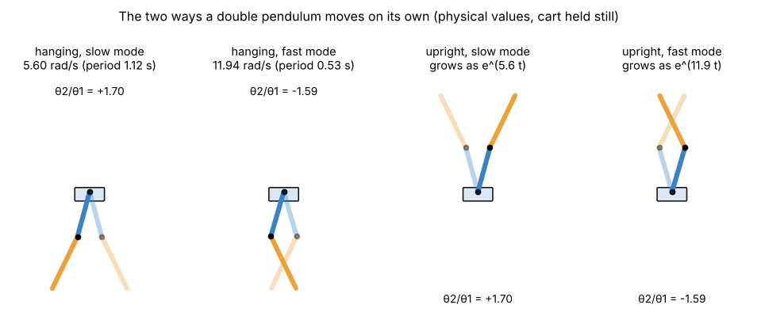
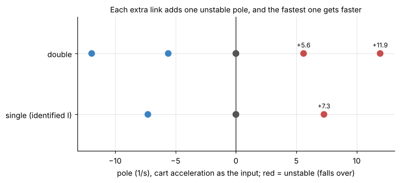

# 3. Linear model, natural motions, discretisation and delay

[Back to Double](README.md) · Prev: [2. Equations of motion](02_equations_of_motion.md) · Next: [4. Balance](04_balance.md)

All numbers on this page come from [`sims/double_model.py`](sims/double_model.py) (physical values unless stated).

## 3.1 Linearising at upright

Near upright $`\sin\theta \approx \theta`$, $`\cos\theta \approx 1`$, $`\cos(\theta_1-\theta_2) \approx 1`$, and the $`\omega^2`$ terms are second order, so they drop. The acceleration-input equations of [2.5](02_equations_of_motion.md#25-two-ways-to-drive-the-model) become

```math
\mathbf H_0\,\dot{\boldsymbol\omega} = g\,\mathrm{diag}(p_1, p_2)\,\boldsymbol\theta - \mathbf p\,a - \mathbf B_f\,\boldsymbol\omega,
\qquad
\mathbf H_0 = \begin{bmatrix}J_1 & h_{12}\\ h_{12} & J_2\end{bmatrix},\ 
\mathbf B_f = \begin{bmatrix}b_1 + b_2 & -b_2\\ -b_2 & b_2\end{bmatrix}
```

so, multiplying by $`\mathbf H_0^{-1}`$,

```math
\dot{\boldsymbol\omega} = \underbrace{g\,\mathbf H_0^{-1}\mathrm{diag}(\mathbf p)}_{\text{gravity}}\,\boldsymbol\theta\ \underbrace{-\ \mathbf H_0^{-1}\mathbf B_f}_{\text{friction}}\,\boldsymbol\omega\ \underbrace{-\ \mathbf H_0^{-1}\mathbf p}_{\text{cart}}\,a
```

This is exactly `continuous_model(r)` in `PythonMasterDouble-Claude.py` (`Gm`, `Dm`, `Pa`). With the physical values (no friction):

```math
\begin{aligned}
\dot\omega_1 &= \phantom{-}88.82\,\theta_1 - 33.83\,\theta_2 - 5.605\,a\\
\dot\omega_2 &= -91.21\,\theta_1 + 85.12\,\theta_2 + 0.621\,a
\end{aligned}
```

Reading it:
- $`+88.8\,\theta_1`$: arm 1 (carrying arm 2) falls over on its own, like the single arm.
- $`-33.8\,\theta_2`$: arm 2 leaning toward +x pushes the joint back toward -x, so it tips arm 1 the other way.
- $`-91.2\,\theta_1`$: when arm 1 falls toward +x, its tip (the joint) accelerates toward +x and drags the bottom of arm 2 along, which rotates arm 2 toward -x. Arm 1 acts as arm 2's cart.
- $`-5.6\,a`$ and $`+0.62\,a`$: accelerating the cart +x tips arm 1 back (toward -x) hard, and throws arm 2 slightly forward through the joint. **One input, opposite effects on the two arms.** That is the whole difficulty of the double.

Full state space ($`\mathbf z = [\theta_1, \omega_1, \theta_2, \omega_2, x, v]`$, input $`a`$):

```math
A = \begin{bmatrix}
0 & 1 & 0 & 0 & 0 & 0\\
88.817 & 0 & -33.834 & 0 & 0 & 0\\
0 & 0 & 0 & 1 & 0 & 0\\
-91.210 & 0 & 85.117 & 0 & 0 & 0\\
0 & 0 & 0 & 0 & 0 & 1\\
0 & 0 & 0 & 0 & 0 & 0
\end{bmatrix},\qquad
B = \begin{bmatrix}0\\ -5.6048\\ 0\\ 0.6211\\ 0\\ 1\end{bmatrix}
```

The cart rows are a pure double integrator: with the stepper, the cart does not feel the arms at all.

## 3.2 The two natural motions



Hold the cart still ($`a = 0`$) and look for motions where both arms move in proportion, $`\boldsymbol\theta(t) = \mathbf v\,e^{st}`$. Substituting into $`\mathbf H_0\ddot{\boldsymbol\theta} = \pm g\,\mathrm{diag}(\mathbf p)\boldsymbol\theta`$ (+ upright, - hanging) gives the eigenproblem

```math
s^2\,\mathbf v = \pm\,g\,\mathbf H_0^{-1}\mathrm{diag}(\mathbf p)\,\mathbf v, \qquad \text{eigenvalues of } g\mathbf H_0^{-1}\mathrm{diag}(\mathbf p):\ 31.38,\ 142.55\ \text{s}^{-2}
```

| Mode | $`\sqrt{\lambda}`$ | Shape $`\theta_2/\theta_1`$ | Hanging: swings at | Upright: falls as |
| --- | --- | --- | --- | --- |
| slow | 5.60 /s | +1.70 (both lean the same way, arm 2 more) | 1.12 s period | $`e^{5.60t}`$, doubles in 124 ms |
| fast | 11.94 /s | -1.59 (zig-zag at the joint) | 0.53 s period | $`e^{11.94t}`$, doubles in **58 ms** |

The same two numbers appear hanging and upright because flipping gravity flips the sign of the eigenvalue. For the other ratio sets: slow 5.41-5.53, fast 11.25-11.34 /s ([numbers](sims/double_model_numbers.json)). Compare the single arm: one mode, 7.29 /s.

The fast mode is the reason the double is so much harder to balance than the single: a zig-zag doubles in 58 ms, while one control cycle plus the motor delay is about 19 ms. The controller must react within a third of a doubling time, every time.

## 3.3 Poles, controllability, observability



Eigenvalues of $`A`$: $`\pm 5.60, \pm 11.94, 0, 0`$. Two unstable poles (one per arm), two at zero (cart position and speed: nothing pulls the cart anywhere).

**Controllability:** $`[B, AB, \ldots, A^5B]`$ has rank 6, so the one cart input can steer both arms and the cart. It is only just so: if arm 2 had zero mass ($`p_2 = h_{12} = 0`$) it would drop to 4.

**Observability** (which measurements are enough to reconstruct every state):

| Measured | Rank (6 = all states) |
| --- | --- |
| $`\theta_1, \theta_2, x`$ (what the rig has) | 6 |
| $`\theta_1, x`$ | 6 in theory (arm 2 inferred from how arm 1 moves), badly conditioned in practice |
| $`\theta_1`$ only or $`\theta_2`$ only | 4 (arms yes, cart no) |
| $`x`$ only | 2: with a stepper the cart tells you nothing about the arms |

## 3.4 The force model of PythonMasterMath2.py

Keeping the cart equation and using force $`F`$ as input (cart 0.910 kg, no drag), linearised the same way:

```math
A_F = \begin{bmatrix}
0 & 1 & 0 & 0 & 0 & 0\\
107.228 & 0 & -34.591 & 0 & 0 & 0\\
0 & 0 & 0 & 1 & 0 & 0\\
-93.251 & 0 & 85.201 & 0 & 0 & 0\\
0 & 0 & 0 & 0 & 0 & 1\\
-3.285 & 0 & 0.135 & 0 & 0 & 0
\end{bmatrix},\qquad
B_F = \begin{bmatrix}0\\ -5.5798\\ 0\\ 0.6184\\ 0\\ 0.9955\end{bmatrix}
```

Open-loop poles $`\pm 6.19, \pm 12.41, 0, 0`$: a little faster than with the cart held, because a free cart is pushed away by the falling arms. $`B_{F,6}`$ = 0.9955 means 1 N accelerates the cart at 0.9955 m/s², an effective mass of 1.004 kg (the cart plus the part of the arms' mass that moves with it). Discretised at 10 ms this gives, to every printed digit, the `Matrix A` and `Matrix B` in `control_matrices2.txt` (checked by [`verify_against_team_code.py`](sims/verify_against_team_code.py)).

As for the single arm, the stepper ignores force; [4.2](04_balance.md#42-generation-1-force-model-pythonmastermath2py--pythonmaster2_autopy) shows how the old double script still made it work, and where it did not.

## 3.5 Discretisation

Same zero-order-hold step as the single ([Single 3.4](../Single/03_linear_model.md#34-discretisation-line-227)): $`A_d = e^{AT_s}`$, $`B_d = \int_0^{T_s}e^{As}ds\,B`$, computed from one matrix exponential of $`\begin{bmatrix}A & B\\0 & 0\end{bmatrix}T_s`$. For the acceleration model:

```math
A_d = \begin{bmatrix}
1.00445 & 0.01001 & -0.00169 & -0.00001 & 0 & 0\\
0.89000 & 1.00445 & -0.33932 & -0.00169 & 0 & 0\\
-0.00457 & -0.00002 & 1.00426 & 0.01001 & 0 & 0\\
-0.91475 & -0.00457 & 0.85289 & 1.00426 & 0 & 0\\
0 & 0 & 0 & 0 & 1 & 0.01\\
0 & 0 & 0 & 0 & 0 & 1
\end{bmatrix},\qquad
B_d = \begin{bmatrix}-0.00028\\ -0.05613\\ 0.00003\\ 0.00631\\ 0.00005\\ 0.01\end{bmatrix}
```

Discrete open-loop poles $`e^{5.60\cdot 0.01}`$ = 1.058 and $`e^{11.94\cdot 0.01}`$ = 1.127: left alone, the zig-zag grows 12.7 % every cycle.

## 3.6 Adding the delay

The motor does not change speed at the sample instant. It takes $`\tau`$ (Pi and USB 1-2 ms, motor and belt about 5 ms; the scripts assume 8-9 ms) before the new command acts. During the first $`\tau`$ of each period the **previous** command is still acting. For an acceleration $`a`$ held over the period ("ramp" model, used by `PythonMasterDouble-Claude.py`):

```math
\mathbf z_{k+1} = \underbrace{e^{AT}}_{\Phi}\mathbf z_k + \underbrace{e^{A(T-\tau)}\Gamma(\tau)}_{G_1}\,a_{k-1} + \underbrace{\Gamma(T-\tau)}_{G_0}\,a_k,
\qquad \Gamma(t) = \int_0^t e^{As}ds\,B
```

`discretize_with_delay(A, B, T, tau)` computes exactly these three. With $`\tau`$ = 9 ms most of the effect of a new command arrives one period late:

```math
G_0 = [-0.0000,\ -0.0053,\ 0.0000,\ 0.0002,\ 0.0000,\ 0.0010]^T,\qquad G_1 = [-0.0003,\ -0.0478,\ 0.0000,\ 0.0018,\ 0.0000,\ 0.0090]^T
```

To design for it, the previous command becomes a seventh state:

```math
\begin{bmatrix}\mathbf z_{k+1}\\ a_k\end{bmatrix} = \underbrace{\begin{bmatrix}\Phi & G_1\\ 0 & 0\end{bmatrix}}_{A_z}\begin{bmatrix}\mathbf z_k\\ a_{k-1}\end{bmatrix} + \underbrace{\begin{bmatrix}G_0\\ 1\end{bmatrix}}_{B_z}a_k
```

LQR on $`(A_z, B_z)`$ then knows the command lands late, and its gain has a seventh entry for $`a_{\text{prev}}`$.

## 3.7 The staircase model (swing-up script)

A stepper does not ramp its speed; it jumps to the new step rate. `PythonMaster2_swingup.step()` models one period as: coast at the old speed for $`\tau`$, jump the speed by $`a\,T`$ (with the arm kick of [2.7](02_equations_of_motion.md#27-when-the-stepper-jumps-speed-the-kick)), coast for $`T-\tau`$. It integrates the full nonlinear model (two RK4 steps per coast), so it can be linearised anywhere along the swing (`linearize()`, central differences). At upright with $`\tau`$ = 8 ms it gives the same $`\Phi`$ as above and

```math
B_{\text{stair}} = [-0.00011,\ -0.05606,\ 0.00001,\ 0.00622,\ 0.00002,\ 0.01,\ 1]^T,\qquad \text{column of } a_{\text{prev}} = 0
```

Since $`\tau < T`$, the previous command is fully applied within its own period, so $`a_{\text{prev}}`$ has no effect and its LQR gain is exactly 0. That is why every swing-up log's `balance_gain` ends in `0.0` while the balance script's ends in 0.418.

What the two scripts send to match their model:

| | Model | Sends to the Arduino |
| --- | --- | --- |
| `PythonMasterDouble-Claude.py` | ramp: $`v`$ changes linearly by $`aT`$ over the period | the **average** speed $`v + aT/2`$, so the position after the period matches the ramp |
| `PythonMaster2_swingup.py` | staircase: $`v`$ jumps by $`aT`$ at $`\tau`$ | the **new** speed $`v + aT`$ |

Both then round the speed to what the Arduino's timer can do ([7.4](07_results.md#74-why-every-rig-attempt-tops-out-at-0831-ms)).

[Back to Double](README.md) · Prev: [2. Equations of motion](02_equations_of_motion.md) · Next: [4. Balance](04_balance.md)
