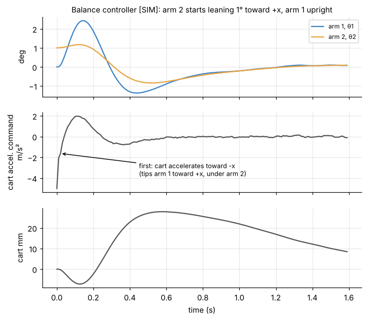
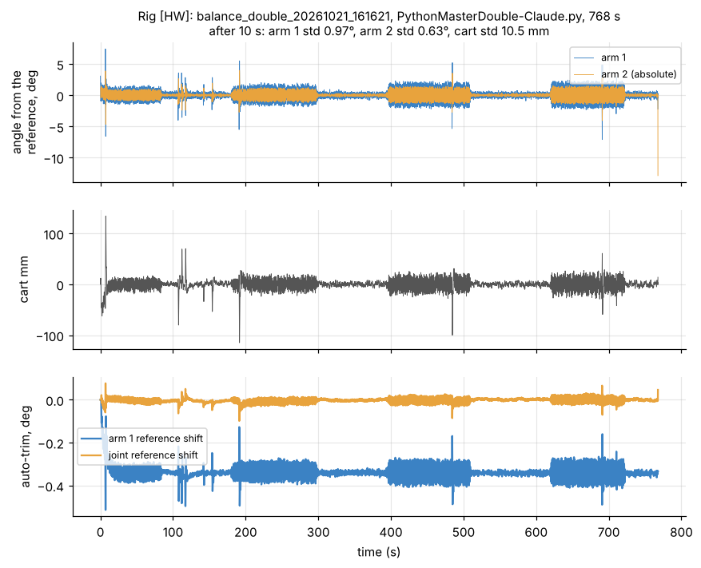
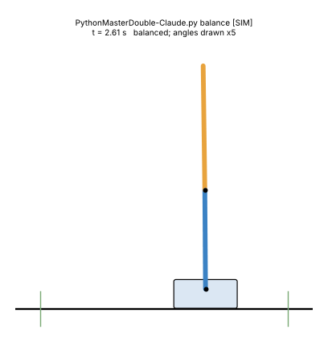

# 4. Balance: LQR, Kalman filter, delay, auto-trim

[Back to Double](README.md) · Prev: [3. Linear model](03_linear_model.md) · Next: [5. Swing-up](05_swing_up.md)

All gains here are recomputed by [`sims/double_model.py`](sims/double_model.py) and match the scripts and the rig logs exactly ([`verify_against_team_code.py`](sims/verify_against_team_code.py)). Script files: etwan007/ENGT480, branch `experiment/legacy-pi-recovery`, commit ba019f9, `LegacyPi/Code/DoublePendulum/`.

## 4.1 Three generations

| | Gen 1 | Gen 2 (balances on the rig) | Gen 3 |
| --- | --- | --- | --- |
| Script | `PythonMasterMath2.py` → `control_matrices2.txt` → `PythonMaster2_auto.py` (also in `Code/DoublePendulum` of the same branch) | `PythonMasterDouble-Claude.py` (on the Pi it ran as `PythonMaster2_auto_improved.py`) | balance part of `PythonMaster2_swingup.py` |
| Model | force on a 0.910 kg cart | cart acceleration, 9 ms delay, "ramp" | cart acceleration, 9 ms delay, "staircase" |
| Arm values | physical | SYSID ratios (P1 5.223, P2 2.013, J2r 0.414, H 0.395, B2 0.03) | swing-fit ratios with B2 = 0.03 |
| LQR | Q = diag(100, 1, 100, 1, 20, 10), R = 0.1, applied ×1.5 | Bryson weights (2°, 2°, 60°/s, 5 cm, 0.3 m/s, 1.3 m/s²) | same weights |
| Estimator | `dlqe` predictor gain, tuning noise | steady Kalman filter, noise from the hardware | same |
| Motor gets | the Kalman filter's cart speed | integral of the commanded acceleration (average over the period) | integral (new speed) |
| Rig result | 13 runs 2026-09-30, longest **24.9 s** [HW] | **767.7 s** (12.8 min) on 2026-10-21; 305.6 s on 2026-10-16 with earlier settings (physical values, 6 ms, 1.5 m/s²) [HW] | used only after a catch, which has not happened on the rig yet |

## 4.2 Generation 1: force model (PythonMasterMath2.py + PythonMaster2_auto.py)

**Design** (`PythonMasterMath2.py`):

```python
Kd, Sd, Ed = ctrl.dlqr(ssDisc, sp.diag(100,1,100,1,20,10), 0.1)
Ld, Pd, Edkalm = ctrl.dlqe(ssDisc.A, sp.diag(1,1,1,1,1,1), ssDisc.C, sp.diag(0.2,0.001,0.2,0.001,0.2,0.001), 0.01*sp.diag(1,1,1))
```

```math
K_d = [-165.773,\ -2.682,\ 240.538,\ 27.067,\ 10.742,\ 15.810]
```

(per $`[\theta_1, \omega_1, \theta_2, \omega_2, x, v]`$, in N per rad, N per rad/s, N per m, N per m/s). The Kalman gain $`L_d`$ (6x3) is in `control_matrices2.txt`; as in the single script it is python-control's **predictor** gain used in a filter-form correction ([Single 5.3](../Single/05_kalman_lqg.md#53-what-dlqe-computes)).

**Loop** (`PythonMaster2_auto.py`, around its line 414):

```python
state = predicted + matrices["Ld"] @ (measured - matrices["C"] @ predicted)
force = np.clip(-matrices["Kd"] @ state * 1.5, -5, 5)
cart_velocity = float(state[5, 0])          # the motor gets the estimator's cart speed
...
upright1 += cart_m / 60 + cart_velocity / 30   # slow centring: shifts arm 1's reference
```

The same "virtual cart" trick as the single ([Single 5.5](../Single/05_kalman_lqg.md#55-the-virtual-cart)): the force only feeds the next prediction, and the motor follows the model's cart speed. Substituting the ×1.5 law into the model's cart row gives the acceleration the motor effectively follows:

```math
a_{\text{eff}} = 244.3\,\theta_1 + 4.0\,\omega_1 - 359.1\,\theta_2 - 40.4\,\omega_2 - 16.0\,x - 23.6\,v\quad[\text{m/s}^2]
```

In the model this loop is stable (largest $`|z|`$ 0.986). On the rig it held for at most 24.9 s (that run ended on two missing radio packets in a row); the other 12 runs of 2026-09-30 lasted under 9 s each, ended by Ctrl+C, radio misses or the 1.0 rad angle limit [HW]. The modelled cart (a force-driven 1.004 kg mass with no motor delay) is not what the stepper does, which is what generation 2 fixed.

## 4.3 Generation 2: acceleration model with delay (PythonMasterDouble-Claude.py)

The script's own summary of what changed: "The model treats the cart the way the stepper actually moves it: the controller decides a cart ACCELERATION, the script integrates it into the speed it sends", "The 5-7 ms between reading the angles and the motor reacting is part of the design", plus auto-trim, a 1-step dither instead of slow creep, limits and a start ramp. The gains are computed at start-up (`design()`), so `control_matrices2.txt` is not used.

Design, in order:
1. $`A, B`$ = acceleration-input linear model from the ratios ([3.1](03_linear_model.md#31-linearising-at-upright)).
2. $`\Phi, G_0, G_1`$ = delay discretisation with $`\tau`$ = `CONTROL_LATENCY_MS` = 9 ms ([3.6](03_linear_model.md#36-adding-the-delay)).
3. LQR on the 7-state $`(A_z, B_z)`$ with Bryson weights (4.4).
4. Steady Kalman filter on $`\Phi`$ with noise from the hardware (4.6).

## 4.4 The weights: Bryson's rule

Each weight is $`1/(\text{size that counts as "a lot"})^2`$, so the numbers in the script are physical sizes, not abstract weights:

| State | Setting | "A lot" | $`Q_{ii}`$ |
| --- | --- | --- | --- |
| $`\theta_1`$ | `LQR_ARM1_ANGLE_DEG` | 2° | 820.7 |
| $`\omega_1`$ | `LQR_ARM_RATE_DEG_S` | 60°/s | 0.912 |
| $`\theta_2`$ | `LQR_ARM2_ANGLE_DEG` | 2° | 820.7 |
| $`\omega_2`$ | `LQR_ARM_RATE_DEG_S` | 60°/s | 0.912 |
| $`x`$ | `LQR_CART_M` | 0.05 m | 400 |
| $`v`$ | `LQR_CART_SPEED_M_S` | 0.3 m/s | 11.1 |
| $`a_{\text{prev}}`$ | - | - | 0 |
| input $`a`$ | `LQR_CART_ACCEL_M_S2` | 1.3 m/s² | $`R`$ = 0.592 |

So the cost says: 1.3 m/s² of cart acceleration is as bad as 2° of arm tilt or 5 cm of cart offset. `LQR_CART_ACCEL_M_S2` is the main calm-versus-stiff knob ("smaller = stiller cart, larger = stronger recovery").

## 4.5 The gains and what they mean

```math
K = [-192.22,\ -4.41,\ 283.91,\ 32.82,\ 20.54,\ 21.30,\ 0.418]
```

(rig log `balance_double_20261021_161621`: identical). The law $`a = -K[\mathbf z; a_{\text{prev}}]`$ reads

```math
a = 192.2\,\theta_1 + 4.4\,\omega_1 - 283.9\,\theta_2 - 32.8\,\omega_2 - 20.5\,x - 21.3\,v - 0.42\,a_{\text{prev}}\quad[\text{m/s}^2]
```

| Situation (1° each) | First command | Why |
| --- | --- | --- |
| only arm 1 leans +x | +3.35 m/s² (cart toward the lean) | like the single: get under it |
| only arm 2 leans +x | **-4.96 m/s²** (cart away from the lean) | tip arm 1 toward +x so the joint moves under arm 2 |
| both lean +x, slow-mode shape (arm 2 1.7°) | -5.07 m/s² | straighten the bend first, then carry the whole thing |
| zig-zag (arm 2 -1.59°) | +11.2 m/s² | the fast mode needs the hardest response |



The middle rows are the surprising part of a double pendulum: **the cart first moves away from the top arm's lean.** Arm 1 is arm 2's "cart"; the only way to move the joint toward +x is to rotate arm 1 toward +x, and the only way to do that is to accelerate the real cart toward -x ([3.1](03_linear_model.md#31-linearising-at-upright): $`-5.6\,a`$). In the simulation above the cart goes 7 mm the "wrong" way, arm 1 swings to +2.4°, then the cart runs +28 mm and both arms come back together [SIM].

Same law rewritten with the joint angle $`\varphi = \theta_2 - \theta_1`$ (what encoder 2 reads): $`a = -91.7\,\theta_1 - 283.9\,\varphi + \ldots`$. The joint bend is weighted three times more than arm 1's tilt.

The delay changes the gains noticeably ($`\tau`$ in ms → $`K`$):

| $`\tau`$ | $`K_{\theta_1}`$ | $`K_{\omega_1}`$ | $`K_{\theta_2}`$ | $`K_{\omega_2}`$ | $`K_x`$ | $`K_v`$ | $`K_{a,\text{prev}}`$ |
| --- | --- | --- | --- | --- | --- | --- | --- |
| 0 | -167.2 | -2.84 | 261.1 | 30.4 | 20.5 | 21.1 | 0 |
| 3 | -175.3 | -3.34 | 268.6 | 31.2 | 20.5 | 21.2 | 0.13 |
| 6 | -183.6 | -3.86 | 276.2 | 32.0 | 20.6 | 21.3 | 0.27 |
| 9 | -192.2 | -4.41 | 283.9 | 32.8 | 20.5 | 21.3 | 0.42 |

A longer delay means the arms will have fallen further by the time the cart reacts, so the gains grow. ($`\tau`$ is capped at one period by `discretize_with_delay`.)

**Closed-loop poles** (continuous equivalents of the 7 discrete ones): $`-12.8 \pm 6.1j`$ and $`-9.2 \pm 4.9j`$ /s (the two arm modes, now decaying with time constants 78 and 108 ms), $`-1.67 \pm 1.35j`$ /s (the cart returning to centre, about 0.6 s), and one at $`z = 0`$ (the delay state). For comparison gen 1 with ×1.5: $`-74.4, -12.1, -5.06 \pm 2.90j, -2.63, -1.44`$.

## 4.6 The Kalman filter (hardware noise, filter form)

```math
\hat{\mathbf z}_k = \hat{\mathbf z}^-_k + L\,(\mathbf y_k - C\hat{\mathbf z}^-_k),\qquad \mathbf y = [\theta_1,\ \theta_2,\ x]^T,\qquad L = P C^T(CPC^T + R_N)^{-1}
```

$`P`$ solves the filter Riccati equation on $`\Phi`$. Unlike gen 1, $`L`$ is the textbook **filter** gain, and the noise sizes come from the hardware:

| Noise | Setting | Value |
| --- | --- | --- |
| model error of each arm's acceleration | `ARM_DISTURBANCE_RAD_S2` = 1 rad/s², over one period | $`Q_N`$: $`(wT/2)^2, w^2`$ with $`w = 1\cdot T`$ |
| cart model error | a quarter step | $`(\Delta x/4)^2`$, $`(\Delta x/4T)^2`$ |
| angle 1 measurement | `ENCODER_NOISE_COUNTS` = 3 counts | $`(3 \times 0.000383)^2`$ rad² |
| angle 2 measurement | 3 counts ×1.4 (it adds encoder 1 and 2) | |
| cart measurement | step rounding, uniform | $`(\Delta x)^2/12`$ |

```math
L = \begin{bmatrix}
0.3558 & -0.0057 & 0\\
7.6541 & -0.1998 & 0\\
-0.0112 & 0.3132 & 0\\
-0.6261 & 5.7946 & 0\\
0 & 0 & 0.7935\\
0 & 0 & 39.35
\end{bmatrix}
```

Reading: each angle estimate moves 36 % (arm 1) or 31 % (arm 2) of the way to the measurement; each angle surprise of 0.01 rad raises the rate estimate by 0.077 (arm 1) or 0.058 rad/s (arm 2). Much gentler than gen 1's 97 %: the model is trusted more because the encoder noise is small and real. The cart-speed row does not matter: right after the correction the script sets $`\hat v`$ to the speed it is integrating (`x_hat[5, 0] = v_state`), which the stepper follows exactly.

## 4.7 One cycle of the loop

```python
x_hat = x_pred + L @ (y - C @ x_pred)             # correct
x_hat[5, 0] = v_state                              # the cart speed is known exactly
a = -float((K @ np.vstack([x_hat, [[a_prev]]]))[0, 0])
a *= t_run / START_RAMP_S  (first 0.25 s)          # soft start
a = clip(a, +-15 m/s^2);  v_end = v_state + a*T;  clip v_end to +-0.8 m/s
v_cmd = v_state + 0.5 * a * T                      # average speed over the coming period
timer = round(125000 / |v_cmd / 99.7e-6|) - 1       # speeds under 0.3 mm/s: hold with a 1-step dither
x_pred = Phi @ x_hat + G0 * a + G1 * a_prev         # predict
a_prev = a;  v_state = v_end
```

Missing angle packets: the prediction stands in for the missing channel, up to `MAX_RUNNING_CONSECUTIVE_MISSES` = 5 in a row.

## 4.8 Auto-trim (double version)

The upright references come from the hanging calibration plus half a turn. If a reference is off by $`\delta`$, the controller holds the arm at "measured 0" = really $`-\delta`$, where gravity never balances, and the cart has to keep accelerating to hold it: it drifts toward a limit switch. The script's fix moves each reference slowly toward the average measured angle:

```math
\text{off}_1 \mathrel{+}= \frac{T}{6\ \text{s}}\,\theta_{1,\text{meas}},\qquad \text{off}_\varphi \mathrel{+}= \frac{T}{6\ \text{s}}\,\varphi_{\text{meas}}
```

(time constant `TRIM_TIME_CONSTANT_S` = 6 s, starts after 1 s, each limited to ±3°). The only steady state is a measured average of 0, i.e. the references sitting on the true balance point. The estimator's angles are shifted by the same amounts so it sees no jump. The single script trims differently: it integrates the cart offset ([Single 5.9](../Single/05_kalman_lqg.md#59-auto-trim-lines-758-768-slow-integral-action-on-the-upright-reference)).

[SIM] With encoder references 0.5° and -0.3° off, the trims reach 0.48° and -0.29° in 20 s. [HW] In the 767 s run arm 1's reference settled about 0.34° below the calibration and the joint's stayed within 0.05° ([fig05](images/fig05_balance_hw.png), bottom).

## 4.9 On the rig



`balance_double_20261021_161621` [HW]: 767.7 s, after the first 10 s arm 1 std 0.97°, arm 2 std 0.63°, cart std 10.5 mm. Two stretches (about 400-510 s and 620-720 s) show visibly more wobble; the log does not say why [?]. It ended on the 30° angle limit (arm 2 at -31.5°) [?] cause not logged.



*Simulation of the same controller [SIM]: a 0.3 rad/s tap on arm 2 at 3 s (angles drawn 5x larger).*

## 4.10 How sensitive is the balance to the arm values? [SIM]

Design with the SYSID ratios, simulate arms that differ (one ratio at a time, 1-count encoder noise, start 2°/1°):

| Ratio | Survives | Falls |
| --- | --- | --- |
| P1 | +5 % to +15 % | -5 % and below |
| P2 | -15 % to -5 % | +5 % and above |
| J2r | -10 % to +15 % | -15 % |
| H | -5 % to +15 % | -8 % and below |
| B2 | 0 to 0.30 (10x) | - |
| real motor delay | 5 to 18 ms (design 9 ms) | - |

In physical terms (linear closed loop with the Kalman filter, physical arm values, one value at a time; [`../Triple/sims/triple_model.py`](../Triple/sims/triple_model.py) [SIM]) the balance survives arm 1 mass -27 % to +143 %, arm 2 mass -49 % to +34 %, arm 2 inertia -44 % to +125 %, either CoM more than ±37 mm off, and joint 2's position more than ±57 mm off. Real arms are nowhere near those limits.

Linearised closed loop including the Kalman filter agrees: the largest $`|z|`$ crosses 1 at about P1 -5 % and P2 +5 %. So the balance tolerates large errors in most directions but only about 5 % in the direction "arm 2 relatively heavier than the model". The rig balancing for 12.8 minutes with these ratios means the real arms lie inside that region [HW]. The swing-up is far less tolerant: about 2-4 % in every direction ([7.2](07_results.md#72-which-model-errors-the-swing-up-survives-sim)).

## 4.11 Generation 3: the balance after a swing-up

`PythonMaster2_swingup.balance_design(r)` uses the same Bryson weights and Kalman noise, but:
- the staircase actuator model ([3.7](03_linear_model.md#37-the-staircase-model-swing-up-script)), so the $`a_{\text{prev}}`$ gain is 0;
- the swing-fit ratios, with `BALANCE_B2` = 0.03 replacing the swing's B2 = 0.114 ("The rig balances best with 0.03");
- `BALANCE_LATENCY_MS` = 9 ms.

```math
K = [-138.67,\ 0.41,\ 232.78,\ 28.19,\ 20.55,\ 21.32,\ 0]
```

(rig log `swingup_double_20261027_184605`: identical). Its cost-to-go matrix $`P`$ is also the end condition of the swing-up's TV-LQR ([5.5](05_swing_up.md#56-tracking-the-plan-time-varying-lqr)), so the swing feedback hands over smoothly.

## 4.12 Tuning guide (from the script's header)

| Symptom | Change |
| --- | --- |
| cart jitters or buzzes while balanced | `ENCODER_NOISE_COUNTS` up, or `LQR_CART_ACCEL_M_S2` down |
| cart slowly wanders a centimetre or more | check the printed trims; `LQR_CART_M` down a little |
| arms wobble, a light tap knocks them over | `LQR_CART_ACCEL_M_S2` up, `LQR_ARM*_ANGLE_DEG` down |
| oscillation at a few Hz that grows | `CONTROL_LATENCY_MS` up 2-4 ms |
| stepper skips | `CART_ACCEL_MAX_M_S2` and `LQR_CART_ACCEL_M_S2` down |
| cart parks off centre at the start | copy the printed trims into `ARM1_OFFSET_DEG` / `JOINT2_OFFSET_DEG` |

[Back to Double](README.md) · Prev: [3. Linear model](03_linear_model.md) · Next: [5. Swing-up](05_swing_up.md)
