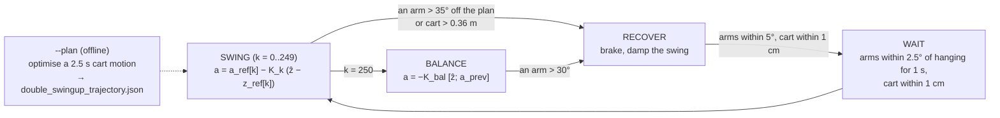
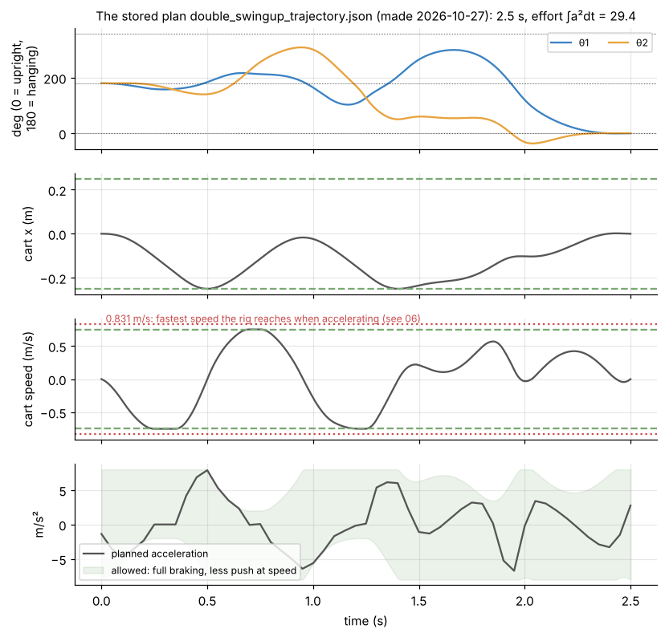
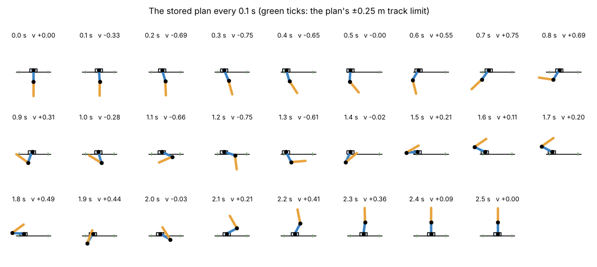
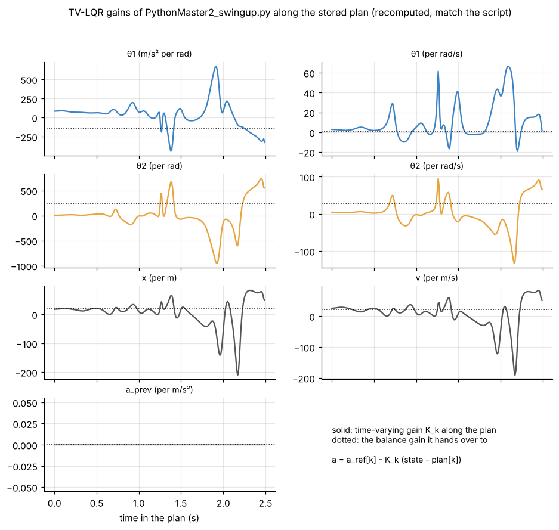

# 5. Swing-up: a planned motion plus time-varying LQR

[Back to Double](README.md) · Prev: [4. Balance](04_balance.md) · Next: [6. Balance vs swing-up](06_balance_vs_swingup.md)

Script: `PythonMaster2_swingup.py` (etwan007/ENGT480, branch `experiment/legacy-pi-recovery`, commit ba019f9, `LegacyPi/Code/DoublePendulum/`), with its plan `double_swingup_trajectory.json` (copy in [`data/`](data/double_swingup_trajectory.json)). Every gain below is recomputed by [`Math/shared`](../shared/nlink_cart.py) and matches the script ([verify](sims/verify_against_team_code.py)).


*The script's controller in simulation [SIM]: dashed grey = the plan, solid = the arms. Catch at 2.5 s, then balance.*

## 5.1 Why not energy pumping, like the single?

The single swing-up ([Single 7](../Single/07_swing_up.md)) works because one number, the arm's energy, decides everything: bring it to the upright value and the arm arrives at the top by itself, slowly, where LQG catches it.

For two arms that fails:
- **One energy, two arms.** The total energy $`E`$ ([2.8](02_equations_of_motion.md#28-energy-used-by-the-recovery-mode)) at the upright value 0.807 J is reached by countless states: arm 1 up and arm 2 hanging but spinning, both horizontal and moving, and so on. Upright-and-still is one point on that energy surface.
- **Chaos.** At that energy the double pendulum is chaotic: a tiny difference now becomes a completely different motion within a second or two. Waiting for it to drift into the catch window could take forever.
- **Opposite effects.** The cart's acceleration tips the two arms in opposite directions ([3.1](03_linear_model.md#31-linearising-at-upright)), so a simple "push with the swing" rule for one arm disturbs the other.

So the swing-up has to be **planned**: find one exact cart motion that takes both arms from hanging to upright at the same instant, then follow it with feedback. This "feedforward plus feedback" structure is what published double and triple swing-ups use (Graichen, Treuer and Zeitz, Automatica 43(1), 2007, for the double; Glück, Eder and Kugi, Automatica 49(3), 2013, for the triple).

## 5.2 The phases



Up to `MAX_ATTEMPTS` = 30 attempts per run.

## 5.3 The plan as an optimisation problem

Find the cart acceleration $`a(t)`$, $`0 \le t \le T`$ = 2.5 s, that

```math
\begin{aligned}
\text{minimises}\quad & J = \int_0^T a(t)^2\,dt \qquad\text{(the gentlest cart motion)}\\
\text{subject to}\quad & \dot{\mathbf z} = f(\mathbf z, a)\ \ \text{(the full nonlinear model of 2.6)}\\
& \mathbf z(0) = [\pi, 0, \pi, 0, 0, 0]\ \ \text{(both hanging, still, cart at 0)}\\
& \mathbf z(T) = [0, 0, 0, 0, 0, 0]\ \ \text{(both upright, still, cart back at 0)}\\
& |x(t)| \le X = 0.25\ \text{m},\quad |v(t)| \le V = 0.75\ \text{m/s},\quad |a| \le A = 8\ \text{m/s}^2\\
& a\,\mathrm{sign}(v) \le A\left(1 - \frac{|v|}{V_{\text{top}}}\right),\quad V_{\text{top}} = 1.0\ \text{m/s}
\end{aligned}
```

The last line is the stepper's **torque-speed limit**: a stepper's torque falls roughly linearly with speed, so it can only speed up further with the torque it has left, while braking always has full torque. In the code it is written as `A * (1 - av / Vtop) - a * vg / av >= 0` with a smoothed $`|v| = \sqrt{v^2 + 10^{-4}}`$.

The cost $`\int a^2`$ is a choice: among all motions that work, pick the one that asks the least of the motor. Other choices (shortest time, least travel) would give other plans.

Note that the problem only uses the **ratios** (2.6), so it is planned for one particular `SYSID_RATIOS` set. A different set needs a new plan (`--plan`).

## 5.4 How `--plan` solves it

The problem has infinitely many unknowns ($`a(t)`$ is a function), so it is cut into finitely many:

- **Acceleration knots.** $`a`$ is given at $`M`$ = 50 knots (every 0.05 s, 51 values) and is linear in between. On the 10 ms grid that is a fixed matrix `W` (251 x 51): `a = u @ W.T`.
- **Multiple shooting.** Simulating 2.5 s of a chaotic system from one guess is hopeless for an optimiser: a tiny change early on moves the end wildly. So the 250 steps are split into $`S`$ = 10 segments of 25 steps. The state at the start of segments 2-10 becomes an unknown too, and "the end of segment $`i`$ equals the start of segment $`i+1`$" becomes an equality constraint. Each segment is short enough to behave smoothly.
- **Integration.** RK4 per 10 ms step, with the input linear within the step (`rk4(z, a0, a1, dt, r)`: $`a_0`$, the midpoint average, $`a_1`$).
- **Unknowns:** 51 knots + 9 x 6 segment starts = **105**. **Equalities:** 9 x 6 continuity + 6 end conditions = **60**. **Inequalities:** track, speed and torque on the grid.
- **Solver:** SciPy SLSQP (sequential quadratic programming) with finite-difference Jacobians; `plan_refine` (a Gauss-Newton least-squares pass) first, when starting near a known plan.
- **Continuation.** For new arm values, `plan_from_stored` walks the stored plan over in steps: ratios $`r_\lambda = r_{\text{old}} + \lambda(r_{\text{new}} - r_{\text{old}})`$, $`\lambda`$ from 0 to 1, halving the step whenever a solve fails, giving up below `CONTINUATION_MIN_STEP` = 0.1. "One jump fails when the new values are far from the old ones (e.g. measured joint friction 19x the calculated value)".
- From scratch it tries a few random guesses of the knots. It takes 1-10 minutes on a Pi.

The stored plan (made 2026-10-27 for the swing-fit ratios): effort $`\int a^2 dt`$ = 29.37, cart within ±0.250 m, speed up to 0.750 m/s, acceleration up to 7.88 m/s². Both limits are touched: the plan uses all the track and all the speed it was given.





What the plan does: two big cart strokes (to -0.25 m and back by 1.0 s, then to -0.25 m again by 1.4 s) pump arm 2 over the top to 306° and back while arm 1 rocks; by 1.6 s arm 1 has risen to about 300° (60° short of upright on the far side) with arm 2 standing at about 55°; then arm 1 swings back down **through the bottom** and up the near side while arm 2 stays roughly up, and both arrive at 0° together at 2.5 s with the cart back at 0.

**Our check with a different solver.** [`Math/shared/nlink_cart.py`](../shared/nlink_cart.py) `plan_team()` states the same problem in CasADi (exact derivatives, every 10 ms step a constraint, IPOPT). Started from the stored plan it converges in 5 s to a nearby plan with effort 29.13 (0.8 % lower). Started from scratch and tightened from loose limits, it finds a **different** family of motions that cannot be squeezed into the rig's limits (stuck at 94 % of the way, effort 62) [SIM]. The problem has many local optima, and which one a solver finds depends on where it starts. That is why `--plan` starts from the stored plan whenever it can.

## 5.5 From the plan to motor commands

The plan is a smooth speed $`v_{\text{plan}}(t)`$. The script sends a new speed every 10 ms, and it lands $`\tau`$ = 8 ms later as a jump ([3.7](03_linear_model.md#37-the-staircase-model-swing-up-script)). `load_trajectory` picks each jump so the staircase straddles the plan:

```math
a_{\text{ref}}[k] = \frac{v_{\text{plan}}(kT + \tau + T/2) - v_{\text{plan}}(kT + \tau - T/2)}{T}
```

(the speed change decided at sample $`k`$ lands at $`kT+\tau`$, so take the plan's change over the period centred there). If the stored plan was made for ratios more than 1 % away from `SYSID_RATIOS`, it warns: "run with --plan".

## 5.6 Tracking the plan: time-varying LQR

Following $`a_{\text{ref}}`$ blindly (open loop) fails within a second: small model errors grow at up to 12 %/cycle near the top. So at every step the script adds feedback on the error from the plan:

```math
\mathbf e_k = \begin{bmatrix}\hat{\mathbf z}_k - \mathbf z_{\text{ref}}[k]\\ a_{\text{prev}} - a_{\text{ref}}[k-1]\end{bmatrix}\ (\text{angles wrapped}),\qquad a_k = a_{\text{ref}}[k] - K_k\,\mathbf e_k
```

The gain changes every step because the arms' dynamics change completely along the swing (hanging, sideways, upright). For each $`k`$, the staircase step is linearised about the plan, $`\mathbf e_{k+1} \approx A_k\mathbf e_k + B_k\,\delta a_k`$ (`linearize(z_ref[k], a_prev, a_ref[k], r)`), and the finite-horizon LQR problem

```math
\min \sum_{k=0}^{N-1}\left(\mathbf e_k^TQ\,\mathbf e_k + R\,\delta a_k^2\right) + \mathbf e_N^T P_{\text{bal}}\,\mathbf e_N
```

is solved backwards in time by the Riccati recursion (`tvlqr`):

```math
P_N = P_{\text{bal}},\qquad K_k = (R + B_k^TP_{k+1}B_k)^{-1}B_k^TP_{k+1}A_k,\qquad P_k = Q + A_k^TP_{k+1}(A_k - B_kK_k)
```

$`P_{\text{bal}}`$ is the balance controller's cost-to-go ([4.11](04_balance.md#411-generation-3-the-balance-after-a-swing-up)): the swing's last moves are chosen knowing that the balance controller takes over at $`k = N`$. Same algorithm as the infinite-horizon LQR of [Single 4.2](../Single/04_lqr.md#42-how-dlqr-solves-it), just not iterated to a fixed point.

Weights (Bryson, [4.4](04_balance.md#44-the-weights-brysons-rule)): `SWING_ANGLE_DEG` = 5°, `SWING_RATE_DEG_S` = 120°/s, `SWING_CART_M` = 0.25 m, `SWING_CART_SPEED_M_S` = 0.3 m/s, `SWING_ACCEL_M_S2` = 5 m/s²:

```math
Q = \mathrm{diag}(131.3,\ 0.228,\ 131.3,\ 0.228,\ 16,\ 11.1,\ 0),\qquad R = 0.04
```

Looser than the balance (5° instead of 2°, 25 cm instead of 5 cm) and with 15x cheaper acceleration ($`R`$ 0.04 vs 0.592): during the swing large corrections are expected and allowed.



The gains swing through large values and sign changes: e.g. the arm-2 angle gain goes from about 0 while hanging to -950 m/s² per rad at 1.9 s and +700 at the end. Near hanging (first 0.6 s) the gains are small: hanging is stable, little feedback is needed. They are largest in the second half (1.3-2.3 s), when arm 2 is up near vertical and arm 1 swings under it, where errors grow fastest.

## 5.7 Estimating the state during the swing

The linear Kalman filter of the balance ([4.6](04_balance.md#46-the-kalman-filter-hardware-noise-filter-form)) is only valid near upright. During the swing the script:

1. **Predicts** with the full nonlinear staircase model, using the speed it really sent: `x_pred = step(x_hat, a_prev, a, r)`.
2. **Corrects** each arm with a constant gain from a 2-state Kalman filter on "angle'' = random, 3 rad/s²" (`SWING_DISTURBANCE_RAD_S2`, encoder noise 3 counts): $`\hat\theta \mathrel{+}= 0.512\,\Delta`$, $`\hat\omega \mathrel{+}= 18.2\,\Delta`$ per radian of angle innovation $`\Delta`$. The cart position estimate takes 0.9 of its error; the cart speed is the speed sent.
3. **Compares at the right time.** Each reading is a few ms old (the receiver reports its age, plus `SENSOR_EXTRA_DELAY_MS` = 1.5 ms). At 10 rad/s, 3 ms is 1.7°, so the innovation compares the reading with where the estimate says the arm **was** then: $`\theta_{\text{meas}} - (\hat\theta - \hat\omega\,d)`$.
4. **Wraps** innovations to ±180°, so the angle estimates stay continuous through full turns.

"Larger [disturbance] trusts the encoders more: follows the real arms closely, but the radio's 1-2 ms timing jitter on fast-moving arms then turns into noisy speed estimates" (script comment).

## 5.8 Abort, recover and retry

- **Abort** if either arm is more than `SWING_ABORT_DEG` = 35° from the plan ("past ~40° the feedback cannot bring it back"), or the cart passes `SWING_CART_ABORT_M` = 0.36 m.
- **Catch**: at $`k`$ = 250 the mode simply switches to BALANCE. There is no catch window: if the swing got there without aborting, the arms are within 35° of upright, and the balance gives up past 30°.
- **RECOVER**: for the first 0.5 s brake at full 16 m/s² until the cart is below 0.05 m/s. Then damp the swing with $`a = \text{clip}(0.20\,(P_1\cos\theta_1\omega_1 + P_2\cos\theta_2\omega_2),\ \pm 4)`$, which can only remove energy ([2.8](02_equations_of_motion.md#28-energy-used-by-the-recovery-mode)); beyond 0.12 m it is only allowed to push toward the centre; plus a centring spring $`-2.25x - 3.0v`$.
- **WAIT**: centre the cart ($`a = -30x - 12v`$) until both arms have been within 2.5° of hanging for 1 s and the cart is within 1 cm, then start the next attempt. The plan starts from rest, so a left-over swing means starting off the plan.

## 5.9 Every swing-up constant

| Constant | Value | Meaning |
| --- | --- | --- |
| `PLAN_DURATION_S` | 2.5 s | length of the plan; 2.5 s tolerated model errors better than 2.0 s on the twin |
| `PLAN_TRACK_M` | 0.25 m (0.20, 0.30 in older plans) | track the plan may use |
| `PLAN_SPEED_M_S` | 0.75 m/s (0.60 in the v060 plan) | fastest planned speed |
| `PLAN_ACCEL_M_S2` | 8 m/s² | hardest planned acceleration from standstill |
| `MOTOR_TOP_SPEED_M_S` | 1.0 m/s | speed where the modelled torque reaches zero |
| `CONTINUATION_MIN_STEP` | 0.1 | smallest continuation step in `--plan` |
| `SWING_ANGLE_DEG`, `SWING_RATE_DEG_S` | 5°, 120°/s | TV-LQR "a lot" for arm errors |
| `SWING_CART_M`, `SWING_CART_SPEED_M_S` | 0.25 m, 0.3 m/s | TV-LQR "a lot" for cart errors |
| `SWING_ACCEL_M_S2` | 5 m/s² | TV-LQR "a lot" for extra acceleration |
| `SWING_ABORT_DEG`, `SWING_CART_ABORT_M` | 35°, 0.36 m | abort an attempt |
| `MAX_ATTEMPTS` | 30 | attempts per run |
| `SWING_DISTURBANCE_RAD_S2` | 3 rad/s² | swing observer: model trust |
| `CONTROL_LATENCY_MS` | 8 ms | delay assumed during the swing |
| `SENSOR_EXTRA_DELAY_MS` | 1.5 ms | age added to each angle reading |
| `RECOVER_ACCEL_M_S2`, `RECOVER_GAIN` | 4 m/s², 0.20 | swing damping |
| `STILL_ANGLE_DEG`, `STILL_TIME_S`, `RECOVER_TIMEOUT_S` | 2.5°, 1 s, 40 s | when the arms count as settled |
| `CART_SPEED_MAX_M_S`, `CART_ACCEL_MAX_M_S2` | 1.0 m/s, 16 m/s² | hard limits on every command |
| `TRACK_SOFT_LIMIT_M` | 0.40 m | motor stops for good |
| `BALANCE_LOST_DEG` | 30° | balance gives up |
| `STOP_BRAKE_M_S2`, `STOP_HOLD_S` | 10 m/s², 6 s | braking and holding at the end of a run |

## 5.10 Limits on every command

```python
a = clip(a, +-CART_ACCEL_MAX_M_S2)                      # 16 m/s^2
if a * v_state > 0:                                     # speeding up further:
    a_lim = 16 * max(0.05, 1 - |v_state| / 1.0)         #   only the torque left at this speed
v_cmd = clip(v_state + a * T, +-1.0)
timer = round(125000 / |v_cmd / 99.7e-6|) - 1           # what the Arduino can do
v_sent = 125000 / (timer + 1) * 99.7e-6
```

The torque limit and the timer rounding together make a hard ceiling at 0.831 m/s when accelerating: see [7.4](07_results.md#74-why-every-rig-attempt-tops-out-at-0831-ms). Every rig attempt so far has hit it.

[Back to Double](README.md) · Prev: [4. Balance](04_balance.md) · Next: [6. Balance vs swing-up](06_balance_vs_swingup.md)
