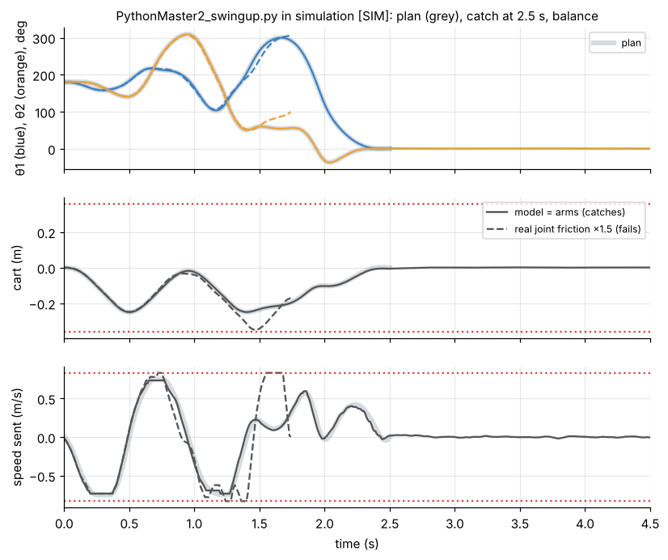
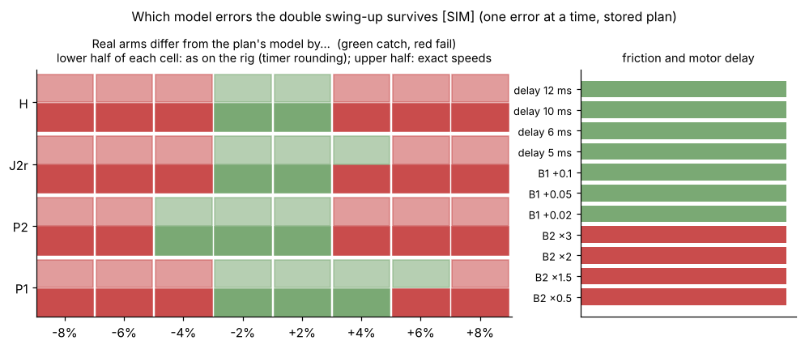
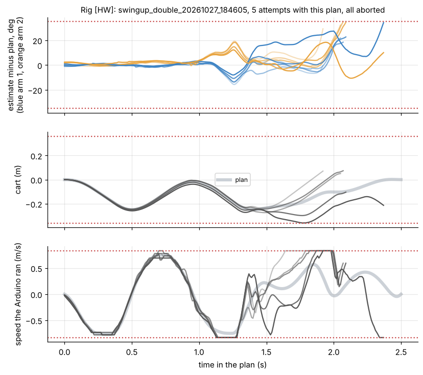
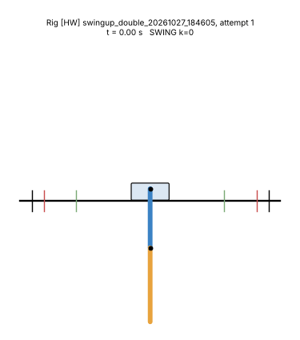
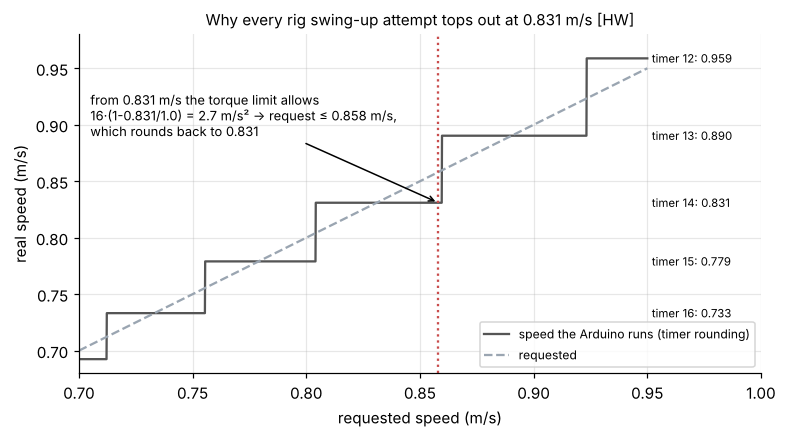

# 7. Simulations and rig results

[Back to Double](README.md) · Prev: [6. Balance vs swing-up](06_balance_vs_swingup.md)

## 7.1 What was simulated [SIM]

[`sims/double_sims.py`](sims/double_sims.py) runs the swing-up script's control loop ([`Math/shared/swing_sim.py`](../shared/swing_sim.py), `TeamSwingController`) and the balance script's loop (`TeamBalanceController`) against the nonlinear arm model:

- **Controller:** the scripts' gains (recomputed, identical), observer, TV-LQR, catch, balance, limits, torque-speed limit and timer rounding, step by step as in the scripts.
- **Plant:** the nonlinear model of [2.6](02_equations_of_motion.md#26-dividing-by-j1-the-codes-form) with its own ("true") ratios, integrated every 0.5 ms; the cart is a speed source that jumps to the rounded speed 8 ms after each sample (with the arm kick); encoders rounded to counts plus 1 count of noise; cart position rounded to steps.
- **Not simulated:** radio dropouts and timing jitter, sensor-age compensation (readings are exact in time), missed steps, belt stretch, Coulomb friction, the WAIT and RECOVER phases.

**Nominal** (true arms = the plan's model): the swing follows the plan, catches at 2.5 s and balances; cart within 0.250 m, speed up to 0.733 m/s.



With the joint friction 1.5x the model's (dashed), the swing drifts from 1.3 s, the speed saturates at 0.831 m/s, the cart runs to -0.35 m and the attempt aborts at k = 169 (35° off the plan).

## 7.2 Which model errors the swing-up survives [SIM]

One error at a time, the stored plan, everything else as on the rig ([`robustness.json`](sims/robustness.json)):



| Error | Catches (as on the rig) | Catches (if the Arduino ran the exact speed) |
| --- | --- | --- |
| P1, P2, J2r or H off by ±2 % | all 8 | all 8 |
| ±4 % | 2 of 8 (P1 +4 %, P2 -4 %) | 4 of 8 |
| ±6 %, ±8 % | none | 1 of 16 |
| joint friction B2 x0.5, x1.5, x2, x3 | none | none |
| pivot friction B1 +0.02 to +0.1 | all | all |
| real motor delay 5-12 ms (plan assumes 8) | all | all |

So the swing-up needs P1, P2, J2r and H within about 2-3 % and the joint friction within well under ±50 %. The pivot friction and the delay barely matter. Removing the timer's speed ceiling helps a little but does not change the picture. This agrees with the team's digital twin ("about 3 % model ratio error, or B2 x1.5 or x0.5, makes it fail", [subsystems/swing-up.md](../../subsystems/swing-up.md)).

The ratio sets the team has used differ from each other by up to 10 % (P2) and 7 % (J2r) ([1.5](01_variables.md#15-the-ratios-what-the-scripts-and-system-id-really-use)): far more than this tolerance.

**Physical errors vs ratio errors.** A real arm cannot have one ratio wrong on its own: if arm 2 is heavier than the model, P1, P2, J2r and H all change together, and $`H = L_1P_2`$ always holds ([1.5](01_variables.md#15-the-ratios-what-the-scripts-and-system-id-really-use)). [`sims/physical_errors.py`](sims/physical_errors.py) makes a plan for the physical arm values (with the swing-fit joint friction, same limits as the stored plan, effort 29.3) and tests the same controller against one **physical** value off at a time ([`physical_errors.json`](sims/physical_errors.json)) [SIM]:

| Real arm differs from the model in | Still catches | Fails |
| --- | --- | --- |
| arm 1 mass $`m_1`$ (207 g) | -15 % to +20 % | -20 % |
| arm 1 inertia $`I_1`$ | -40 % to +20 % | +30 % |
| arm 1 CoM $`c_1`$ (87 mm) | ±10 mm (all tested) | |
| arm 2 CoM $`c_2`$ (106 mm) | ±10 mm (all tested) | |
| joint 2 position $`L_1`$ (200 mm) | ±6 mm | ±10 mm |
| arm 2 mass $`m_2`$ (210 g) | -8 % to +5 % | -10 %, +6 % |
| **arm 2 inertia $`I_2`$** | **-4 % to +6 %** | -6 %, +10 % |
| one ratio alone (P1, P2, J2r or H), same model | ±2 % (all four) | ±4 to 6 % (each ratio somewhere) |

So the swing-up is not uniformly fragile: a centre of mass 10 mm off is harmless, because it moves $`p_2`$ and $`J_2`$ together and barely changes how the arms swing. The numbers that really matter are **arm 2's mass and inertia**: at the edge of what still catches ($`m_2`$ -8 % or +5 %, $`I_2`$ -4 % or +6 %), arm 2's own swing frequency $`\sqrt{g\,p_2/J_2}`$ (arm 2 swinging on a fixed joint) has moved by only 1-2 %. Next come $`L_1`$ and arm 1's inertia. Ratio fits that are free to break $`H = L_1P_2`$ can be wrong in exactly the directions that hurt.

**The v060 plan** (`double_swingup_trajectory_v060.json`, PLAN_SPEED 0.60 m/s, branch `claude/project-thread-orcdoj` of TheBarnyard/ChatGPT-Pendulum-Project), same 28 single-error cases (±2, 4, 6 % in each ratio and B2 x0.5, 1.5, 2): 13 catches vs 11 for the stored plan. More speed headroom helps a little; it is not enough on its own [SIM].

**Longer plans** ([`sims/longer_plans.py`](sims/longer_plans.py), [`longer_plans.json`](sims/longer_plans.json)): the same model (swing-fit ratios) and the same limits (±0.25 m, 0.75 m/s, 8 m/s², top 1.0 m/s), but 3.0 or 3.5 s instead of 2.5 s, tested on the same 35 single errors as above (ratios ±2 to 8 %, B2 ×0.5, 1.5, 2) [SIM]:

| Plan | Effort $`\int a^2dt`$ | Peak speed / accel. | Catches (of 35 errors + nominal) | Joint friction B2 ×0.5 / ×1.5 / ×2 |
| --- | --- | --- | --- | --- |
| stored, 2.5 s | 29.4 | 0.75 m/s / 7.9 m/s² | 11 of 36 | fail / fail / fail |
| 3.0 s | 23.8 | 0.75 / 7.4 | 19 of 36 | catch / catch / fail |
| **3.5 s** | **18.5** | **0.73 / 5.7** | **25 of 36** | **catch / catch / catch** |

A longer plan is gentler and leaves the feedback more time and more speed to correct; it more than doubles the number of model errors survived, including the joint friction being anywhere from half to twice the model's. The triple shows the same effect even more strongly ([Triple 4.7](../Triple/04_swing_up.md#47-which-model-errors-it-survives-sim)).

Both plans are in the swing-up script's own file format ([`data/double_swingup_trajectory_3.5s.json`](data/double_swingup_trajectory_3.5s.json), [`_3.0s.json`](data/double_swingup_trajectory_3.0s.json)) and were checked with the script's own `plan_problem` (dynamics mismatch 2e-11, all limits met) and `load_trajectory` (reads 350 steps) [SIM]. To try one on the rig [HYP], back up `double_swingup_trajectory.json`, copy the 3.5 s file over it and start a normal run: the script takes the plan length from the file. The plans are for the swing-fit ratios; if the script's ratios have changed since, it warns, and `--plan` can walk the 3.5 s plan over to the new ratios (the file carries the script's own unknowns `p`). Not tried on the rig yet.

## 7.3 What the rig did [HW]

All swing-up runs in the `logs` branch of etwan007/ENGT480, 2026-10-21 to 2026-10-28 ([`data/hw_double_attempts.csv`](data/hw_double_attempts.csv), [`data/hw_double_events.csv`](data/hw_double_events.csv)):

| | |
| --- | --- |
| Attempts | 35, in 15 runs, with 4 different plans and 3 ratio sets (the first one with B2 from 0.047 to 0.169) |
| Caught | 0 |
| Aborted at | k = 107 to 237 (1.07-2.37 s into the 2.5 s plan), median 160 |
| Abort reason | 24 angle (an arm > 35° off the plan), 11 cart (at 0.36 m) |
| Highest real cart speed | **0.831 m/s in every one of the 35** (commanded 0.858) |





*Rig attempt 1 of `swingup_double_20261027_184605` (solid) against the plan (dashed) [HW].*

The five attempts of `swingup_double_20261027_184605` (stored plan, swing-fit ratios) in detail:

| Attempt | Largest error from the plan at k = 50 / 100 / 110 / 130 | First step at 0.831 m/s | Aborted at |
| --- | --- | --- | --- |
| 1 | 1.6° / 3.4° / 9.7° / 14.0° | k = 114 | k = 192 |
| 2 | 1.8° / 2.8° / 9.1° / 13.5° | 113 | 205 |
| 3 | 1.7° / 3.8° / 9.3° / 14.5° | 70 | 207 |
| 4 | 0.9° / 2.9° / 8.5° / 10.0° | 113 | 209 |
| 5 | 2.8° / 3.8° / 8.3° / 7.5° | 113 | 237 |

What this says:
1. For the first second the rig follows the plan within 1-4°, every attempt. The plan, the motor and the observer work.
2. Between k = 100 and 110 (1.0-1.1 s, while arm 2 swings over the top at about 300° and the cart reverses at full speed) the error jumps from about 3° to about 9°, in every attempt the same way. That is a **model error**, not noise: noise would differ between attempts.
3. From k = 113 the feedback asks for more speed than the 0.831 m/s ceiling, so it cannot correct, and the error grows to the abort.

## 7.4 Why every rig attempt tops out at 0.831 m/s



The Arduino can only run step rates of $`125000/(N+1)`$ steps/s. Near 0.8 m/s the possible speeds are 0.733, 0.779, **0.831**, 0.890 m/s ($`N`$ = 16, 15, 14, 13). Going from 0.831 to 0.890 needs a requested speed above about 0.860 m/s (where the rounding flips), i.e. an acceleration of 2.9 m/s² within one 10 ms cycle. But the torque-speed limit allows only $`16\,(1 - 0.831/1.0)`$ = 2.7 m/s² when speeding up at 0.831 m/s: request at most 0.858 m/s, which rounds back to 0.831. So 0.831 m/s is a hard ceiling whenever the controller is speeding up, and 0.858 is exactly the commanded speed seen in every log. (Already recorded by the team in [debug/2026-10-27_double-swingup-aborts.md](../../debug/2026-10-27_double-swingup-aborts.md); confirmed here on all 35 attempts.)

The ceiling is the **symptom** that ends the attempts; the **cause** is the model error of 7.3 point 2 (the error grows before the ceiling is reached, and in simulation removing the ceiling saves only a few more cases).

## 7.5 What could make it catch (untested ideas)

All [HYP]; none of these has been tried on the rig.

| Idea | Why it might work | Cost |
| --- | --- | --- |
| Fit the ratios to the logged swing-up attempts themselves (the first 1.0-1.1 s of all 35, before the ceiling) | the model only needs to be right along this one motion; the logs contain exactly that motion, repeated | an offline fit; the swing-fit set was a first try with 5 attempts [HYP] |
| Iterative learning control: after each failed attempt, correct $`a_{\text{ref}}`$ by the error pattern it produced | attempts repeat almost identically for the first 1.1 s (7.3), which is the situation ILC is made for; it does not need a better model | more code; several attempts per tuning |
| Add a Coulomb (constant-torque) joint friction term to the model | B2 fits 0.03 for balancing and 0.114 for swinging, a typical sign of Coulomb friction (6.3) | one more parameter to fit |
| More speed headroom: lower `PLAN_SPEED_M_S`, or fix the rounding (choose the timer value nearest the request when accelerating) | the feedback can then act after k = 113 | v060 plan: 13 vs 11 of 28 in simulation |
| Plan robustly: one plan that works for several ratio sets at once (minimise the worst case) | trades effort for tolerance | longer planning |
| **Longer plan: 3.5 s instead of 2.5 s, same limits** | 25 of 36 single errors survived instead of 11, including B2 ×0.5 to ×2 (7.2); plan file ready | one rig session; no code change |
| Fit the model in physical form, or at least with $`H`$ fixed to 0.200 m x $`P_2`$ | the swing-up tolerates physical errors far better than broken-structure ones (7.2); the swing-fit set implies $`L_1`$ = 0.218 m | refit only, no rig time |
| Measure arm 2's own swing period: hang it from joint 2 with arm 1 clamped, time 20 swings | gives $`J_2/p_2`$, the most sensitive number (7.2), to well under 1 % | 5 minutes with a phone stopwatch |

## 7.6 Rerun everything

```bash
cd Math/Double/sims
python verify_against_team_code.py <path to LegacyPi/Code/DoublePendulum>   # 14 checks against the team code
python double_model.py      # every matrix and gain on these pages
python double_sims.py       # swing-up, robustness sweep, balance (about 1-2 min)
python make_figures.py      # ../images
python extract_hw_logs.py <folder with the run_logs>   # ../data from the full logs
```

Needs numpy, scipy, matplotlib, pillow; `casadi` only for `plan_team` in `Math/shared/nlink_cart.py`.

[Back to Double](README.md) · Prev: [6. Balance vs swing-up](06_balance_vs_swingup.md)
