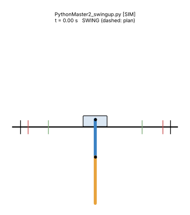
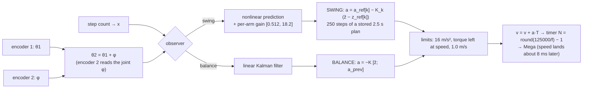

# Double pendulum: the math, and how our code does it

Everything behind the double inverted pendulum on a cart: every variable and equation, the linear model, the balance controllers, the planned swing-up with time-varying LQR, how they differ, and what the rig and simulations show. Every matrix and gain on these pages is recomputed and checked against the team's scripts (14 checks, all exact): `PythonMasterMath2.py` / `PythonMaster2_auto.py`, `PythonMasterDouble-Claude.py` (= `PythonMaster2_auto_improved.py` on the Pi) and `PythonMaster2_swingup.py`, all in [etwan007/ENGT480 `experiment/legacy-pi-recovery`, commit ba019f9, `LegacyPi/Code/DoublePendulum/`](https://github.com/etwan007/ENGT480/tree/ba019f9c07369a59731eefc16b8dfa34f9be00f8/LegacyPi/Code/DoublePendulum). A line-by-line code walkthrough (like [Single 9](../Single/09_code_walkthrough.md)) is not written yet.

Tags: `[HW]` from rig logs, `[SIM]` simulation only, `[HYP]` hypothesis, `[?]` unconfirmed.

*`PythonMaster2_swingup.py`'s controller in simulation: plan (dashed), catch at 2.5 s, balance [SIM]. On the rig it has not caught yet; see [7](07_results.md).*

## Read in this order

| # | Page | What you learn |
| --- | --- | --- |
| 1 | [Variables](01_variables.md) | every symbol, unit and value, the sign convention, the ratios P1, P2, J2r, H, B1, B2 and the four sets used |
| 2 | [Equations of motion](02_equations_of_motion.md) | Lagrange step by step, the force and acceleration forms, the code's `f()`, the speed-jump "kick", energy, any number of links |
| 3 | [Linear model](03_linear_model.md) | A and B with numbers, the two natural motions, poles, observability, discretisation, the delay and the staircase model |
| 4 | [Balance](04_balance.md) | three generations of balance controllers, Bryson weights, what the gains mean (why the cart first moves the "wrong" way), Kalman filter, auto-trim, sensitivity |
| 5 | [Swing-up](05_swing_up.md) | why energy pumping is not enough, the plan as an optimisation problem, multiple shooting, TV-LQR, the swing observer, recover and retry, every constant |
| 6 | [Balance vs swing-up](06_balance_vs_swingup.md) | what differs and why the swing-up is so much more sensitive |
| 7 | [Simulations and rig results](07_results.md) | robustness sweep, all 35 rig attempts, the 0.831 m/s ceiling, ideas to try |

## The whole controller on one screen

## Key numbers

| | Value | Source |
| --- | --- | --- |
| Arm constants | P1 5.358, P2 1.987, J2r 0.387, H 0.3975 (physical); rig fits differ by up to 10 % | [1.5](01_variables.md#15-the-ratios-what-the-scripts-and-system-id-really-use) |
| Natural motions | slow 5.60 /s (both lean, θ2/θ1 = +1.70), fast 11.94 /s (zig-zag, -1.59) | [3.2](03_linear_model.md#32-the-two-natural-motions) |
| Fastest falling | zig-zag doubles in 58 ms (single arm: 95 ms) | same |
| Balance gain (rig, 12.8 min) | K = [-192.2, -4.41, 283.9, 32.8, 20.5, 21.3, 0.42] | [4.5](04_balance.md#45-the-gains-and-what-they-mean) |
| Arm 2 leans 1° | cart first accelerates 5 m/s² **away** from it | same |
| Energy to add in a swing-up | 1.614 J | [2.8](02_equations_of_motion.md#28-energy-used-by-the-recovery-mode) |
| Stored plan | 2.5 s, cart ±0.25 m, 0.75 m/s, 7.9 m/s², ∫a²dt = 29.4 | [5.4](05_swing_up.md#54-how---plan-solves-it) |
| Swing-up tolerance to model error | about 2-3 % per ratio [SIM] | [7.2](07_results.md#72-which-model-errors-the-swing-up-survives-sim) |
| Balance tolerance | about 5 % in the worst direction, 15 % in others [SIM] | [4.10](04_balance.md#410-how-sensitive-is-the-balance-to-the-arm-values-sim) |
| Longest balance | 767.7 s, arm std 0.97° / 0.63°, cart std 10.5 mm [HW] | [4.9](04_balance.md#49-on-the-rig) |
| Swing-up attempts | 35 on the rig, 0 caught; all hit the 0.831 m/s ceiling [HW] | [7.3](07_results.md#73-what-the-rig-did-hw) |

## Folders

- [`images/`](images/): figures and animations (made by `sims/make_figures.py`).
- [`sims/`](sims/README.md): `double_model.py`, `double_sims.py`, `make_figures.py`, `extract_hw_logs.py`, `verify_against_team_code.py`.
- [`data/`](data/): the stored plan, every swing-up attempt and event from the rig logs, a 10 Hz copy of the 767 s balance run, one swing-up run in full.
- The model and controller code shared with [Triple](../Triple/README.md) is in [`Math/shared/`](../shared/README.md).

## Origin

Written 2026-10-29 by Claude for Ryan (Barney), session [2026-10-29_1448_Barney_math-folder](../../sessions/2026/10/2026-10-29_1448_Barney_math-folder.md). Rig numbers come from the run logs on the `logs` branch of etwan007/ENGT480. The team's code was only read, never changed.
