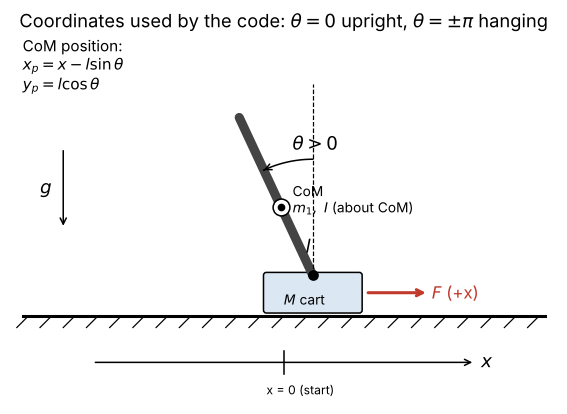

# 1. Every variable

[Back to Single](README.md) · Next: [2. Equations of motion](02_equations_of_motion.md)

Code: [`PythonMasterUpExpClaudeImproved.py`](https://github.com/etwan007/ENGT480/blob/ba019f9c07369a59731eefc16b8dfa34f9be00f8/LegacyPi/Code/SinglePendulum/PythonMasterUpExpClaudeImproved.py) (etwan007/ENGT480, branch `experiment/legacy-pi-recovery`, commit `ba019f9`). "Line" means a line in that file.

## Sign conventions (read this first)

- $`\theta = 0`$ is **upright**. $`\theta = \pm\pi`$ is **hanging**. The code wraps every angle into $`[-\pi, \pi)`$.
- $`\theta > 0`$ means the centre of mass is on the **-x side** of the pivot, because the CoM is at $`x_p = x - l\sin\theta`$. So a positive tilt needs the cart to move toward **-x** to get back under it, and every gain on $`\theta`$ ends up pushing the cart toward -x.
- $`x`$ is cart position in metres from where the Arduino started counting steps. It is about 0 at the start because the Arduino is reset (DTR) at startup (lines 452-459); the code also stores `x_start` (line 568).
- Positive force $`F`$ and positive speed push the cart toward **+x**.

## Physical parameters

| Symbol | Meaning | Unit | Value in the code | Code name (line) | Notes |
| --- | --- | --- | --- | --- | --- |
| $`m`$ | pendulum (arm) mass | kg | 0.260 | `m1`, `m1val` (159, 171) | |
| $`M`$ | cart mass | kg | 0.969 | `mcart`, `mcartVal` (159, 174) | Only matters inside the controller's model, because the stepper sets the speed. See [5](05_kalman_lqg.md#55-the-virtual-cart). |
| $`l`$ | pivot to arm centre of mass | m | 0.05 | `l`, `lval` (159, 169) | |
| — | arm length | m | 0.2 | `length` (168) | Logged only; never used in the math. |
| $`I`$ | arm inertia about its **own centre of mass** | kg m² | 0.003 nominal; **re-set at runtime** to about 0.00175 | `I`, `Ival` (162, 170), `Ival_identified` (676) | The Lagrangian adds $`ml^2`$ to it, so $`I`$ is about the CoM, not the pivot. |
| $`J_p = I + ml^2`$ | arm inertia about the **pivot** | kg m² | 0.00365 nominal, 0.00240 identified | appears as `(m1*l**2+I)` (180) | |
| $`g`$ | gravity | m/s² | 9.81 | `g`, `gval` (159, 176) | |
| $`b_c`$ | cart viscous drag | N s/m | 0.5 | `B_cart_drag`, `B_cart_dragVal` (159, 175) | Also a "virtual" parameter, like $`M`$. |
| $`\tau_d`$ | pivot drag torque | N m | 0 | `T_drag`, `T_dragVal` (162, 173) | The model has no pivot friction. The rig has some: 13 to 22 % amplitude loss per swing [HW]. |
| $`\omega_0`$ | small-swing natural frequency of the hanging arm, $`\sqrt{mgl/J_p}`$ | rad/s | 5.911 from the model; **7.09 to 7.47 measured** [HW] | `w0_model` (298), `w0` (299, 673) | Period $`2\pi/\omega_0`$: 1.063 s model vs 0.84 to 0.89 s on the rig. |

Unused symbols declared on line 162: `H`, `V` (leftovers from a Newton-Euler version that used reaction forces).

## Time

| Symbol | Meaning | Value | Code name (line) |
| --- | --- | --- | --- |
| $`T_s`$ | sample period the model is discretised with | 0.01 s | `Ts` (165) |
| $`\Delta t`$ | real time since the last cycle, used by the swing-up integrator | measured, capped at 0.03 s | `swing_dt` (591) |
| $`k`$ | cycle number | | `cycle_count` |
| | real loop rate | 100.0 Hz mean, 8.1 to 12.3 ms between cycles (5th to 95th percentile) [HW] | `cycle_period_ms` |

The loop is paced by the ESP32 receiver: it waits about 6.4 ms for the next angle packet, then about 2.7 ms for the cart position [HW, run balance_20261016_160234].

## State, input, output

| Symbol | Meaning | Unit | Code name (line) |
| --- | --- | --- | --- |
| $`\mathbf{y} = [\theta,\ \dot\theta,\ x,\ \dot x]^T`$ | state vector, in **this order** | rad, rad/s, m, m/s | `Y = [Y1, Y2, Y3, Y4]` (203-209) |
| $`u = F`$ | model input: horizontal force on the cart | N | `F` (162), `u` (404, 773) |
| $`\mathbf{z} = [\theta,\ x]^T`$ | what is measured | rad, m | `Ymeas` (405), built inside `estimate_with_angle` |
| $`f(\mathbf{y}, u)`$ | nonlinear model $`\dot{\mathbf{y}} = f`$ | | `NonLinMod` (208) |
| $`\ddot\theta = F_1`$, $`\ddot x = F_2`$ | solved accelerations | | `F1`, `F2` (205-206) (not the force!) |

Watch the name clash: `F` is the force, `F1`/`F2` are accelerations.

## Linear model and gains

| Symbol | Meaning | Size | Code name (line) |
| --- | --- | --- | --- |
| $`A, B`$ | continuous linear model at upright | 4x4, 4x1 | `A_sym`, `B_sym` (211-212), `A_num`, `B_num` (225-226) |
| $`C, D`$ | output matrices: pick $`\theta`$ and $`x`$ | 2x4, 2x1 | `C`, `D` (213-216) |
| $`A_d, B_d`$ | discrete (zero-order-hold) model | 4x4, 4x1 | `ss_disc.A`, `ss_disc.B` (227), `ssDisc` (235) |
| $`Q`$ | LQR state weights | 4x4 | `sp.diag(40,5,150,60)` (229) |
| $`R`$ | LQR input weight | 1x1 | `1` (229) |
| $`K`$ | LQR gain, $`u = -K\mathbf{y}`$ | 1x4 | `K`, `Kd` (229, 235) |
| | extra loop gain on $`K`$ | 2.0 | `* 2.0` (773) |
| $`Q_N`$ | process-noise covariance for the estimator | 4x4 | `sp.diag(0.5,0.5,0.5,0.5)` (230) |
| $`R_N`$ | measurement-noise covariance | 2x2 | `(0.01)*sp.diag(1,1)` (230) |
| $`G`$ | how process noise enters | 4x4 | `sp.diag(1,1,1,1)` (230) |
| $`L`$ | estimator gain | 4x2 | `L_gain`, `Ld` (230, 235) |
| $`\hat{\mathbf{y}}^-`$ | predicted state (before the measurement) | 4x1 | `Yest` (614) |
| $`\hat{\mathbf{y}}`$ | corrected state estimate | 4x1 | `YfinalEst` (629), stored as `Ylast` (638) |

## Swing-up variables

| Symbol | Meaning | Unit | Code name (line) |
| --- | --- | --- | --- |
| $`e`$ | normalised pendulum energy, $`\tfrac12(\dot\theta/\omega_0)^2 + \cos\theta`$: -1 hanging still, +1 upright still | — | `e`, `e_norm` (380, 644) |
| $`e^*`$ | energy target (adapts) | — | `energy_target` (310) |
| $`\hat{\dot\theta}`$ | finite-difference angular rate, low-pass filtered | rad/s | `theta_dot_est` (306, 335) |
| $`\alpha`$ | filter coefficient for $`\hat{\dot\theta}`$ | 0.3 | `alpha_td` (307) |
| $`a`$ | commanded cart acceleration while pumping | m/s² | `accel`, `swing_accel` (388, 696) |
| $`v`$ | commanded cart speed | m/s | `xDiv_swing` (312), `xDiv` (779, 789), `xDiv_sent` (792) |
| | swing direction with hysteresis (±0.3 rad/s) | ±1 | `swing_direction` (700) |
| | highest $`e`$ in the current half swing | — | `swing_energy_peak` (699) |

All swing-up constants (`SWING_*`, `ID_*`, `CATCH_*`, `AUTO_TRIM_*`, limits) are explained one by one in [7. Swing-up](07_swing_up.md#79-every-swing-up-constant).

## Sensing and actuation variables

| Symbol | Meaning | Value | Code name (line) |
| --- | --- | --- | --- |
| $`N_{enc}`$ | encoder counts per turn (MT6701, 14-bit) | 16384 | `ENCODER_COUNTS` (20) |
| | half a turn in counts | 8192 | `HALF_TURN` (21) |
| $`c_{up}`$ | raw count that means upright | measured each run (11716 to 11978 in the logs) | `correction`, `automatic_correction` (472-474) |
| | manual / auto-trim offset of the upright reference | degrees | `UPRIGHT_OFFSET_DEG` (25, 763) |
| $`d`$ | cart travel per step | 0.638175 / 6400 = 99.71 µm | constant in `positionRead` (156) and line 793 |
| $`f`$ | step frequency sent to the motor | steps/s | `f` (793) |
| $`N`$ | Arduino Timer3 top value, signed (sign = direction) | $`125000/f`$ | `pulses`, `timer_command` (797-806) |

[Back to Single](README.md) · Next: [2. Equations of motion](02_equations_of_motion.md)
