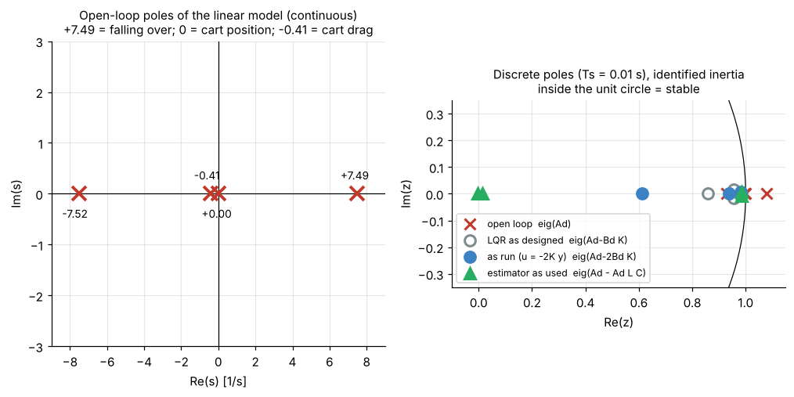

# 3. Linear model and discretisation

[Back to Single](README.md) · Prev: [2. Equations of motion](02_equations_of_motion.md) · Next: [4. LQR](04_lqr.md)

Code: lines 211-227 of [the script](https://github.com/etwan007/ENGT480/blob/ba019f9c07369a59731eefc16b8dfa34f9be00f8/LegacyPi/Code/SinglePendulum/PythonMasterUpExpClaudeImproved.py#L211-L227). All numbers below come from [`sims/single_model.py`](sims/single_model.py) running the script's own SymPy and python-control calls.

## 3.1 Why linearise

LQR and the Kalman filter need a **linear** model $`\dot{\mathbf y} = A\mathbf y + Bu`$. The pendulum is nonlinear ($`\sin\theta`$, $`\cos\theta`$, $`\dot\theta^2`$), but near upright those are almost linear: $`\sin\theta \approx \theta`$, $`\cos\theta \approx 1`$, $`\dot\theta^2 \approx 0`$. At 17° (the catch limit) $`\sin\theta`$ is still within 1.5 % of $`\theta`$, so the linear model is good wherever the LQG is allowed to run.

## 3.2 Jacobians (lines 211-212, 218, 225-226)

The linear model is the first-order Taylor expansion of $`f(\mathbf y, F)`$ about the upright equilibrium $`\mathbf y = 0, F = 0`$ (line 218, `Equilibrium`):

```math
A = \left.\frac{\partial f}{\partial \mathbf y}\right|_{0}, \qquad B = \left.\frac{\partial f}{\partial F}\right|_{0}
```

Line 211 `NonLinMod.jacobian(Y)` and line 212 `NonLinMod.diff(F)` do exactly this; lines 225-226 substitute the numbers and the equilibrium.

At $`\theta = 0`$ the mass-matrix determinant is $`\Delta_0 = I(M+m) + Mml^2`$. Differentiating the boxed accelerations of [2.7](02_equations_of_motion.md#27-solve-for-the-accelerations-lines-195-201) gives (SymPy prints the same):

```math
A = \begin{bmatrix}
0 & 1 & 0 & 0 \\
\dfrac{mgl(M+m)}{\Delta_0} & 0 & 0 & -\dfrac{b_c\,ml}{\Delta_0} \\
0 & 0 & 0 & 1 \\
\dfrac{m^2gl^2}{\Delta_0} & 0 & 0 & -\dfrac{b_c\,J_p}{\Delta_0}
\end{bmatrix},
\qquad
B = \begin{bmatrix} 0 \\ \dfrac{ml}{\Delta_0} \\ 0 \\ \dfrac{J_p}{\Delta_0} \end{bmatrix}
```

What each non-trivial entry means:

| Entry | Meaning |
| --- | --- |
| $`A_{21}`$ | gravity: tilt makes the arm fall faster (positive = unstable) |
| $`A_{24}`$ | cart drag slows the cart, and slowing the cart tips the arm |
| $`A_{41}`$ | a tilted arm pushes back on the cart |
| $`A_{44}`$ | cart drag on the cart itself |
| $`B_2`$ | pushing the cart +x tips the arm toward $`+\theta`$ (CoM falls back toward -x) |
| $`B_4`$ | pushing the cart accelerates it (about $`1/(M+m)`$, a little more because the arm swings) |

## 3.3 The numbers

$`m = 0.26`$, $`M = 0.969`$, $`l = 0.05`$, $`g = 9.81`$, $`b_c = 0.5`$. Two inertias matter: the nominal one in the code and the one IDENTIFY picks on the rig (from $`\omega_0 = 7.2881`$ rad/s, run balance_20261027_150517 [HW]).

| | nominal $`I = 0.003`$ | identified $`I = 0.001751`$ |
| --- | --- | --- |
| $`J_p = I + ml^2`$ | 0.00365 | 0.002401 |
| $`\Delta_0`$ | 0.0043169 | 0.0027811 |
| $`A_{21}`$ | 36.3076 | 56.3434 |
| $`A_{24}`$ | -1.50573 | -2.33664 |
| $`A_{41}`$ | 0.384051 | 0.59598 |
| $`A_{44}`$ | -0.422762 | -0.43155 |
| $`B_2`$ | 3.01146 | 4.67328 |
| $`B_4`$ | 0.845524 | 0.86310 |
| open-loop poles (eig $`A`$) | **+6.018**, -6.034, 0, -0.4068 | **+7.494**, -7.519, 0, -0.4068 |



The four open-loop poles:
- **+7.49 /s**: the arm falling over. Unstable. A small tilt grows as $`e^{7.49t}`$ (doubling in 93 ms). This is nearly $`\omega_0`$ (7.29), slightly bigger because the free cart also moves.
- **-7.52 /s**: its mirror image (the arm falling "back").
- **0**: cart position. Nothing pulls the cart back to centre by itself.
- **-0.41 /s**: cart drag, $`\approx -b_c/(M + \text{something})`$; a coasting cart slows with a 2.5 s time constant (in the model).

**Controllability.** $`[B, AB, A^2B, A^3B]`$ has full rank 4, so one force can steer all four states. **Observability.** With $`C`$ picking $`\theta`$ and $`x`$ (lines 213-215), $`[C; CA; CA^2; CA^3]`$ has rank 4, so $`\dot\theta`$ and $`\dot x`$ can be reconstructed from the two measurements. Both conditions are why LQR and the Kalman filter below have solutions.

## 3.4 Discretisation (line 227)

The Pi runs every $`T_s = 0.01`$ s and holds the command constant in between (zero-order hold). The exact discrete model of a linear system under a held input is

```math
\mathbf y_{k+1} = A_d\,\mathbf y_k + B_d\,u_k, \qquad A_d = e^{AT_s}, \qquad B_d = \int_0^{T_s} e^{A\tau}\,d\tau\;B
```

`ctrl.c2d(ctrl.ss(A_num, B_num, C, D), Ts)` uses this zero-order-hold method by default. One way to compute it (and how `single_model.py` checks it) is one matrix exponential of an augmented matrix:

```math
\exp\!\left(\begin{bmatrix} A & B \\ 0 & 0 \end{bmatrix} T_s\right) = \begin{bmatrix} A_d & B_d \\ 0 & 1 \end{bmatrix}
```

Numbers (identified inertia, the matrices the rig actually balances with):

```math
A_d = \begin{bmatrix}
1.002818 & 0.010009 & 0 & -0.000117 \\
0.563893 & 1.002818 & 0 & -0.023338 \\
0.000030 & 0 & 1 & 0.009978 \\
0.005953 & 0.000030 & 0 & 0.995694
\end{bmatrix},
\qquad
B_d = \begin{bmatrix} 0.000233 \\ 0.046676 \\ 0.000043 \\ 0.008613 \end{bmatrix}
```

Sanity check by eye: $`A_d \approx I + AT_s`$ for small $`T_s`$. E.g. $`A_{d,21} \approx 56.34 \times 0.01 = 0.563`$ and $`B_{d,2} \approx 4.673 \times 0.01 = 0.0467`$. The discrete open-loop poles are $`e^{p T_s}`$: $`e^{7.494 \times 0.01} = 1.078`$ (outside the unit circle, unstable), 0.928, 1, 0.996.

Nominal-inertia values (used for the first 3 s before IDENTIFY finishes) are printed by `single_model.py`; they are also logged by the script in the CSV `config` row (`discrete_A`, `discrete_B`, line 495-496).

## 3.5 What the linear model gets wrong on our rig

1. **The stepper is not a force actuator.** The model says force in, acceleration out. The rig is speed in. The code handles this by using the model's own velocity estimate as the speed command; see [5.4 The virtual cart](05_kalman_lqg.md#55-the-virtual-cart). So $`M`$ and $`b_c`$ act more like tuning knobs than physical facts.
2. **No pivot friction** ($`\tau_d = 0`$). The rig loses 13-22 % of its swing amplitude per period [HW].
3. **Inertia.** With $`I = 0.003`$ the model swings at 1.063 s; the rig at 0.85 s [HW]. IDENTIFY fixes this at runtime (see [7.3](07_swing_up.md#73-identify-measure-ω0-on-the-rig)). Which of $`m, l, I`$ is actually wrong is an open question in [open-questions.md](../../open-questions.md).

[Back to Single](README.md) · Prev: [2. Equations of motion](02_equations_of_motion.md) · Next: [4. LQR](04_lqr.md)
