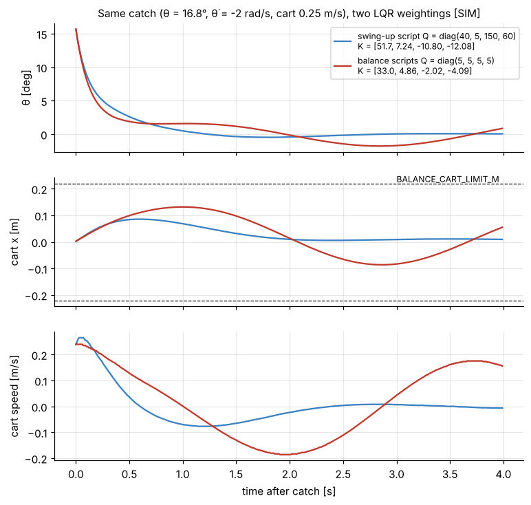

# 4. LQR: the balance gains

[Back to Single](README.md) · Prev: [3. Linear model](03_linear_model.md) · Next: [5. Kalman filter and LQG](05_kalman_lqg.md)

Code: line 229 and line 773 of [the script](https://github.com/etwan007/ENGT480/blob/ba019f9c07369a59731eefc16b8dfa34f9be00f8/LegacyPi/Code/SinglePendulum/PythonMasterUpExpClaudeImproved.py#L229).

```python
K, _, _ = ctrl.dlqr(ss_disc, sp.diag(40,5,150,60), 1)   # line 229
u = -Kd @ YfinalEst * 2.0                                 # line 773
```

## 4.1 The idea

State feedback $`u_k = -K\mathbf y_k`$: the force is a weighted sum of tilt, tilt rate, cart position and cart speed. LQR (Linear Quadratic Regulator) picks the four weights by minimising a cost:

```math
J = \sum_{k=0}^{\infty} \left( \mathbf y_k^T Q\,\mathbf y_k + u_k^T R\,u_k \right)
```

- $`\mathbf y^TQ\mathbf y = 40\theta^2 + 5\dot\theta^2 + 150x^2 + 60\dot x^2`$ (with $`Q = \text{diag}(40,5,150,60)`$): how much we dislike each state being away from zero.
- $`u^TRu = 1\cdot F^2`$: how much we dislike using force.

Only the **ratios** matter (doubling $`Q`$ and $`R`$ gives the same $`K`$). Bigger $`Q_{ii}`$ makes the controller fight that state harder; bigger $`R`$ makes it gentler.

A handy reading (Bryson's rule): $`Q_{ii} = 1/(\text{acceptable size})^2`$ per unit of $`R`$. So $`Q`$ = (40, 5, 150, 60) says "about as bad as 1 N of force": 0.16 rad (9°) of tilt, 0.45 rad/s of tilt rate, 8 cm of cart offset, 13 cm/s of cart speed.

## 4.2 How dlqr solves it

For a discrete linear system the optimal law is linear, $`u = -K\mathbf y`$, with

```math
K = (R + B_d^TPB_d)^{-1}B_d^TPA_d
```

where $`P`$ (4x4, symmetric) solves the **discrete algebraic Riccati equation (DARE)**:

```math
P = A_d^TPA_d - A_d^TPB_d\,(R + B_d^TPB_d)^{-1}B_d^TPA_d + Q
```

$`\mathbf y^TP\mathbf y`$ is the total future cost starting from state $`\mathbf y`$. `ctrl.dlqr` solves the DARE (via SciPy) and returns $`K`$, $`P`$ and the closed-loop eigenvalues; the code keeps only $`K`$ (the `_`, `_`).

Why the DARE gives the optimum, in one paragraph: suppose the cost-to-go is $`\mathbf y^TP\mathbf y`$. Then one step of the cost is $`\mathbf y^TQ\mathbf y + u^TRu + (A_d\mathbf y + B_du)^TP(A_d\mathbf y + B_du)`$. Set its derivative with respect to $`u`$ to zero: $`2Ru + 2B_d^TP(A_d\mathbf y + B_du) = 0`$, which gives the $`K`$ above. Substitute that $`u`$ back and require the result to equal $`\mathbf y^TP\mathbf y`$ again for every $`\mathbf y`$: that is the DARE.

## 4.3 The gains (numbers)

From [`sims/single_model.py`](sims/single_model.py). The order is $`[\theta, \dot\theta, x, \dot x]`$.

| Design | $`K_\theta`$ [N/rad] | $`K_{\dot\theta}`$ [N s/rad] | $`K_x`$ [N/m] | $`K_{\dot x}`$ [N s/m] |
| --- | --- | --- | --- | --- |
| This script, nominal $`I`$ (first 3 s only) | 59.612 | 10.165 | -11.033 | -12.983 |
| **This script, identified $`I`$ = 0.001751 (what balances)** | **51.719** | **7.236** | **-10.795** | **-12.078** |
| Balance scripts Q = (5,5,5,5), nominal $`I`$ | 35.512 | 6.272 | -2.064 | -4.286 |
| Q = (5,5,5,5), identified $`I`$ | 32.981 | 4.863 | -2.019 | -4.089 |

The rig logged $`K`$ = [51.12, 7.03, -10.77, -12.00] for $`\omega_0`$ = 7.422 (run balance_20261016_132151) and [59.61, 10.17, -11.03, -12.98] before IDENTIFY [HW], matching these.

**Signs.** $`u = -K\mathbf y`$, so a positive tilt ($`\theta > 0`$, CoM toward -x) gives a negative force: drive the cart toward -x, under the arm. Correct. $`K_x`$ and $`K_{\dot x}`$ are **negative**, so a cart at +x gets a **positive** (outward) push. That looks backwards but is right for an inverted pendulum: to bring the cart back to -x, the controller must first tip the arm toward -x, and to tip it toward -x it briefly moves the cart further +x (non-minimum-phase behaviour). The tilt gains then dominate: once the arm leans toward -x, $`-K_\theta\theta`$ is negative and larger, and the cart heads home.

## 4.4 The extra factor of 2 (line 773)

The force actually used is $`u = -2K\hat{\mathbf y}`$. This is not LQR any more; it is LQR's direction with twice the loop gain, a hand-tuning knob kept from the balance scripts (`PythonMaster.py` and `PythonMaster_auto.py` do the same). Effect on the closed-loop poles (identified $`I`$):

| | discrete poles $`z`$ | equivalent continuous poles $`s = \ln z / T_s`$ | time constants |
| --- | --- | --- | --- |
| $`u = -K\mathbf y`$ | 0.8592, 0.9566 ± 0.0162j, 0.9837 | -15.2, -4.42 ± 1.69j, -1.65 /s | 66 ms, 226 ms, 607 ms |
| $`u = -2K\mathbf y`$ (as run) | 0.6112, 0.9366, 0.9814 ± 0.0074j | -49.2, -6.55, -1.87 ± 0.76j /s | 20 ms, 153 ms, 534 ms |

All inside the unit circle (stable) either way. Doubling makes the fast "catch the arm" pole three times faster, which helps against the real loop's delays. The slow pair (about 0.5 s) is the cart returning to centre.

## 4.5 What the law means for a stepper

The motor gets a speed, not a force (see [5.4](05_kalman_lqg.md#55-the-virtual-cart)). The model turns force into cart acceleration with its fourth row, $`\ddot x = A_{41}\theta + A_{44}\dot x + B_4u`$. Substitute $`u = -2K\mathbf y`$ (identified numbers):

```math
\ddot x_{\text{cmd}} = -\left(88.68\,\theta + 12.49\,\dot\theta - 18.63\,x - 20.42\,\dot x\right)\ \ \text{m/s}^2
```

So in plain words, the balance controller is: **accelerate the cart 1.55 m/s² toward the arm's lean for every degree of lean**, plus 12.5 m/s² per rad/s of tilt rate, then gently steer the cart home. The commanded speed is the running integral of this (done inside the estimator), clipped to ±0.8 m/s and to ±15 m/s² (lines 778-780).

## 4.6 Balance-script Q vs swing-up-script Q

The comment on line 229 says the weights were "raised from 5,5,5,5: firmer catch, faster return to centre". Same catch, both weightings, simulated with the rig's identified dynamics:



- With (5,5,5,5) the position gains are 5x smaller (-2.0 vs -10.8). The tilt is recovered almost as fast, but the cart wanders 13 cm out and oscillates slowly (about 4 s period) instead of settling in about 2 s.
- After a swing-up the cart arrives at the catch already moving (up to 0.6 m/s) and up to 12 cm off centre, and LQG gives up past 22 cm. That is why the swing-up script needs much bigger $`Q_x`$ and $`Q_{\dot x}`$ than a balance-only script, where a person starts the arm upright with the cart at rest in the centre.
- $`Q_\theta`$ went from 5 to 40 for a firmer hold at the catch, where the arm starts 15-17° off.

## 4.7 Tuning rules of thumb for this rig

| Want | Change | Side effect |
| --- | --- | --- |
| Hold the arm stiffer | raise $`Q_\theta`$ (or the ×2) | more cart chatter, more stepper noise |
| Less overshoot / ringing of the arm | raise $`Q_{\dot\theta}`$ | slower response |
| Cart stays nearer centre | raise $`Q_x`$ | needs bigger tilts to move the cart; arm wobbles more |
| Cart moves smoother | raise $`Q_{\dot x}`$ | slower return to centre |
| Gentler everything | raise $`R`$ | can lose the arm at the catch |

Any change of $`Q`$, $`R`$, $`I`$, $`M`$ or $`b_c`$ changes $`K`$; rerun `single_model.py` to see the new gains and poles before trying it on the rig.

[Back to Single](README.md) · Prev: [3. Linear model](03_linear_model.md) · Next: [5. Kalman filter and LQG](05_kalman_lqg.md)
