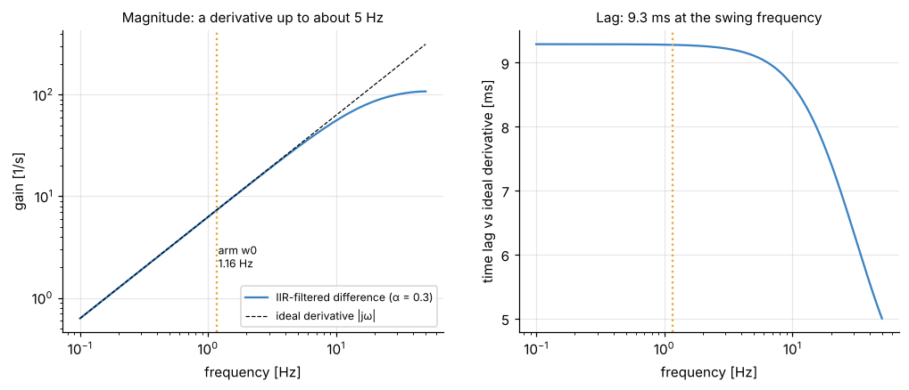
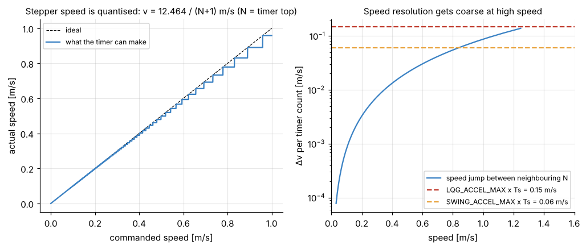

# 6. Sensing and actuation: from counts to radians, from m/s to timer ticks

[Back to Single](README.md) · Prev: [5. Kalman filter and LQG](05_kalman_lqg.md) · Next: [7. Swing-up](07_swing_up.md)

Code: lines 20-21, 88-156, 324-340, 793-812 of [the script](https://github.com/etwan007/ENGT480/blob/ba019f9c07369a59731eefc16b8dfa34f9be00f8/LegacyPi/Code/SinglePendulum/PythonMasterUpExpClaudeImproved.py#L88-L156), and [`ArduinoSlave.ino`](https://github.com/etwan007/ENGT480/blob/ba019f9c07369a59731eefc16b8dfa34f9be00f8/LegacyPi/Code/ArduinoSlave/ArduinoSlave.ino) (same branch).

## 6.1 Angle: counts to radians (lines 145-148)

The MT6701 gives 14 bits: 0 to 16383 counts per turn, $`2\pi/16384 = 3.835\times10^{-4}`$ rad = 0.022° per count. The angle relative to the upright reference $`c_{up}`$ (`correction`):

```math
\delta = \big((\text{raw} - c_{up} + 8192) \bmod 16384\big) - 8192, \qquad \theta = \delta \cdot \frac{2\pi}{16384}
```

The "+8192, mod, -8192" maps any difference into $`[-8192, 8191]`$ counts, i.e. $`\theta \in [-\pi, \pi)`$, so crossing the 16383 → 0 seam of the encoder never makes a 360° jump. The same trick in radians, $`((\cdot + \pi) \bmod 2\pi) - \pi`$, appears on lines 333, 604, 768.

## 6.2 Calibration from hanging (lines 121-142, 472-474)

With the motor off and the arm hanging still, read 50 packets.

**Circular mean (lines 129-131).** Raw counts near the seam (e.g. 16380 and 3) would average to nonsense. So each reading is turned into a unit vector at angle $`\varphi_i = 2\pi\,\text{raw}_i/16384`$, the vectors are averaged, and the angle of the average is taken:

```math
\bar\varphi = \arg\left(\frac{1}{n}\sum_i e^{j\varphi_i}\right), \qquad \text{down} = \bar\varphi\cdot\frac{16384}{2\pi}
```

**Stillness check (lines 132-139).** If any reading is more than 80 counts (1.76°) from the mean, the arm is still swinging: stop and retry.

**Upright = down + half a turn (line 140).** A rigid body hanging at rest has its centre of mass straight below the pivot; balanced, straight above. Those are exactly 180° apart whatever the arm's shape, so $`c_{up} = (\text{down} + 8192) \bmod 16384`$. The residual error comes from pivot friction (the arm can rest a little off-centre) and encoder non-linearity; on the rig it was 0.35° in run balance_20261016_160234, removed by the auto-trim ([5.9](05_kalman_lqg.md#59-auto-trim-lines-758-768-slow-integral-action-on-the-upright-reference)).

Logged upright references: 11978, 11926, 11927 and 11716 counts on 2026-10-16; 11945, 11948 on 2026-10-27 [HW]. The 11716 vs 11926 jump on the same day (4.6°) suggests the arm or magnet was re-seated between runs [?]. This is why this script measures it every run, and why the hard-coded 10687.7 in `PythonMaster.py` ([open question 1](../../open-questions.md)) does not apply to it.

**Manual offset (lines 473-474, 596-610).** `UPRIGHT_OFFSET_DEG` adds $`\text{offset}\times16384/360`$ counts to $`c_{up}`$. Arrow keys change it live by 0.05°. Positive offset makes the reported angle smaller.

## 6.3 Angle rate for the swing-up (lines 324-340)

The swing-up needs $`\dot\theta`$ at large angles, where the linear Kalman filter is invalid. So it uses a filtered finite difference, timed with the **receiver's** millisecond clock (so a late packet or a skipped frame does not distort the rate):

```math
r_k = \frac{\text{wrap}(\theta_k - \theta_{k-1})}{\Delta t_{\text{rx}}}, \qquad \hat{\dot\theta}_k = \alpha\,\hat{\dot\theta}_{k-1} + (1-\alpha)\,r_k, \quad \alpha = 0.3
```

Edge cases: the 32-bit receiver clock wrap is handled by `& 0xFFFFFFFF`; a zero or negative interval (receiver restart) resets the rate to 0.

What the filter does:



- Up to about 5 Hz it is a true derivative; the arm swings at 1.16 Hz, so the swing is measured correctly.
- It lags an ideal derivative by 9.3 ms: 5 ms from the backward difference ($`T_s/2`$) plus 4.3 ms from the low-pass ($`T_s\alpha/(1-\alpha)`$). At 7.3 rad/s that is about 4° of phase. The catch window and the pumping law tolerate this.
- Quantisation: one count per 10 ms is 0.038 rad/s; the filter smooths it.

## 6.4 Cart position (lines 150-156)

After each speed command the Arduino replies with its step counter as a signed 16-bit big-endian integer (`struct.unpack('>h', ...)`):

```math
x = \text{steps}\times\frac{0.638175}{6400} = \text{steps}\times 99.71\ \mu\text{m}
```

0.638175 m per 6400 steps is a measured calibration (also in `Code/Global/physical_parameters.py` as `DISTANCE_PER_6400_STEPS_M`). The int16 counter covers ±3.27 m, far beyond the track. The position is read **after** the command, so the $`x`$ used in the next cycle is about 7 ms old when that cycle's angle arrives.

## 6.5 Speed to step frequency to timer top (lines 793-807)

```math
f = -\frac{v \cdot 6400}{0.638175}\ \ \text{steps/s}, \qquad N = \text{int}\!\left(\frac{0.5/f}{1/250000}\right) = \text{int}\!\left(\frac{125000}{f}\right)
```

If $`|f| \le 2`$ the code sends $`N = \pm65535`$ (almost stopped). The sign of $`N`$ is the direction.

**Why 125000/f.** On the Mega, Timer3 runs at 16 MHz / 64 = 250 kHz (4 µs per tick, `CS31|CS30`). In CTC mode with TOP = ICR3 = $`|N|`$ (`WGM33|WGM32`) it counts 0 to $`|N|`$, i.e. $`|N|+1`$ ticks, and toggles the step pin OC3A once per count cycle. Two toggles make one step pulse, and the Arduino counts one step per falling edge (INT3 on pin 18). So the real step rate is

```math
f_{\text{real}} = \frac{250000}{2(|N|+1)} = \frac{125000}{|N|+1}, \qquad v_{\text{real}} = \frac{12.464}{|N|+1}\ \text{m/s}
```

The code's $`125000/f`$ ignores the "+1" and `int()` rounds $`N`$ down; together the cart runs 1 to 3 % slower than asked at 0.6 to 0.8 m/s (0.6 → N = 20 → 0.594 m/s; 0.8 → N = 15 → 0.779 m/s). The simulator includes both.

**Direction.** In `motorControl`, $`N > 0`$ → direction pin HIGH, counter decrements; $`N < 0`$ → counter increments. With the minus sign in $`f`$, a positive speed gives $`N < 0`$ and $`x`$ increasing. Consistent.

**Quantisation.** Only speeds $`12.464/(N+1)`$ exist:



Below 0.3 m/s the steps are tiny. Near 0.83 m/s one count is about 0.06 m/s, the whole per-cycle acceleration budget of the swing-up (6 m/s² × 0.01 s), and near 1.4 m/s it exceeds the LQG's 0.15 m/s. That is why `SWING_SPEED_MAX` is 0.6 and `LQG_SPEED_MAX` 0.8 (the double swing-up hit this wall at about 0.83 m/s, see [gotchas](../../gotchas.md)).

**Immediate speed change.** When the new TOP is below the running counter, `motorControl` sets `TCNT3 = ICR3 - 1` so the new speed starts on the next tick instead of after a counter wrap.

## 6.6 Serial protocol

| Direction | Bytes | Format | Meaning |
| --- | --- | --- | --- |
| Pi → Mega | 4 | `struct.pack('<i', N)` little-endian int32 | timer top with sign = direction |
| Pi → Mega | 4 | `0xFFFFFFFF` | stop: timer off, driver disabled (lines 425-449, `atexit`) |
| Mega → Pi | 2 | `>h` big-endian int16 | step counter, sent after every command |

The first command (line 550) is -65535, which both wakes the Arduino (it waits for 4 bytes before enabling the driver) and asks for the first position. Limit switches (pins 22, 27) or the button (pin 23) disable the driver and freeze the Arduino; the Pi then times out on the next position read.

## 6.7 Safety limits on the cart

| Limit | Value | Where | What happens |
| --- | --- | --- | --- |
| `TRACK_SOFT_LIMIT_M` | 0.30 m from start | line 640 | `RuntimeError`, motor stopped (any mode) |
| `BALANCE_CART_LIMIT_M` | 0.22 m | line 746 | LQG hands back to swing-up |
| `CATCH_CART_MAX_M` | 0.12 m | line 727 | no catch unless the cart is within this |
| `SWING_SPEED_MAX` / `SWING_ACCEL_MAX` | 0.6 m/s, 6 m/s² | lines 389-390 | clip while pumping |
| `LQG_SPEED_MAX` / `LQG_ACCEL_MAX` | 0.8 m/s, 15 m/s² | lines 779-780 | clip while balancing |

## 6.8 Loop timing [HW]

Run balance_20261016_160234: cycle period 10.03 ± 3.01 ms (100 Hz), of which about 6.4 ms waiting for the next angle packet and 2.7 ms for the position reply; radio age of the angle 1.4 ms on average. The model assumes exactly 10 ms; the swing-up integrator uses the measured interval (`swing_dt`, capped at 30 ms).

[Back to Single](README.md) · Prev: [5. Kalman filter and LQG](05_kalman_lqg.md) · Next: [7. Swing-up](07_swing_up.md)
