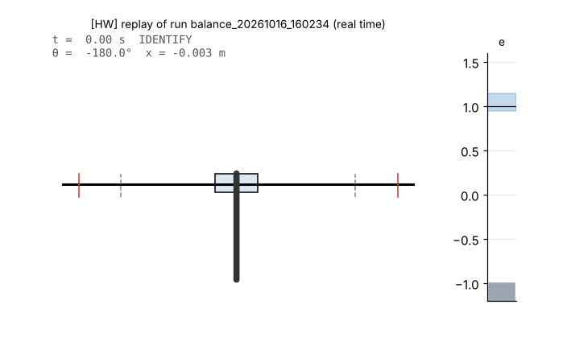
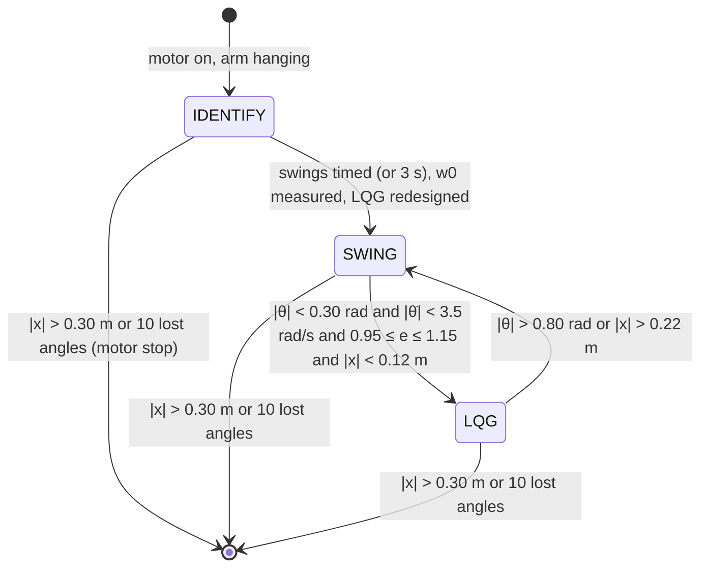
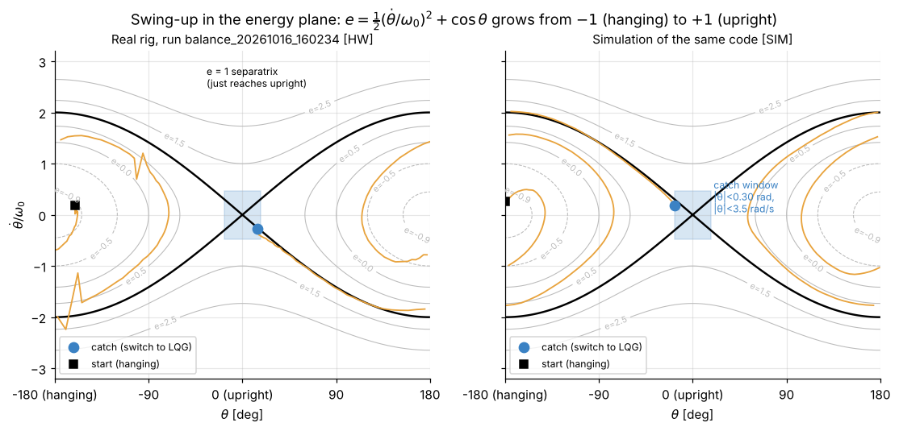
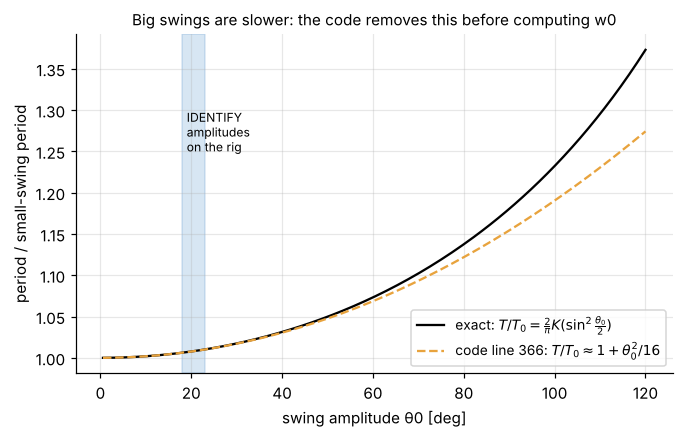
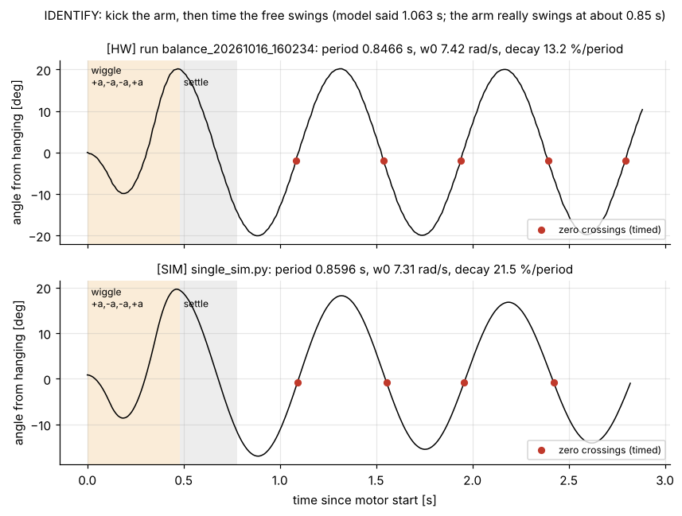
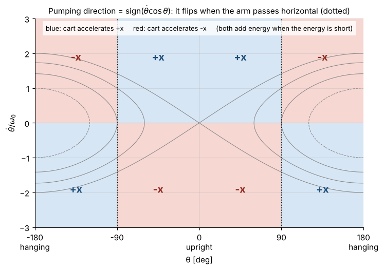
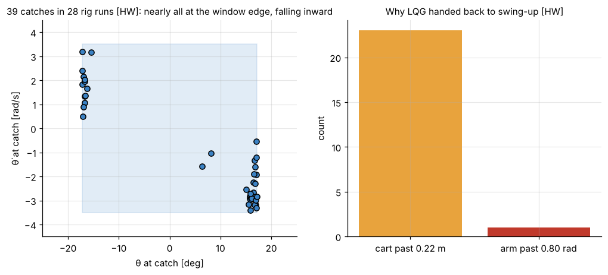
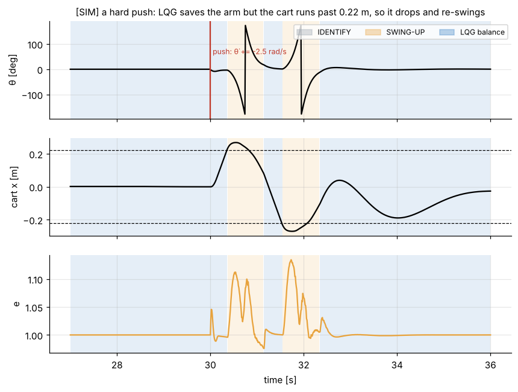

# 7. Swing-up: identify, pump energy, catch

[Back to Single](README.md) · Prev: [6. Sensing and actuation](06_sensing_actuation.md) · Next: [8. Balance vs swing-up](08_balance_vs_swingup.md)

Code: lines 238-392 (constants and helpers) and 647-789 (the three modes) of [the script](https://github.com/etwan007/ENGT480/blob/ba019f9c07369a59731eefc16b8dfa34f9be00f8/LegacyPi/Code/SinglePendulum/PythonMasterUpExpClaudeImproved.py#L238-L392). The method is energy control in the style of Åström and Furuta ("Swinging up a pendulum by energy control", Automatica 36, 2000), plus rig-specific additions: identification, a centering spring, an adaptive energy target, and an automatic hand-over to LQG.



*Real rig, run balance_20261016_160234, replayed from the log at real speed [HW]. The bar on the right is the energy $`e`$; the blue band is the catch window.*

## 7.1 The state machine



`mode` (line 295) holds the state. Every cycle, whatever the mode, the code first predicts and corrects the estimator, checks the soft limit, and computes $`e`$ (lines 611-644). Then the mode-specific block runs. Then the output block (lines 771-789) picks the speed: the LQG's $`\hat{\dot x}`$ in LQG, the integrated swing acceleration otherwise.

## 7.2 Normalised energy

From [2.10](02_equations_of_motion.md#210-the-energy-of-the-arm), the arm's energy is $`E = \tfrac12J_p\dot\theta^2 + mgl\cos\theta`$. Divide by $`mgl`$ and use $`J_p/(mgl) = 1/\omega_0^2`$:

```math
\boxed{e = \frac{E}{mgl} = \frac12\left(\frac{\dot\theta}{\omega_0}\right)^2 + \cos\theta}
```

Code: line 380 `e = 0.5 * (theta_dot / w0)**2 + np.cos(theta_now)` and line 644.

| Situation | $`e`$ |
| --- | --- |
| hanging still ($`\theta=\pi`$) | -1 |
| arm horizontal, still | 0 |
| upright, still ($`\theta=0`$) | +1 |
| just enough energy to coast up to upright and stop there | exactly 1 (the **separatrix**) |

It needs only $`\omega_0`$, which IDENTIFY measures. Mass, length and inertia drop out.

How fast the cart changes it (from 2.10, divided by $`mgl`$):

```math
\boxed{\dot e = \frac{\ddot x\,\dot\theta\cos\theta}{g} - \frac{\tau_d\,\dot\theta}{mgl}}
```

The first term is the only thing the controller has. It depends on **neither $`m`$, $`l`$ nor $`\omega_0`$**: 1 m/s² of cart acceleration while $`\dot\theta\cos\theta`$ = 1 rad/s adds 0.102 per second to $`e`$. The second term is pivot friction, always draining energy.



In the $`(\theta, \dot\theta/\omega_0)`$ plane the curves of constant $`e`$ are the paths an unforced arm follows. The thick black curve is $`e = 1`$. Swing-up = climb from the $`e=-1`$ point at hanging, out across the curves, to the black curve, then ride it into the catch box at upright. The real run [HW] and the simulation [SIM] climb in the same number of swings.

## 7.3 IDENTIFY: measure ω0 on the rig

Lines 343-375 and 647-691. Why: the model's $`\omega_0`$ (5.911 rad/s, period 1.063 s) is wrong for the real arm (7.09-7.47 rad/s, 0.84-0.89 s [HW]), and $`e`$ needs the true $`\omega_0`$. Using the model's value would make $`e`$ read wrong everywhere except at rest, so the catch-energy test and the pumping target would be off.

**Step 1, the wiggle (lines 343-346, 650-654).** Cart acceleration $`+a, -a, -a, +a`$ with $`a = 3`$ m/s², 0.12 s each. Speed goes 0 → 0.36 → 0 → -0.36 → 0 m/s and position 0 → 2.2 → 4.3 → 2.2 → 0 cm: the cart **ends where it started, at rest**, and the arm is left swinging about ±20°.

**Step 2, settle 0.3 s (lines 655-661).** Then log (receiver ms, angle from hanging) each cycle, with angle from hanging $`= (\theta \bmod 2\pi) - \pi`$.

**Step 3, time zero crossings (lines 349-375).** Remove the mean, find each sign change, and interpolate linearly for the crossing time:

```math
t_c = t_{i-1} + \frac{a_{i-1}}{a_{i-1} - a_i}\,(t_i - t_{i-1})
```

Half-periods are the differences between crossings; period $`T = 2\times\text{median}`$ (the median ignores one bad crossing). Timing stops after 3 s, or earlier once 4 half-swings are seen (checked every 10 cycles, lines 663-665).

**Step 4, remove the large-swing stretch (line 366).** A pendulum swinging with amplitude $`A`$ is slower than the small-swing period $`T_0`$:

```math
\frac{T}{T_0} = \frac{2}{\pi}K\!\left(\sin^2\frac{A}{2}\right) = 1 + \frac{A^2}{16} + \frac{11A^4}{3072} + \dots
```

($`K`$ is the complete elliptic integral of the first kind.) The code keeps the first correction: $`T_0 = T/(1 + A^2/16)`$. At the 20° amplitudes on the rig the stretch is 0.76 % and the dropped terms are under 0.006 %:



Then $`\omega_0 = 2\pi/T_0`$; if $`T_0`$ is outside 0.3-3 s the result is rejected and the model value kept (line 367).

**Step 5, decay (lines 370-374).** Peak of each half-swing $`p_1, \dots, p_n`$; amplitude lost per full period $`= 1 - (p_n/p_1)^{2/(n-1)}`$. Only logged, not used by the controller.

**Step 6, redesign the LQG (lines 676-677).** Keep $`m`$ and $`l`$, choose the inertia that makes the model swing at the measured $`\omega_0`$:

```math
\omega_0^2 = \frac{mgl}{I + ml^2} \;\Rightarrow\; I = \frac{mgl}{\omega_0^2} - ml^2
```

Run `design_lqg` again with it. As shown in [2.9](02_equations_of_motion.md#29-the-equation-that-really-matters-on-our-rig), $`\omega_0`$ alone fixes how the arm responds to cart acceleration, so this makes the LQG's arm model right without knowing which of $`m, l, I`$ is wrong.



IDENTIFY results logged on the rig [HW] (all runs of this script, 2026-10-16 to 2026-10-27):

| Quantity | Range over 20 successful identifies | Model |
| --- | --- | --- |
| period $`T_0`$ | 0.8408 - 0.8864 s | 1.0630 s |
| $`\omega_0`$ | 7.088 - 7.473 rad/s | 5.911 rad/s |
| amplitude | 18.4 - 23.1° | |
| amplitude loss per period | 13.2 - 21.8 % | 0 (no pivot friction in the model) |
| identified $`I`$ | 0.001634 - 0.001888 kg m² | 0.003 |

One run (2026-10-16 13:16) failed to time the swings and fell back to the model's $`\omega_0`$; it never caught.

## 7.4 The pumping law (lines 378-391)

```math
\text{pump} = \text{clip}\big(4\,(e^* - e),\ -1,\ 1\big), \qquad \text{dir} = \text{sign}(\dot\theta\cos\theta)
```
```math
a = \text{clip}\big(6\cdot\text{pump}\cdot\text{dir} + a_{\text{center}},\ \pm 6\big)\ \text{m/s}^2, \qquad v_{k} = \text{clip}(v_{k-1} + a\,\Delta t,\ \pm 0.6\ \text{m/s})
```

**Why it works.** Put the main term into $`\dot e`$:

```math
\dot e = \frac{6}{g}\,\text{clip}\big(4(e^*-e)\big)\,\big|\dot\theta\cos\theta\big| \quad(\text{ignoring friction, centering, clips})
```

It has the sign of $`e^* - e`$: below target the energy only rises, above target it only falls. Formally, $`V = \tfrac12(e - e^*)^2`$ never increases ($`\dot V = -(e^*-e)\dot e \le 0`$), a Lyapunov argument. It stops working only where $`\dot\theta\cos\theta = 0`$: at the turning points and when the arm is horizontal.

**Which way the cart goes.**



Below horizontal ($`\cos\theta < 0`$) the cart accelerates opposite to $`\dot\theta`$; above horizontal, with it. The direction flips each time the arm passes horizontal and each time it turns around. Intuition: like pumping a swing, push the pivot so that the arm's apparent gravity helps it on the way down and fights it less on the way up.

**Saturation.** The gain 4 means full acceleration whenever the energy is more than 0.25 short; inside that band the push shrinks smoothly to zero at the target, which avoids overshooting it.

**How much energy per swing.** The speed clip (0.6 m/s) is reached in 0.1 s at 6 m/s², much shorter than a half-swing (0.43 s), so each pump is effectively a speed reversal $`\Delta v`$ of up to 1.2 m/s. A speed change adds $`\Delta e = \dot\theta\cos\theta\,\Delta v/g`$. Near the bottom $`|\dot\theta|`$ is several rad/s, so a single reversal can add almost 1 to $`e`$. That is why the rig climbs from $`e = -0.93`$ to 1 in about four half-swings, 1.6 s [HW, fig07].

**Why a target above 1** (`SWING_ENERGY_TARGET` = 1.03, line 258). Pivot friction drains energy on the last climb. Aiming at exactly 1 would always arrive a little short.

## 7.5 Centering spring (lines 383-387)

Pumping alone walks the cart off the track. A soft spring-damper toward the start position is added:

```math
a_{\text{center}} = \frac{-12\,(x - x_0) - 6\,v}{1 + (\dot\theta\cos\theta/\omega_0)^2}
```

- Spring and damper: $`\omega_c = \sqrt{12} = 3.46`$ rad/s, damping ratio $`6/(2\sqrt{12}) = 0.87`$ (on their own, a nearly critically damped return to centre in about 1.5 s).
- The shaping factor (`SWING_CENTER_SHAPE = 1`): any cart acceleration changes the energy at a rate $`\propto \dot\theta\cos\theta`$. Centering is therefore done mostly where $`\dot\theta\cos\theta`$ is small (arm sideways or turning around), where it costs almost no energy, and faded out where pumping is strongest.

Simulated, the cart stays within about ±22 cm during the swing [SIM]. Too weak a spring and the 0.30 m soft limit stops the run; too strong and it cancels the pumping.

## 7.6 Adaptive energy target (lines 698-716)

Friction differs from day to day, so the target learns from each swing.

**Turned back short (lines 700-709).** A turning point is detected when $`\hat{\dot\theta}`$ changes sign (with a ±0.3 rad/s dead band). At a turning point $`\dot\theta = 0`$, so $`e = \cos\theta`$ exactly, and the energy still missing to reach upright is $`1 - \cos\theta`$. If the arm turned back within 0.6 rad (34°) of upright although the swing's peak $`e`$ had reached the target (minus 0.02):

```math
e^* \leftarrow \min\big(e^* + \min(0.6\,(1-\cos\theta),\ 0.05),\ 1.30\big)
```

**Went over too fast (lines 711-715).** If the arm crosses upright (sign of $`\theta`$ flips near the top, $`|\theta| < 0.5`$) faster than the catch rate (3.5 rad/s), it had too much: $`e^* \leftarrow \max(e^* - 0.03,\ 0.97)`$.

## 7.7 The catch (lines 723-742)

All four must hold in the same cycle:

| Condition | Value | Why |
| --- | --- | --- |
| $`\lvert\theta\rvert`$ < `CATCH_ANGLE_RAD` | 0.30 rad (17.2°) | the linear model is still good (sin within 1.5 %) |
| $`\lvert\hat{\dot\theta}\rvert`$ < `CATCH_RATE_RAD_S` | 3.5 rad/s | the LQG can absorb it within the cart limits |
| `CATCH_ENERGY_MIN` ≤ $`e`$ ≤ `CATCH_ENERGY_MAX` | 0.95 to 1.15 | the arm is really arriving, not falling back |
| $`\lvert x - x_0\rvert`$ < `CATCH_CART_MAX_M` | 0.12 m | room left for the LQG's catch motion |

On the separatrix, $`\dot\theta = \pm 2\omega_0\sin(\theta/2)`$: 2.18 rad/s at 0.3 rad. So the window accepts arrivals with somewhat more energy than the separatrix ($`|\dot\theta|`$ up to 3.5 rad/s gives $`e`$ up to 1.07 at the window edge).

**Hand-over (lines 728-734).** `mode = LQG`; `loop = 250` (no force ramp); estimator seeded with $`[\theta, \hat{\dot\theta}, x, v_{\text{swing}}]`$ and $`u = 0`$. Because the LQG's speed command is the estimator's $`\hat{\dot x}`$, and that starts at the current swing speed, the cart speed is continuous across the switch; the 15 m/s² rate limit smooths the rest.



39 catches in the logs [HW]. Almost all happen at $`|\theta|`$ = 15-17°: the arm arrives fast enough that the first sample inside 17.2° already passes. All arrive falling inward (sign of $`\dot\theta`$ opposite to $`\theta`$). Energy at catch: 0.958 to 1.066, mean 1.013.

## 7.8 Losing balance and trying again (lines 746-757)

LQG hands back to swing-up when $`|\theta| > 0.8`$ rad (46°) or the cart is more than 0.22 m from the start. The swing speed starts from the estimator's cart speed (continuity), and the turning-point detector is reset.

On the rig, **23 of 24 hand-backs were triggered by the cart limit**, and in 20 of those the arm was still within 11° of upright; only one was the arm passing 0.8 rad [HW]. After the hand-back the swing-up law, with $`e \approx 1`$ near its target, barely pushes; the arm falls and is swung back up and caught again 0.8 to 2.5 s later. The longest single LQG stretch in the logs is 114 s (run balance_20261027_150517, 164.3 s to 278.6 s), in a 290 s run with 11 catches that ended on lost angle packets.

[SIM] The same happens in simulation after a hard push:



## 7.9 Every swing-up constant

| Constant (line) | Value | Unit | What it does | Raise it and... |
| --- | --- | --- | --- | --- |
| `SWING_ACCEL_MAX` (255) | 6.0 | m/s² | max cart acceleration while pumping and identifying | faster pumping, more stepper torque, risk of missed steps |
| `SWING_SPEED_MAX` (256) | 0.6 | m/s | max cart speed while pumping | bigger pumps, more track used; above ~0.83 m/s speed steps get coarse |
| `SWING_ENERGY_GAIN` (257) | 4.0 | — | slope of pump vs energy error; full push when 0.25 short | sharper approach, more overshoot |
| `SWING_ENERGY_TARGET` (258) | 1.03 | — | starting energy target | arrives faster, over the top more often |
| `SWING_TARGET_STEP` (259) | 0.03 | — | target decrease after an over-the-top swing | faster adaptation, more hunting |
| `SWING_TARGET_MIN` / `MAX` (261-262) | 0.97 / 1.30 | — | limits on the adaptive target | |
| `SWING_CENTER_KP` (263) | 12.0 | 1/s² | centering spring stiffness | cart stays nearer centre, less energy per swing |
| `SWING_CENTER_KV` (264) | 6.0 | 1/s | centering damping | less cart ringing |
| `SWING_CENTER_SHAPE` (265) | 1 | flag | fade centering where it costs energy | 0 = plain spring everywhere |
| `ID_KICK_ACCEL` (267) | 3.0 | m/s² | wiggle acceleration | bigger identify swings |
| `ID_KICK_TIME` (268) | 0.12 | s | duration of each of the 4 wiggle segments | bigger identify swings |
| `ID_SETTLE_S` (269) | 0.3 | s | wait after the wiggle before timing | cleaner data, longer start |
| `ID_COAST_S` (270) | 3.0 | s | max timing window | |
| `ID_HALF_SWINGS` (271) | 4 | — | stop timing early after this many half-swings | more accurate, slower start |
| `AUTO_TRIM_KX` / `KV` (275-276) | 4.0 / 5.0 | deg/s per m, per m/s | balance trim rates ([5.9](05_kalman_lqg.md#59-auto-trim-lines-758-768-slow-integral-action-on-the-upright-reference)) | faster centering, can oscillate |
| `AUTO_TRIM_MAX_DEG` (277) | 3.0 | deg | trim limit | |
| `AUTO_TRIM_DELAY_S` (278) | 0.5 | s | no trimming right after a catch | |
| `CATCH_ANGLE_RAD` (280) | 0.30 | rad | catch window angle | earlier catch, model less accurate |
| `CATCH_RATE_RAD_S` (281) | 3.5 | rad/s | catch window rate (also "too fast over the top") | more catches, harder ones |
| `CATCH_ENERGY_MIN` / `MAX` (282-283) | 0.95 / 1.15 | — | catch window energy | |
| `CATCH_CART_MAX_M` (284) | 0.12 | m | cart must be this near the start to catch | |
| `BALANCE_LOST_RAD` (285) | 0.80 | rad | LQG gives up past this tilt | |
| `BALANCE_CART_LIMIT_M` (286) | 0.22 | m | LQG gives up past this cart offset (applies all the time in LQG, not only while catching as the comment says) | fewer drops, closer to the soft limit |
| `LQG_SPEED_MAX` (287) | 0.8 | m/s | clip on the LQG speed command | |
| `LQG_ACCEL_MAX` (288) | 15.0 | m/s² | clip on LQG speed change per cycle | |
| `TRACK_SOFT_LIMIT_M` (289) | 0.30 | m | stop the motor | |
| `alpha_td` (307) | 0.3 | — | rate-filter coefficient ([6.3](06_sensing_actuation.md#63-angle-rate-for-the-swing-up-lines-324-340)) | smoother, more lag |

[Back to Single](README.md) · Prev: [6. Sensing and actuation](06_sensing_actuation.md) · Next: [8. Balance vs swing-up](08_balance_vs_swingup.md)
