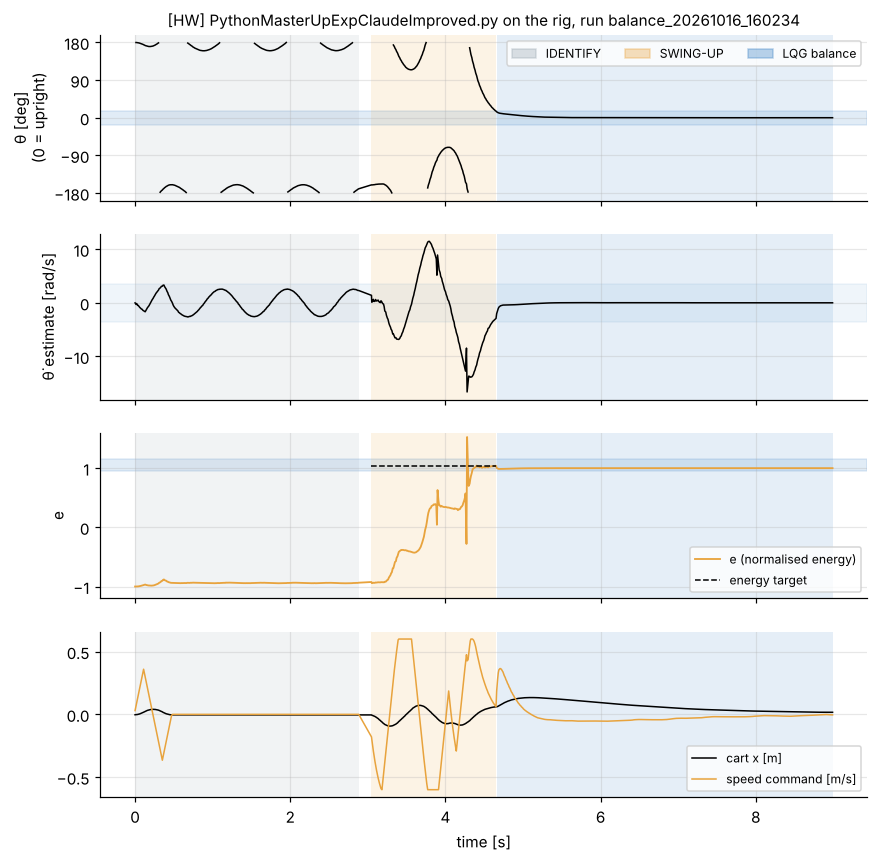
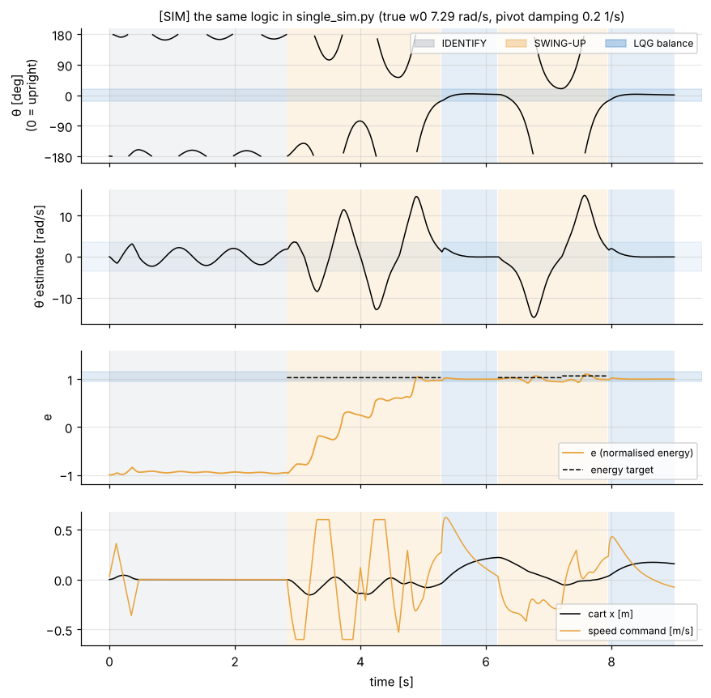
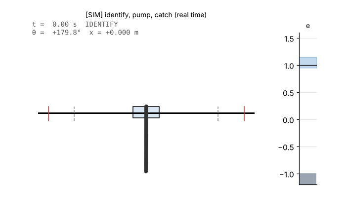
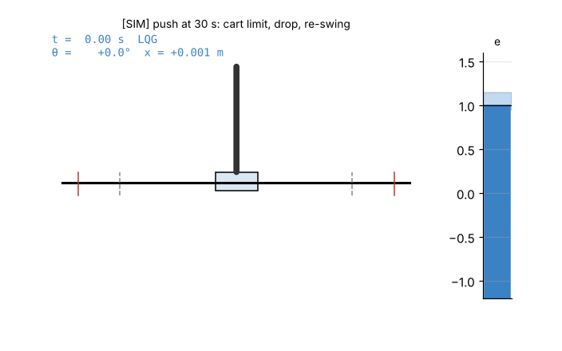
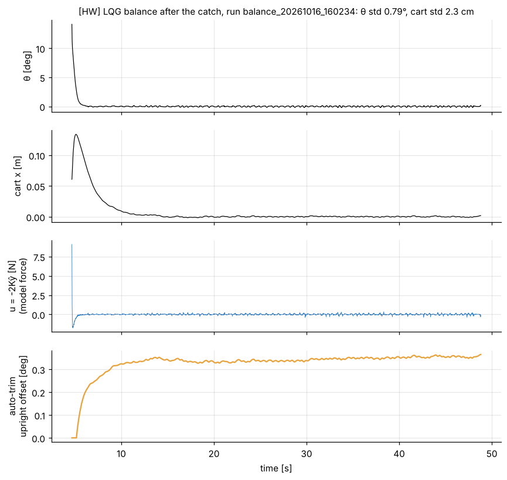

# 10. Simulations and rig results

[Back to Single](README.md) · Prev: [9. Code walkthrough](09_code_walkthrough.md)

## 10.1 What was simulated [SIM]

[`sims/single_sim.py`](sims/single_sim.py) re-implements the script's control loop cycle by cycle (same constants, same estimator, same catch and trim rules, gains from the script's own SymPy and python-control code via [`sims/single_model.py`](sims/single_model.py)) and closes it around a model of the rig:

| Part | How it is modelled | Value |
| --- | --- | --- |
| Arm | $`\ddot\theta = \tfrac{\omega_0^2}{g}(g\sin\theta + \ddot x\cos\theta) - c\,\dot\theta`$ ([2.9](02_equations_of_motion.md#29-the-equation-that-really-matters-on-our-rig)), RK4 at 0.5 ms | $`\omega_0`$ = 7.2881 rad/s (rig IDENTIFY), $`c`$ = 0.2 /s (chosen so the simulated IDENTIFY decay, 21 %/period, sits in the rig's 13-22 % range) |
| Cart | ideal speed source; speed jumps every cycle to $`12.464/(N+1)`$ m/s exactly as the timer produces; a jump $`\Delta v`$ kicks the arm by $`\Delta\dot\theta = (\omega_0^2/g)\cos\theta\,\Delta v`$ | |
| Sensors | 14-bit angle quantisation, 99.7 µm cart steps, cart position read 3 ms after the command and used next cycle | |
| Timing | 10 ms cycle, command applied 2 ms after the angle sample [HYP] | |
| Calibration error | 1.0° added to the angle, to exercise the auto-trim | |
| Disturbances | taps on the arm at 20 s ($`\Delta\dot\theta`$ = +1.2 rad/s) and 30 s (-2.5 rad/s) | |

Not modelled: radio dropouts, missed steps or stalls, Coulomb (dry) friction, serial jitter, the arm cable.

## 10.2 Rig vs simulation, swing-up

| | Rig [HW] run balance_20261016_160234 | Simulation [SIM] |
| --- | --- | --- |
| IDENTIFY period / $`\omega_0`$ | 0.8466 s / 7.42 rad/s | 0.8596 s / 7.31 rad/s |
| amplitude, decay | 22.1°, 13.2 %/period | 19.0°, 21.5 %/period |
| IDENTIFY ends | 3.24 s | 2.83 s |
| first catch | 4.86 s, θ = +15.7°, θ̇ = -2.90 rad/s, e = 1.039 | 5.29 s, θ = -17.0°, θ̇ = +1.32 rad/s, e = 0.973 |
| swing-up duration | 1.62 s (rig median over 16 runs: 1.75 s, range 1.62-3.41 s) | 2.46 s |
| after the catch | cart out to 13.5 cm, back to centre in about 5 s, balanced until Ctrl+C at 48 s | cart drifted to 22 cm, dropped at 6.19 s, re-caught at 7.95 s (this also happens on the rig: 8 of 31 LQG stretches lasted 0.4 s or less) |

Same structure, same number of pumps, same catch type. The simulation is good enough to try parameter changes before taking them to the rig, but it is not a substitute for the rig (it catches a bit later and its cart wanders a bit more).

Animations (real time):

| Rig replay [HW] | Simulation [SIM] | Push, drop and recovery [SIM] |
| --- | --- | --- |
|  |  |  |

## 10.3 Balance

| | Rig [HW] run balance_20261016_160234, all LQG time | Simulation [SIM], 8-20 s |
| --- | --- | --- |
| θ standard deviation | 0.79° | 0.77° |
| cart standard deviation | 2.3 cm (includes the catch transient) | 4.8 cm |
| cart speed once settled | 95th percentile 7.7 mm/s | |
| auto-trim | settled at +0.35° in 10 s | settled at 1.006° (1.0° injected) |

## 10.4 What the 28 rig runs of this script show [HW]

Runs from 2026-10-16 to 2026-10-27 on the `logs` branch (summary in [`data/hw_events.csv`](data/hw_events.csv)).

- **IDENTIFY**: 20 succeeded, 1 failed (that run never caught). $`\omega_0`$ 7.09-7.47 rad/s; the nominal model's 5.91 is 20 % low.
- **Catches**: 39. Energy at catch 0.958-1.066 (mean 1.013). Nearly all at the 17° window edge.
- **Hand-backs to swing-up**: 24; 23 by the 0.22 m cart limit (20 of them with the arm within 11° of upright), 1 by the angle limit.
- **LQG stretches** (catch to hand-back or stop, 31 measurable): from 0.2 s to 114 s. The longest run was 290 s with 11 catches (balance_20261027_150517).
- **Stops**: soft limit at start-up (5 runs on 2026-10-19: the cart reading was 0.33 to 2.04 m from the start within 2 to 43 cycles; cause not recorded [?]), lost angle packets (2026-10-21, 2026-10-27: the TX1 power problem), and Ctrl+C.

## 10.5 Ideas the math suggests (not tested) [HYP]

These are not changes; per [decision 0004](../../decisions/0004_work-in-copies.md) any of them would go in a copy and through the simulator first.

1. Most balance losses are the cart limit, not the arm. Raising $`Q_x`$ further, or a slightly stronger auto-trim, would keep the cart nearer centre; the simulator can test both.
2. After a cart-limit hand-back the arm is still up, but swing-up lets it fall. A "re-centre" mode (LQG with a moving cart reference) could avoid a full drop.
3. Swapping $`L`$ for the textbook filter gain $`M`$ ([5.4](05_kalman_lqg.md#54-how-the-code-runs-it-every-10-ms)) would change the effective tuning; only worth doing together with re-tuning.

## 10.6 Reproduce everything

See [sims/README.md](sims/README.md).

[Back to Single](README.md) · Prev: [9. Code walkthrough](09_code_walkthrough.md)
