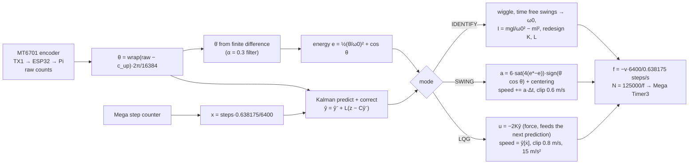

# Single pendulum: the math, and how our code does it

Everything behind the single inverted pendulum on a cart: every variable, every equation, how each becomes code, balance and swing-up, and how they differ. Compared line by line with our best single swing-up, **`PythonMasterUpExpClaudeImproved.py`** ([etwan007/ENGT480 `experiment/legacy-pi-recovery`, commit ba019f9](https://github.com/etwan007/ENGT480/blob/ba019f9c07369a59731eefc16b8dfa34f9be00f8/LegacyPi/Code/SinglePendulum/PythonMasterUpExpClaudeImproved.py)), checked against **28 real rig runs** of it and a simulation of the same logic.

Tags: `[HW]` from rig logs, `[SIM]` simulation only, `[HYP]` hypothesis, `[?]` unconfirmed.

*The real rig running this code (replayed from log balance_20261016_160234) [HW].*

## Read in this order

| # | Page | What you learn |
| --- | --- | --- |
| 1 | [Variables](01_variables.md) | every symbol, unit, value, and its name in the code |
| 2 | [Equations of motion](02_equations_of_motion.md) | Lagrange derivation step by step (lines 158-208), and the one equation that matters for a stepper |
| 3 | [Linear model](03_linear_model.md) | Jacobians, A and B with numbers, poles, discretisation (lines 211-227) |
| 4 | [LQR](04_lqr.md) | cost function, Riccati equation, the gains, the ×2, balance-script Q vs swing-up Q |
| 5 | [Kalman filter and LQG](05_kalman_lqg.md) | estimator, the "virtual cart" (why the motor gets the estimator's speed), missing packets, auto-trim |
| 6 | [Sensing and actuation](06_sensing_actuation.md) | counts to radians, hanging calibration, rate filter, m/s to Arduino timer ticks |
| 7 | [Swing-up](07_swing_up.md) | energy, IDENTIFY, pumping law, centering, adaptive target, catch, every constant |
| 8 | [Balance vs swing-up](08_balance_vs_swingup.md) | what differs and why, gains across our scripts |
| 9 | [Code walkthrough](09_code_walkthrough.md) | the whole file, line range by line range, linked to the math |
| 10 | [Simulations and rig results](10_results.md) | rig vs simulation, what the 28 runs show, untested ideas |

## The whole controller on one screen

## Key numbers

| | Value | Source |
| --- | --- | --- |
| Arm natural frequency $`\omega_0`$ | 7.09-7.47 rad/s (period 0.84-0.89 s) | IDENTIFY, 20 rig runs [HW] |
| Same from the model's $`m, l, I`$ | 5.91 rad/s (1.063 s) | code constants, 20 % off |
| Falling-over rate (unstable pole) | +7.49 /s: a tilt doubles every 93 ms | [3](03_linear_model.md) |
| LQR gain used on the rig | $`K`$ = [51.7, 7.24, -10.8, -12.1], applied ×2 | [4](04_lqr.md) |
| Same as a cart acceleration law | 1.55 m/s² per degree of tilt | [4.5](04_lqr.md#45-what-the-law-means-for-a-stepper) |
| Catch window | 17.2°, 3.5 rad/s, e 0.95-1.15, cart within 12 cm | [7.7](07_swing_up.md#77-the-catch-lines-723-742) |
| Swing-up time after IDENTIFY | median 1.75 s (1.62-3.41 s) | 16 rig runs [HW] |
| Longest continuous balance in these logs | 114 s | [HW] |
| Balance quality | θ std 0.79°, cart std 2.3 cm | run balance_20261016_160234 [HW] |

## Folders

- [`images/`](images/): all figures and animations (made by `sims/make_figures.py`).
- [`sims/`](sims/README.md): `single_model.py` (the script's model and gains, exactly), `single_sim.py` (closed-loop simulation of the script's logic), `make_figures.py`, `extract_hw_logs.py`.
- [`data/`](data/): compact extracts of two rig runs and every identify/catch/fault event from the 28 runs.

## Origin

Written 2026-10-29 by Claude for Ryan (Barney), session [2026-10-29_1448_Barney_math-folder](../../sessions/2026/10/2026-10-29_1448_Barney_math-folder.md). Model numbers were recomputed from the script's own code; rig numbers come from the run logs on the `logs` branch of etwan007/ENGT480. The original code was not modified.
