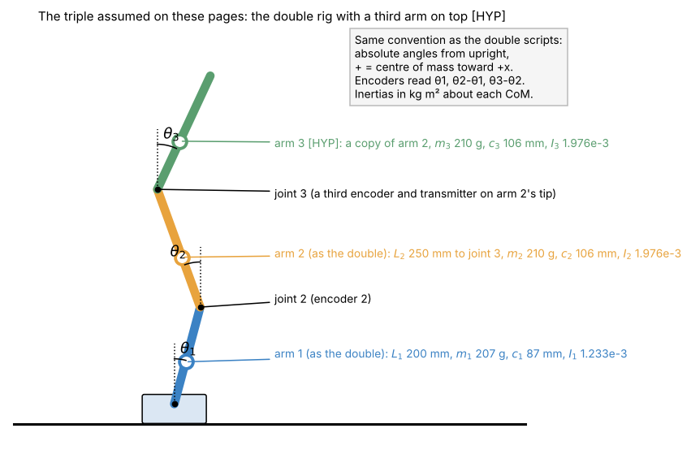

# 1. The rig, the variables and the equations of motion

[Back to Triple](README.md) · Next: [2. Linear model](02_linear_model.md)

## 1.1 Which triple? [HYP]

There is no triple rig and no triple code. To make every number concrete, these pages assume **the double rig with a third arm on top**:



| | Value | Where it comes from |
| --- | --- | --- |
| Arm 1 | $`m_1`$ = 0.207 kg, $`c_1`$ = 0.087 m, $`L_1`$ = 0.200 m, $`I_1`$ = 1.23325e-3 kg m² | the double's physical values (`physical_parameters.py`, `PythonMasterMath2.py`) |
| Arm 2 | $`m_2`$ = 0.210 kg, $`c_2`$ = 0.106 m, $`L_2`$ = 0.250 m (to joint 3), $`I_2`$ = 1.97564e-3 kg m² | the double's arm 2, now carrying joint 3 at its tip |
| Arm 3 [HYP] | a copy of arm 2: $`m_3`$ = 0.210 kg, $`c_3`$ = 0.106 m, $`I_3`$ = 1.97564e-3 kg m² | assumption |
| Joint friction | $`b_2 = b_3`$ = 3.36e-4 N m s/rad for balancing (the double's `BALANCE_B2` 0.03 × $`J_1`$); 1.276e-3 for swinging (the swing-fit 0.11396 × $`J_1`$) | double scripts |
| Sensors | 14-bit encoders: arm 1 absolute, joints 2 and 3 relative; cart from the step count | as the double, plus a third encoder and transmitter on arm 2's tip |
| Motor | stepper speed lands about 9 ms (balance) / 8 ms (swing) after each 10 ms sample; Mega timer rounding | as the double |

Barney (2026-10-29): the new arm 2 carries electronics that will measure the joint between arms 2 and 3, so a third arm is planned [?]; its real values are not known yet.

`I` is each arm's inertia about its own centre of mass. The masses ignore the third encoder, magnet and transmitter that arm 2 would have to carry: that would make arm 2 heavier, which changes the numbers below but not the method. A lighter variant is checked too: arm 3 = the corrected 2026-10-29 STL estimate of the new arm 2 alone (111.9 g, CoM 186.5 mm from its pivot, $`I`$ 6.17e-4 kg m² about its CoM, [params.md](../../params.md#new-arms-mass-properties-stls--measured-weights-2026-10-29) [?]). It changes little: fastest fall 16.4 /s instead of 16.5, the same 14.1 ms delay limit.

Everything is in [`sims/triple_model.py`](sims/triple_model.py) (`TRIPLE`, `TRIPLE_SWING`, `TRIPLE_LIGHT`).

## 1.2 Variables

Same conventions as the double ([Double 1](../Double/01_variables.md)):

| Symbol | Meaning | Unit | Code |
| --- | --- | --- | --- |
| $`x, v, a`$ | cart position, speed, acceleration (+ to the right) | m, m/s, m/s² | `z[6]`, `z[7]`, input `a` |
| $`\theta_i`$ | angle of arm $`i`$ from upright, absolute, + = CoM toward +x | rad | `z[0]`, `z[2]`, `z[4]` |
| $`\omega_i = \dot\theta_i`$ | angular rate of arm $`i`$ | rad/s | `z[1]`, `z[3]`, `z[5]` |
| $`\varphi_2 = \theta_2-\theta_1`$, $`\varphi_3 = \theta_3-\theta_2`$ | joint angles, what encoders 2 and 3 read | rad | measurement |
| $`p_j`$ | first moment seen at joint $`j`$ | kg m | `Rig.p()` |
| $`h_{ij}`$ | inertia matrix entries | kg m² | `Rig.h()` |
| $`b_i`$ | viscous friction at joint $`i`$, on the relative rate | N m s/rad | `Link.b` |

State: $`\mathbf z = [\theta_1, \omega_1, \theta_2, \omega_2, \theta_3, \omega_3, x, v]`$ (8 numbers; 9 with the previous command $`a_{k-1}`$ when the motor delay is modelled).

## 1.3 The constants, worked out

The general formulas ([Double 2.9](../Double/02_equations_of_motion.md#29-any-number-of-links)) for three links:

```math
p_1 = m_1c_1 + L_1(m_2+m_3),\qquad p_2 = m_2c_2 + L_2m_3,\qquad p_3 = m_3c_3
```

```math
h_{11} = I_1 + m_1c_1^2 + L_1^2(m_2+m_3),\quad h_{22} = I_2 + m_2c_2^2 + L_2^2m_3,\quad h_{33} = I_3 + m_3c_3^2
```

```math
h_{12} = L_1p_2,\qquad h_{13} = L_1p_3,\qquad h_{23} = L_2p_3
```

With the numbers of 1.1:

| Constant | Sum | Value |
| --- | --- | --- |
| $`p_1`$ | 0.018009 + 0.200 × 0.420 | **0.102009** kg m |
| $`p_2`$ | 0.022260 + 0.250 × 0.210 | **0.074760** kg m |
| $`p_3`$ | 0.210 × 0.106 | **0.022260** kg m |
| $`h_{11}`$ | 0.0012332 + 0.0015668 + 0.0400 × 0.420 | **0.019600** kg m² |
| $`h_{22}`$ | 0.0019756 + 0.0023596 + 0.0625 × 0.210 | **0.017460** kg m² |
| $`h_{33}`$ | 0.0019756 + 0.0023596 | **0.004335** kg m² |
| $`h_{12}`$ | 0.200 × 0.074760 | **0.014952** kg m² |
| $`h_{13}`$ | 0.200 × 0.022260 | **0.004452** kg m² |
| $`h_{23}`$ | 0.250 × 0.022260 | **0.005565** kg m² |

Compare the double: $`p_1`$ = 0.0600, $`p_2`$ = 0.0223, $`h_{11}`$ = 0.0112. Arm 3 raises what the cart holds up at the main pivot by 70 % ($`p_1`$ 0.060 → 0.102) and makes arm 2 a heavy middle link ($`p_2`$ 0.022 → 0.075, 3.4 times).

**Nine numbers, but only six are free.** The three products $`h_{12} = L_1p_2`$, $`h_{13} = L_1p_3`$, $`h_{23} = L_2p_3`$ tie the inertia matrix to the first moments through the joint positions. A model fitted as nine independent numbers (as the double scripts fit their ratios) can break these ties; [3.6](03_balance.md#36-what-the-balance-tolerates-sim) shows why that is dangerous.

## 1.4 Equations of motion

Lagrange's equations ([Double 2.3](../Double/02_equations_of_motion.md#23-lagranges-equations)) with the cart acceleration $`a`$ as input give, for each arm $`i`$ = 1, 2, 3:

```math
\sum_{j=1}^{3} h_{ij}\cos(\theta_i-\theta_j)\,\dot\omega_j = g\,p_i\sin\theta_i - p_i\cos\theta_i\,a - \sum_{j=1}^{3} h_{ij}\sin(\theta_i-\theta_j)\,\omega_j^2 + \tau_i
```

Written out, as a 3×3 linear system for the angular accelerations:

```math
\begin{bmatrix}
h_{11} & h_{12}\cos(\theta_1-\theta_2) & h_{13}\cos(\theta_1-\theta_3)\\
h_{12}\cos(\theta_1-\theta_2) & h_{22} & h_{23}\cos(\theta_2-\theta_3)\\
h_{13}\cos(\theta_1-\theta_3) & h_{23}\cos(\theta_2-\theta_3) & h_{33}
\end{bmatrix}
\begin{bmatrix}\dot\omega_1\\ \dot\omega_2\\ \dot\omega_3\end{bmatrix}
=
\begin{bmatrix}
g p_1\sin\theta_1 - p_1\cos\theta_1\,a - h_{12}\sin(\theta_1-\theta_2)\omega_2^2 - h_{13}\sin(\theta_1-\theta_3)\omega_3^2 + \tau_1\\
g p_2\sin\theta_2 - p_2\cos\theta_2\,a + h_{12}\sin(\theta_1-\theta_2)\omega_1^2 - h_{23}\sin(\theta_2-\theta_3)\omega_3^2 + \tau_2\\
g p_3\sin\theta_3 - p_3\cos\theta_3\,a + h_{13}\sin(\theta_1-\theta_3)\omega_1^2 + h_{23}\sin(\theta_2-\theta_3)\omega_2^2 + \tau_3
\end{bmatrix}
```

Friction on the relative rates: $`\tau_1 = b_2(\omega_2-\omega_1)`$, $`\tau_2 = -b_2(\omega_2-\omega_1) + b_3(\omega_3-\omega_2)`$, $`\tau_3 = -b_3(\omega_3-\omega_2)`$ (the main pivot's $`b_1`$ is 0 here, as in the swing-fit set).

Each row reads like the double's ([Double 2.3](../Double/02_equations_of_motion.md#23-lagranges-equations)): own inertia and the pull of the other arms on the left; gravity, the cart's push $`-p_i\cos\theta_i\,a`$, the centrifugal pull of the other arms and friction on the right.

**In code** ([`Math/shared/nlink_cart.py`](../shared/nlink_cart.py), `accel_dynamics`): `Mq = H * cos(D)`, `rhs = G*p*sin(th) - p*cos(th)*a - (H*sin(D)) @ w**2 + friction`, `dw = solve(Mq, rhs)`. The same function runs the double ([checked against the team's `f()`](../Double/sims/verify_against_team_code.py)); for the triple nothing changes except the size.

**Stepper speed jumps** ([Double 2.7](../Double/02_equations_of_motion.md#27-when-the-stepper-jumps-speed-the-kick)) kick all three arms at once: $`\Delta\boldsymbol\omega = -\mathbf H(\theta)^{-1}\,(\mathbf p\cos\boldsymbol\theta)\,\Delta v`$ (`speed_jump`).

## 1.5 Energy

```math
E = \tfrac12\boldsymbol\omega^T\mathbf H(\theta)\boldsymbol\omega + g\,(p_1\cos\theta_1 + p_2\cos\theta_2 + p_3\cos\theta_3)
```

From hanging to upright the swing-up has to add $`2g(p_1+p_2+p_3)`$:

| | Single | Double | Triple |
| --- | --- | --- | --- |
| Energy to add | 0.255 J | 1.614 J | **3.905 J** |

and, as for the double, $`dE/dt = -a\sum_i p_i\cos\theta_i\,\omega_i`$ + friction: one cart acceleration feeds all three arms, so energy alone cannot say which arm gets it ([4.1](04_swing_up.md#41-why-a-plan)).

[Back to Triple](README.md) · Next: [2. Linear model](02_linear_model.md)
