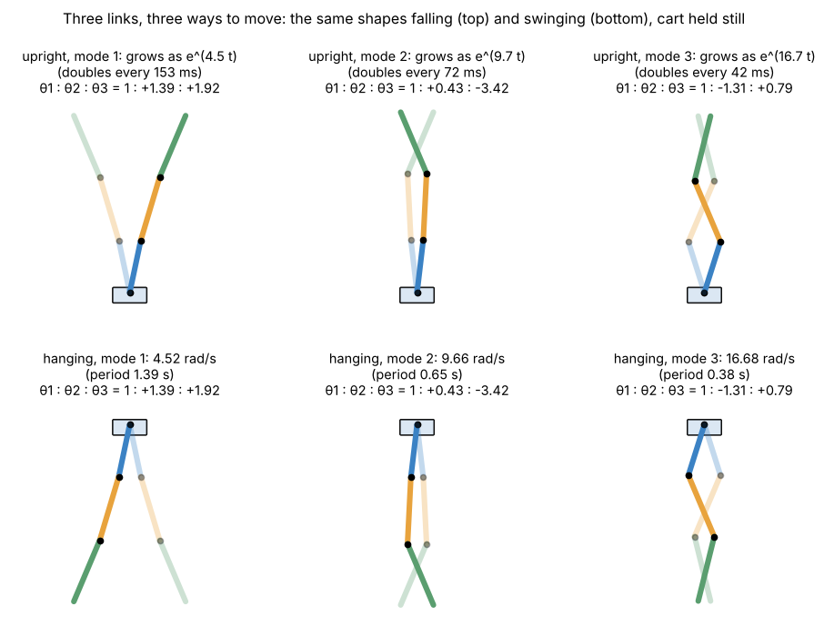
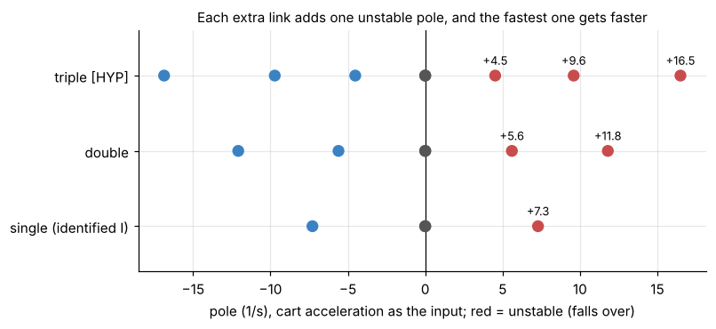
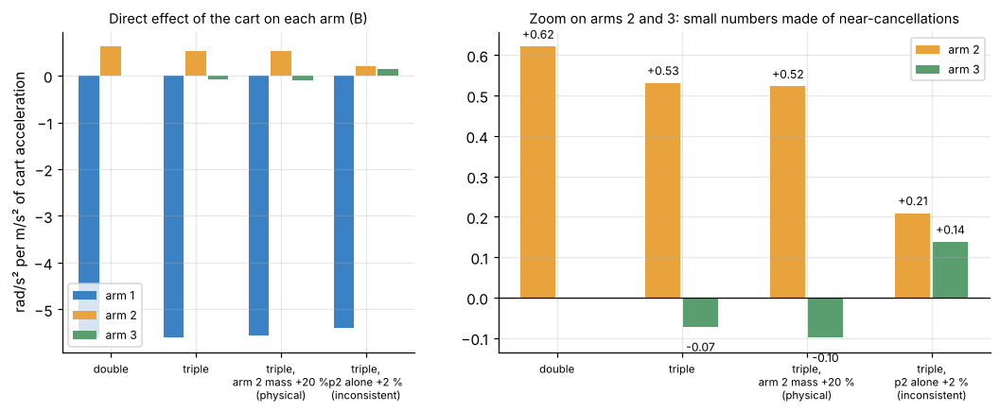

# 2. Linear model: three ways to fall

[Back to Triple](README.md) · Prev: [1. Model](01_model.md) · Next: [3. Balance](03_balance.md)

## 2.1 Linearising at upright

Near upright, $`\sin\theta\approx\theta`$, $`\cos\approx 1`$ and the $`\omega^2`$ terms vanish, so 1.4 becomes

```math
\mathbf H\,\dot{\boldsymbol\omega} = g\,\mathrm{diag}(\mathbf p)\,\boldsymbol\theta - \mathbf p\,a - \mathbf B_f\,\boldsymbol\omega
\quad\Rightarrow\quad
\dot{\boldsymbol\omega} = \underbrace{g\,\mathbf H^{-1}\mathrm{diag}(\mathbf p)}_{\text{gravity}}\boldsymbol\theta\;\underbrace{-\,\mathbf H^{-1}\mathbf B_f}_{\text{friction}}\boldsymbol\omega\;\underbrace{-\,\mathbf H^{-1}\mathbf p}_{\text{cart}}\,a
```

($`\mathbf B_f`$ is the friction matrix of the relative-rate joints, `friction_matrix`). With the 1.3 numbers ([`triple_model.py`](sims/triple_model.py), `linear_accel`), the three angular-acceleration rows of $`\dot{\mathbf z} = \mathbf A\mathbf z + \mathbf B a`$ are:

| | $`\theta_1`$ | $`\omega_1`$ | $`\theta_2`$ | $`\omega_2`$ | $`\theta_3`$ | $`\omega_3`$ | $`a`$ (= B) |
| --- | --- | --- | --- | --- | --- | --- | --- |
| $`\dot\omega_1`$ | 148.09 | -0.094 | -97.17 | 0.145 | 3.96 | -0.051 | **-5.593** |
| $`\dot\omega_2`$ | -132.59 | 0.117 | 158.10 | -0.237 | -30.71 | 0.120 | **0.531** |
| $`\dot\omega_3`$ | 18.13 | -0.053 | -103.15 | 0.233 | 85.74 | -0.179 | **-0.073** |

The other rows are $`\dot\theta_i = \omega_i`$, $`\dot x = v`$, $`\dot v = a`$. Units: 1/s² for the angle columns, 1/s for the rate columns, rad/m for B (rad/s² per m/s²).

How to read a row: $`\dot\omega_2`$ = -132.6 θ1 + 158.1 θ2 - 30.7 θ3 + 0.53 a. Arm 2 tipping over (158 θ2) is slowed when arm 1 leans the same way (it carries joint 2 along) and pushed by arm 3 leaning the other way.

## 2.2 The three natural motions

Hold the cart still ($`a`$ = 0) and drop friction: $`\ddot{\boldsymbol\theta} = g\mathbf H^{-1}\mathrm{diag}(\mathbf p)\,\boldsymbol\theta`$. Its eigenvalues $`s^2`$ give three motions. At upright they grow as $`e^{st}`$; hanging, the same shapes swing at $`\omega = s`$ (gravity flips sign):



| Mode | Shape θ1 : θ2 : θ3 | Upright: grows at | Doubles every | Hanging: swings at | Period |
| --- | --- | --- | --- | --- | --- |
| 1 (all lean) | 1 : +1.39 : +1.92 | 4.52 /s | 153 ms | 4.52 rad/s | 1.390 s |
| 2 (middle bends) | 1 : +0.43 : -3.42 | 9.66 /s | 72 ms | 9.66 rad/s | 0.651 s |
| 3 (zig-zag) | 1 : -1.31 : +0.79 | **16.68 /s** | **42 ms** | 16.68 rad/s | 0.377 s |

For the double the fastest motion doubles every 58 ms, for the single (identified inertia) every 95 ms ([Double 3.2](../Double/03_linear_model.md#32-the-two-natural-motions)). The triple's zig-zag is faster than anything the team's controllers have had to hold so far.

The hanging periods are a cheap check on a real triple: time each mode by hand-exciting it, as for the double.

## 2.3 Poles

With friction and the cart as the input (`linear_accel`): **+16.49, +9.59, +4.52** (unstable), -16.87, -9.72, -4.52, and 0, 0 for the cart (position and speed are pure integrators of $`a`$).



Each link adds one unstable pole. Over one 10 ms control period the fastest motion grows by $`e^{0.165}`$ = 1.179 (17.9 % per cycle; double about 12.5 %, single 7.6 %).

## 2.4 Controllability: one cart, three arms

The controllability matrix $`[\mathbf B, \mathbf A\mathbf B, \dots, \mathbf A^7\mathbf B]`$ has full rank 8, so in theory the cart alone can hold all three arms. But look at the B column, the direct effect of 1 m/s² of cart acceleration on each arm's angular acceleration:



| | Arm 1 | Arm 2 | Arm 3 |
| --- | --- | --- | --- |
| Double | -5.60 | +0.62 | |
| Triple | -5.59 | +0.53 | **-0.073** |
| Triple, arm 2 mass +20 % (a real change) | -5.56 | +0.52 | -0.099 |
| Triple, $`p_2`$ alone +2 % (breaks $`h_{12} = L_1p_2`$) | -5.40 | +0.21 | **+0.138** |

The cart pushes arm 1 directly. Arms 2 and 3 feel the cart only as small differences: each arm's own push $`p_i a`$ minus what the arms below take away through the joints. For arm 3 these cancel to 1.3 % of arm 1's number. A real change of the arms (20 % more mass on arm 2) keeps the cancellation. An inconsistent change of one number by 2 % flips the sign of arm 3's entry: the model then believes the cart pushes arm 3 the other way. This is why the triple's balance and swing-up tolerate physical errors far better than errors in independently fitted numbers ([3.6](03_balance.md#36-what-the-balance-tolerates-sim)).

Another view: the share of each unstable motion the cart can reach directly (left eigenvector · B, normalised): 0.74 (slow), 0.43 (middle), **0.26** (zig-zag); double: 0.78 and 0.43. The fastest motion is also the one the cart reaches least.

## 2.5 Observability

Measured: $`\theta_1`$, $`\theta_2`$, $`\theta_3`$ (from encoder 1 plus the two joint encoders) and $`x`$. With all four the system is observable. Even encoder 1 plus the cart alone would be (rank 8), but only just: every arm's rate would have to be inferred through the chain. With the joint encoders the Kalman filter mostly works arm by arm ([3.4](03_balance.md#34-the-kalman-filter)).

Encoder noise matters more than for the double: angles of arms 2 and 3 are sums of two or three encoder readings, so their noise adds (the filter assumes $`\sqrt2`$ for every joint encoder, `kalman_physical`).

## 2.6 Discretisation and delay

As for the double ([Double 3.5-3.6](../Double/03_linear_model.md#35-discretisation)): the speed command lands $`\tau`$ = 9 ms after the sample, so the period splits into 9 ms of the old acceleration and 1 ms of the new:

```math
\mathbf z_{k+1} = \boldsymbol\Phi\,\mathbf z_k + \mathbf G_0\,a_k + \mathbf G_1\,a_{k-1},\qquad
\boldsymbol\Phi = e^{\mathbf A T},\quad \mathbf G_0 = \int_0^{T-\tau}e^{\mathbf A s}ds\,\mathbf B,\quad \mathbf G_1 = e^{\mathbf A(T-\tau)}\int_0^{\tau}e^{\mathbf A s}ds\,\mathbf B
```

`delay_discretize(A, B, 0.01, 0.009)`. The controller's state becomes $`[\mathbf z; a_{k-1}]`$, 9 numbers. The unstable eigenvalues of $`\boldsymbol\Phi`$: 1.046, 1.101, 1.179.

**Why delay hurts more here:** in 9 ms the zig-zag grows by $`e^{16.5\times0.009}`$ = 1.16 before the cart even starts to answer. Rule of thumb: delay × fastest pole should stay well below 1; triple 0.15, double 0.11, single 0.07. [3.6](03_balance.md#36-what-the-balance-tolerates-sim) gives the exact delay each one survives.

[Back to Triple](README.md) · Prev: [1. Model](01_model.md) · Next: [3. Balance](03_balance.md)
