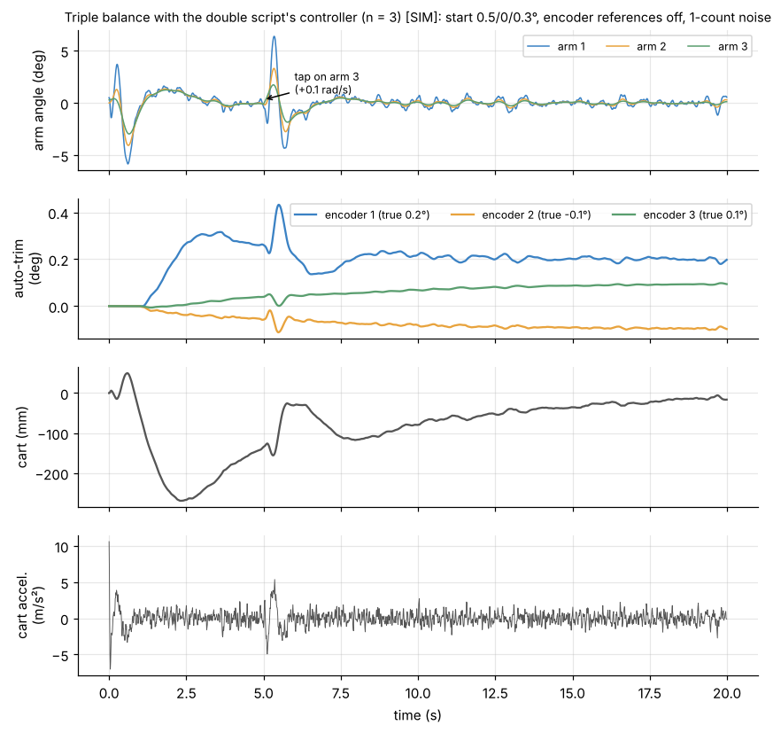
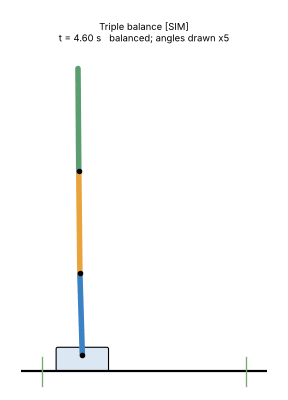
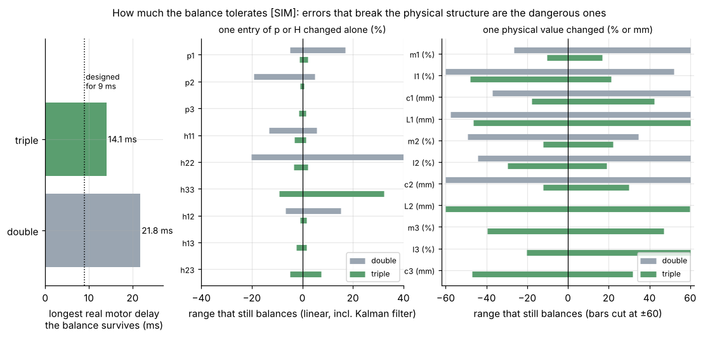

# 3. Balance

[Back to Triple](README.md) · Prev: [2. Linear model](02_linear_model.md) · Next: [4. Swing-up](04_swing_up.md)

Everything here is simulation on the assumed rig of [1.1](01_model.md#11-which-triple-hyp) [SIM][HYP].

## 3.1 Same recipe as the double

The controller is `PythonMasterDouble-Claude.py`'s ([Double 4.3](../Double/04_balance.md#43-generation-2-acceleration-model-with-delay-pythonmasterdouble-claudepy)), written for any number of links in [`Math/shared/`](../shared/README.md) and run with n = 3:

1. linear model with the cart acceleration as input (2.1), discretised with the 9 ms motor delay (2.6), state $`[\mathbf z; a_{k-1}]`$ (9 numbers);
2. LQR gain $`\mathbf K`$ (1×9) from Bryson weights, `balance_design_ramp` → `dlqr`;
3. steady Kalman filter from physical noise sizes (`kalman_physical`);
4. each 10 ms: correct the prediction with the 4 measurements, $`a = -\mathbf K[\hat{\mathbf z}; a_{k-1}]`$, clip to 15 m/s² and 0.8 m/s, send the average speed of the coming period, predict;
5. auto-trim of each encoder's zero (time constant 6 s, after 1 s, at most 3°).

Two changes from the double script: no 0.25 s start ramp (the triple falls too fast to wait; with the ramp the largest start lean it catches drops to a third or less), and one more encoder.

## 3.2 Weights

Unchanged from the double script ([Double 4.4](../Double/04_balance.md#44-the-weights-brysons-rule)): each arm 2°, each rate 60°/s, cart 0.05 m and 0.3 m/s, acceleration 1.3 m/s²:

```math
\mathbf Q = \mathrm{diag}(820.7,\ 0.912,\ 820.7,\ 0.912,\ 820.7,\ 0.912,\ 400,\ 11.1,\ 0),\qquad R = 1/1.3^2 = 0.592
```

Other weights were tried (acceleration 0.5 to 6 m/s², angles 1° to 5°, rates 30 to 120°/s, filter disturbance 0.3 to 3 rad/s², 108 combinations): none was much more tolerant of model errors (3.6), so the double's settings stay.

## 3.3 The gain and what it means

```math
\mathbf K = [\,-390.10,\ -13.455,\ 1089.84,\ 48.990,\ -858.07,\ -87.829,\ -17.898,\ -22.961,\ 0.660\,]
```

for $`[\theta_1, \omega_1, \theta_2, \omega_2, \theta_3, \omega_3, x, v, a_{k-1}]`$. The command is $`a = -\mathbf K\,[\cdot]`$, so per unit:

| | Arm 1 | Arm 2 | Arm 3 | Double arm 1 | Double arm 2 |
| --- | --- | --- | --- | --- | --- |
| m/s² per degree of lean | +6.81 | **-19.02** | **+14.98** | +3.06 | -4.60 |
| m/s² per °/s | +0.235 | -0.855 | +1.533 | | |

(Double: the same settings on the physical double values.) Cart: +0.018 m/s² per mm off centre and +23.0 per m/s, the opposite sign to the double's cart gains; $`a_{k-1}`$: -0.66 per m/s² still in flight. In the closed loop both rigs bring the cart home the same way: started 50 mm off centre, the cart first drifts about 4 mm further out while the arms lean toward the centre, then returns in about 2 s [SIM].

What the signs say, for a lean toward +x:
- **arm 3 leans**: the cart accelerates toward it (+15 m/s² per degree), to get under the top;
- **arm 2 leans**: the cart accelerates **away** (-19 m/s² per degree), which tips arm 1 forward under arm 2 (the double does the same, [Double 4.5](../Double/04_balance.md#45-the-gains-and-what-they-mean));
- **arm 1 leans**: toward it, like a single pendulum.

Alternating signs up the chain: to straighten a link, the cart works on the link below it. The gains are 2 to 4 times the double's. A 1° lean of arm 3 already asks for the full 15 m/s².

Changing the design delay changes the gain like for the double: 0 ms gives $`\theta_2`$ gain 938, 9 ms gives 1090 (`triple_model.py` prints the table).

Closed-loop poles (|z| of the 9 discrete eigenvalues): 0.985 (twice, the cart drifting home over about 0.7 s), 0.929, 0.893, 0.840 (each twice), 0.

## 3.4 The Kalman filter

Filter gain (corrections per unit of innovation, rows = state, columns = $`\theta_1, \theta_2, \theta_3, x`$ innovations):

| | $`\theta_1`$ | $`\theta_2`$ | $`\theta_3`$ | $`x`$ |
| --- | --- | --- | --- | --- |
| $`\theta_1`$ | 0.367 | -0.014 | 0.002 | 0 |
| $`\omega_1`$ | 8.25 | -0.76 | 0.06 | 0 |
| $`\theta_2`$ | -0.028 | 0.329 | -0.013 | 0 |
| $`\omega_2`$ | -1.22 | 6.52 | -0.28 | 0 |
| $`\theta_3`$ | 0.003 | -0.013 | 0.316 | 0 |
| $`\omega_3`$ | 0.21 | -0.85 | 5.91 | 0 |
| $`x`$ | | | | 0.794 |
| $`v`$ | | | | 39.4 |

Mostly diagonal: each arm's angle and rate are corrected from its own angle, with small cross terms. The filter trusts the model about two thirds and the encoder one third each cycle (0.33-0.37), less on arms 2 and 3 because their angles are sums of noisier joint readings.

## 3.5 Simulation [SIM]

Start 0.5°/0°/0.3°, encoder zeros off by 0.2°/-0.1°/0.1°, 1-count encoder noise, the real motor delay 9 ms, a 0.1 rad/s tap on arm 3 at 5 s ([`sims/triple_sims.py`](sims/triple_sims.py)):





Auto-trim finds the encoder errors (0.198°, -0.098°, 0.094° at the end; encoder 1 within about 8 s, the joint encoders more slowly) and the tap is caught. Until the trims settle the cart wanders up to **270 mm** off centre: with "upright" 0.1-0.2° wrong the controller holds the arms slightly tilted, which needs a steady acceleration. The double, with larger errors (0.5° and -0.3°), wandered 167 mm in the same test ([Double 4.8](../Double/04_balance.md#48-auto-trim-double-version)). A real triple would need its encoder zeros set to better than 0.1°, or a slow start.

How much it catches (no auto-trim, starting from rest, 1-count noise):

| | Arm 1 | Arm 2 | Arm 3 | Double arm 1 | Double arm 2 |
| --- | --- | --- | --- | --- | --- |
| Largest start lean (others upright) | 4.0° | 1.5° | 1.75° | 8° | 4° |
| Largest tap (rad/s added at once) | 1.5 | 0.3 | 0.2 | 1.5 | 0.4 |

Wobble caused by encoder noise alone:

| Encoder noise | Arm std (1 / 2 / 3) | Cart std | Command std |
| --- | --- | --- | --- |
| 1 count | 0.33° / 0.16° / 0.09° | 4.2 mm | 0.76 m/s² |
| 2 counts | 0.62° / 0.30° / 0.18° | 9.1 mm | 1.5 m/s² |
| 3 counts | 0.94° / 0.46° / 0.27° | 13.3 mm | 2.2 m/s² |
| 5 counts | 1.53° / 0.75° / 0.45° | 22.6 mm | 3.7 m/s² |

Arm 1 wobbles most: the controller moves the cart, and arm 1, to keep arms 2 and 3 straight.

## 3.6 What the balance tolerates [SIM]



**Motor delay.** Designed for 9 ms, the triple holds up to **14.1 ms** of real delay (linear closed loop with the Kalman filter, `balance_closed_loop_radius`; nonlinear sim: 14 ms holds, 16 ms falls). The double holds up to 21.8 ms. The lighter arm 3 variant ([1.1](01_model.md#11-which-triple-hyp)): also 14.1 ms.

**Model errors: two kinds.** Each bar is the range of one error that still balances (linear closed loop including the filter):

| Error | Double | Triple |
| --- | --- | --- |
| one entry of $`\mathbf p`$ or $`\mathbf H`$ changed alone | worst: $`p_1`$ -4.8 %, $`p_2`$ +4.8 % | worst: $`p_2`$ -0.8/+0.6 %, $`h_{12}`$ -0.8 %, $`p_1`$ -1.1 % |
| arm 1 mass / inertia | -27/+143 % / > -90 %, +52 % | -10/+17 % / -48/+21 % |
| arm 2 mass / inertia | -49/+34 % / -44/+125 % | -12/+22 % / -30/+19 % |
| arm 3 mass / inertia | | -40/+47 % / -20/+71 % |
| CoM positions $`c_i`$ | beyond ±37 mm | -12 to +30 mm (arm 2, the tightest) |
| joint positions $`L_i`$ | beyond ±57 mm | beyond ±46 mm |

So the triple balance tolerates real arm errors of about **±10 %** in mass and inertia, but an error in **one fitted number on its own** of under **1 %** breaks it. The reason is the near-cancellation of 2.4: physical errors keep $`h_{12} = L_1p_2`$, $`h_{13} = L_1p_3`$ and $`h_{23} = L_2p_3`$; independent errors break them and can flip the sign of the cart's effect on arm 3. For the double the same effect exists but is about 5 times weaker.

**Lesson for system ID** [HYP]: identify the arms in physical form (masses, CoMs, inertias, joint positions measured with a ruler) or at least keep the products $`h_{ij} = L_ip_j`$ fixed, instead of fitting every ratio freely. The double's fitted ratio sets already break $`H = L_1P_2`$ by up to 9 % ([Double 1.5](../Double/01_variables.md#15-the-ratios-what-the-scripts-and-system-id-really-use)).

## 3.7 What a real triple balance would need [HYP]

| Need | Why | Double today |
| --- | --- | --- |
| Motor delay well below 14 ms, better under 10 | 3.6 | about 9 ms, holds to 22 ms |
| A model fitted with the physical structure | 3.6 | ratios fitted freely |
| Encoder noise around 1-2 counts | 3.5: 5 counts already wobbles arm 1 by 1.5° | |
| Third encoder and transmitter on arm 2's tip, light | they add to $`m_2`$ and move $`c_2`$; recompute | |
| Full 15 m/s² available | a 1° lean of arm 3 already asks for it | same limit |

[Back to Triple](README.md) · Prev: [2. Linear model](02_linear_model.md) · Next: [4. Swing-up](04_swing_up.md)
