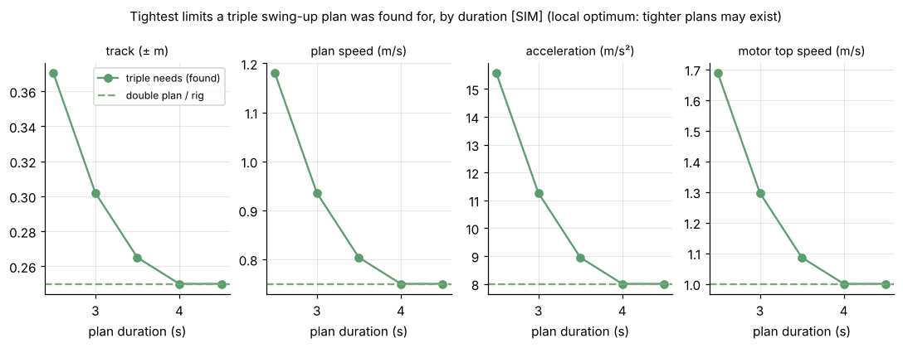
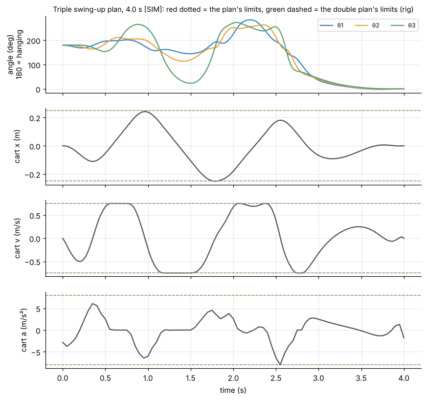
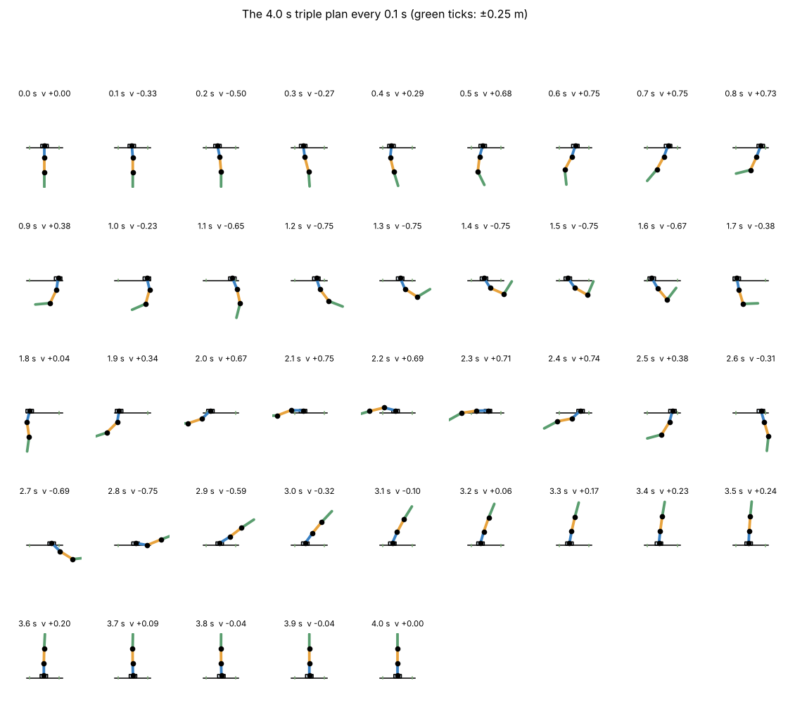
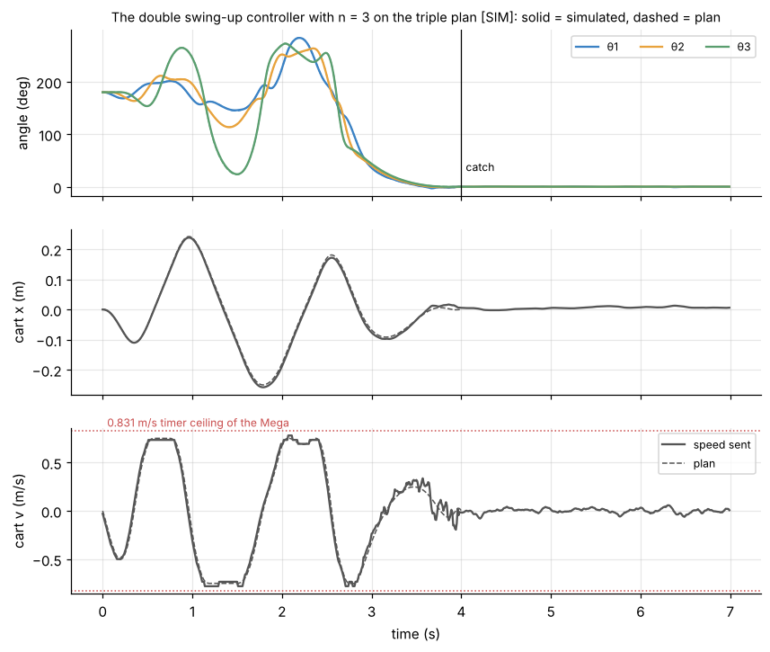
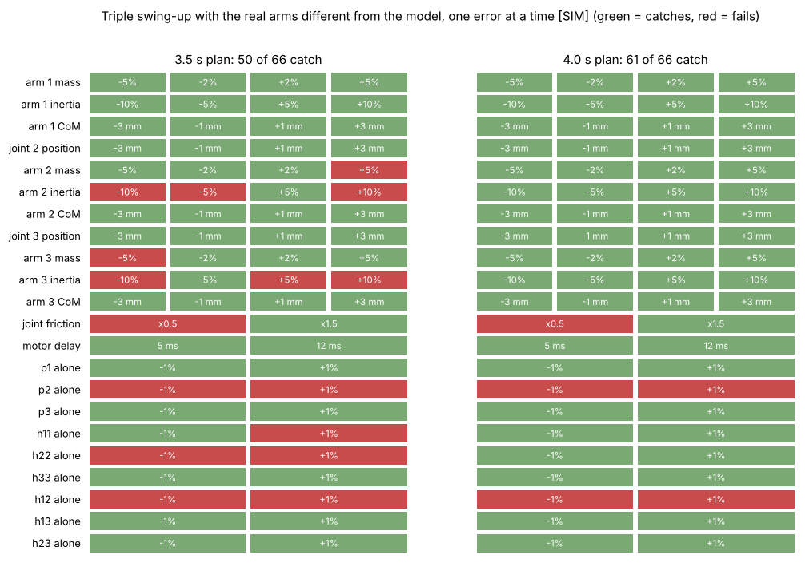

# 4. Swing-up

[Back to Triple](README.md) · Prev: [3. Balance](03_balance.md) · Next: [5. Comparison](05_comparison.md)

Everything here is simulation on the assumed rig of [1.1](01_model.md#11-which-triple-hyp) [SIM][HYP].


*The double swing-up script's controller, run with n = 3 on the 4.0 s plan: plan (dashed), catch at 4.0 s, balance [SIM].*

## 4.1 Why a plan

Everything that rules out energy pumping for the double ([Double 5.1](../Double/05_swing_up.md#51-why-not-energy-pumping-like-the-single)) is worse with three arms: one energy number (3.905 J to add, [1.5](01_model.md#15-energy)) for three arms, a chaotic motion at that energy, and a cart that pushes the three arms in alternating directions with very different strengths (2.4). So the triple uses the double's method unchanged: **plan** one cart motion offline that takes all three arms from hanging to upright at the same instant, then **follow** it with time-varying LQR and hand over to the balance controller. Glück, Eder and Kugi (Automatica 49(3), 2013) swung up a real triple pendulum on a cart this way.

## 4.2 The plan problem with three links

The double script's `--plan` problem ([Double 5.3](../Double/05_swing_up.md#53-the-plan-as-an-optimisation-problem)) with the state of 1.2:

```math
\begin{aligned}
\min\ & \int_0^T a^2\,dt\\
\text{s.t. } & \dot{\mathbf z} = f(\mathbf z, a)\ \text{(1.4)},\quad
\mathbf z(0) = [\pi,0,\pi,0,\pi,0,0,0],\quad \mathbf z(T) = \mathbf 0\\
& |x|\le X,\quad |v|\le V,\quad |a|\le A,\quad a\,\mathrm{sign}(v)\le A\,(1-|v|/V_{\text{top}})
\end{aligned}
```

Solved by `plan_team` in [`Math/shared/nlink_cart.py`](../shared/nlink_cart.py) (CasADi + IPOPT, the same formulation as the team's SLSQP version: acceleration knots every 0.05 s, linear in between, every 10 ms RK4 step a constraint). For T = 4.0 s that is 81 knots + 401 × 8 states = **3289 unknowns** and 3216 equality constraints, solved in seconds to minutes.

**Finding a first plan.** Started from a straight-line guess directly at the rig's limits, IPOPT often stops with "infeasible" even where plans exist (it did for the double). What works reliably is **continuation** (`plan_team_homotopy`, [`sims/make_plans.py`](sims/make_plans.py)):
1. solve with loose limits (track ±0.6 m, 2 m/s, 30 m/s², motor top speed 3 m/s): always succeeds;
2. tighten all four limits a step toward the rig's (0.25 m, 0.75 m/s, 8 m/s², 1.0 m/s), starting each solve from the last plan that worked;
3. if a step fails, halve it; stop at the rig's limits or when the step is below 1/32.

IPOPT finds **local** optima. A step that fails from one starting plan might succeed from another, so the limits below are what a plan was found for, not proven minimums.

## 4.3 How long does it need?

| Duration | Tightest limits found (track, plan speed, accel., motor top) | Effort $`\int a^2dt`$ | Within the rig's limits? |
| --- | --- | --- | --- |
| 2.5 s | ±0.370 m, 1.18 m/s, 15.6 m/s², 1.69 m/s | 63.7 | no |
| 3.0 s | ±0.302 m, 0.94 m/s, 11.3 m/s², 1.30 m/s | 78.0 | no |
| 3.5 s | ±0.265 m, 0.80 m/s, 8.95 m/s², 1.09 m/s | 45.5 | almost |
| **4.0 s** | **±0.25 m, 0.75 m/s, 8 m/s², 1.0 m/s** | **29.7** | **yes** |
| 4.5 s | ±0.25 m, 0.75 m/s, 8 m/s² (uses 5.5), 1.0 m/s | 19.8 | yes |
| double, stored plan | 2.5 s: ±0.25 m, 0.75 m/s, 8 m/s², 1.0 m/s | 29.4 | yes |



With the double's 2.5 s, a triple swing-up needs a 50 % longer track, a 60 % faster cart and twice the acceleration. Given 4.0 s, the same rig limits are enough, with the same effort as the double's plan. (The 3.0 s effort is higher than the 2.5 s one because its limits were pushed much tighter.)

## 4.4 The 4.0 s plan





What it does ([`data/triple_swingup_plan_4.0s.json`](data/triple_swingup_plan_4.0s.json)):
- five big cart strokes, to -0.11, +0.24, -0.25, +0.18 and -0.09 m (at 0.35, 0.96, 1.79, 2.55, 3.16 s), each pumping energy into the arms;
- arm 3 whips over the top early (23° from upright at 1.5 s) and falls back, the chain folds and unfolds;
- between 2.75 and 3.0 s all three arms rise together on the same side (θ ≈ 120°, 90°, 75° → 35°, 40°, 45°);
- the last 0.75 s is a slow final straightening with the cart creeping back to 0.

It uses the limits fully: speed at 0.75 m/s for 22 % of the time, the track edge, one moment at 8 m/s².

## 4.5 Following the plan

Exactly the double script's machinery ([Double 5.5-5.7](../Double/05_swing_up.md#55-from-the-plan-to-motor-commands)), with n = 3 ([`Math/shared/swing_sim.py`](../shared/swing_sim.py), `build`, `TeamSwingController`):

| Part | Triple |
| --- | --- |
| Feedforward | staircase reference $`a_{\text{ref}}[k]`$ from the plan's speed, 8 ms motor delay (`stair_reference`) |
| Feedback | $`a_k = a_{\text{ref}}[k] - \mathbf K_k\mathbf e_k`$, **400** gains of 9 numbers each, from the backward Riccati recursion on the staircase model, ending in the triple balance's cost-to-go (`tvlqr_stair`) |
| Weights | the double's: 5°, 120°/s, 0.25 m, 0.3 m/s, $`R = 1/5^2`$ |
| Observer | nonlinear staircase prediction, each arm corrected with the same constant gain [0.512, 18.21] per rad (`swing_observer_gain`) |
| Limits | 16 m/s², torque-speed limit with top speed 1.0 m/s, 1.0 m/s, Mega timer rounding |
| Abort / catch | 35° off the plan or cart 0.36 m (0.11 m past the plan's track) / switch to the balance of 3 at k = 400 |

## 4.6 Closed loop [SIM]

Real arms = model, 1-count encoder noise, 8 ms motor delay, timer rounding ([`sims/triple_sims.py`](sims/triple_sims.py)):



| Plan | Result | Highest speed sent | Furthest cart |
| --- | --- | --- | --- |
| 2.5 s | catches, with its own wider limits (motor top 1.69 m/s, cart abort at 0.48 m) | 1.246 m/s | 0.369 m |
| 3.0 s | catches | 0.959 m/s | 0.303 m |
| 3.5 s | catches | 0.831 m/s (the timer ceiling) | 0.270 m |
| **4.0 s** | **catches** | **0.779 m/s** | **0.258 m** |
| 4.5 s | catches | 0.733 m/s | 0.248 m |

Unlike the double on the rig ([Double 7.4](../Double/07_results.md#74-why-every-rig-attempt-tops-out-at-0831-ms)), the 4.0 s plan's feedback does not even reach the 0.831 m/s ceiling of the Mega's timer.

## 4.7 Which model errors it survives [SIM]

One error at a time ([`sims/triple_sims.json`](sims/triple_sims.json)):



| Real arms differ in | 3.5 s plan | 4.0 s plan |
| --- | --- | --- |
| arm 1: mass ±5 %, inertia ±10 %, CoM ±3 mm, joint 2 position ±3 mm | all catch | all catch |
| arm 2: mass ±2 % / ±5 % | catch / -5 % catches, +5 % fails | all catch |
| arm 2: inertia ±5 % / ±10 % | +5 % only | all catch |
| arm 2: CoM ±3 mm, joint 3 position ±3 mm | all catch | all catch |
| arm 3: mass ±2 % / ±5 % | catch / -5 % fails | all catch |
| arm 3: inertia ±5 % / ±10 % | -5 % only | all catch |
| arm 3: CoM ±3 mm | all catch | all catch |
| joint friction ×0.5 / ×1.5 | fails / catches | fails / catches |
| motor delay 5 or 12 ms (plan assumes 8) | catch | catch |
| one entry of p or H alone ±1 % | $`p_2`$, $`h_{12}`$, $`h_{22}`$ (both signs) and $`h_{11}`$ +1 % fail | $`p_2`$ and $`h_{12}`$ fail (both signs) |

Two lessons:
1. **The longer, gentler plan is far more tolerant.** The 4.0 s plan survives every physical error tested; the 3.5 s plan, which needs slightly more than the rig's limits and hits the timer ceiling, fails at 5 % in arm 2 or 3. Speed headroom and time to correct matter more than anything else here.
2. **Inconsistent fitted numbers are the danger**, as for the balance ([3.6](03_balance.md#36-what-the-balance-tolerates-sim)): 1 % in $`p_2`$ or $`h_{12}`$ alone breaks it, while 5 % in a real mass does not.

Not tested: Coulomb friction, missed steps, belt stretch, radio dropouts and timing jitter, a start that is not perfectly still.

**The same holds for the double** [SIM]: with the stored plan's model and limits, a 3.5 s double plan survives 25 of 36 single model errors where the stored 2.5 s plan survives 11, including the joint friction anywhere from half to twice the model's ([Double 7.2](../Double/07_results.md#72-which-model-errors-the-swing-up-survives-sim)). That plan is ready in the double script's file format.

[Back to Triple](README.md) · Prev: [3. Balance](03_balance.md) · Next: [5. Comparison](05_comparison.md)
