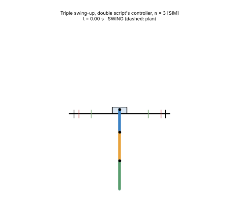

# Triple pendulum: the math, worked out on an assumed rig

There is no triple rig and no triple code yet. These pages take the double rig, put a third arm (a copy of arm 2) on top, and run the double scripts' own methods with three links: model, linear model, balance, swing-up, simulations. Everything is computed, nothing is guessed, but the rig is an assumption [HYP] and every result is simulation [SIM]. The code is the shared n-link code in [`Math/shared/`](../shared/README.md), which reproduces the team's double scripts exactly for n = 2.

*A 4.0 s triple swing-up inside the double rig's exact limits (±0.25 m, 0.75 m/s, 8 m/s²), followed by the double swing-up script's controller with n = 3 [SIM].*

## Read in this order

| # | Page | What you learn |
| --- | --- | --- |
| 1 | [Model](01_model.md) | the assumed rig, every variable, the nine constants worked out, the equations of motion written out, energy |
| 2 | [Linear model](02_linear_model.md) | A and B with numbers, three ways to fall (and swing), poles, why the cart barely reaches arm 3, delay |
| 3 | [Balance](03_balance.md) | the double balance controller with n = 3, the 9 gains and what they mean, Kalman filter, simulations, what it tolerates |
| 4 | [Swing-up](04_swing_up.md) | why a plan, how long it must be for the rig's limits, the 4.0 s plan, TV-LQR, closed loop, model errors |
| 5 | [Comparison](05_comparison.md) | single vs double vs triple in one table, balance vs swing-up, what a real triple would need |

## Key numbers [SIM, HYP rig]

| | Triple | Double (same method) | Source |
| --- | --- | --- | --- |
| Unstable poles | +16.5, +9.6, +4.5 /s | +11.8, +5.6 /s | [2.3](02_linear_model.md#23-poles) |
| Fastest fall doubles in (cart held still) | 42 ms | 58 ms | [2.2](02_linear_model.md#22-the-three-natural-motions) |
| Cart's direct effect on the top arm | -0.07 rad/s² per m/s² | +0.62 | [2.4](02_linear_model.md#24-controllability-one-cart-three-arms) |
| Balance gain on the top arm | 15 m/s² per degree | 4.6 | [3.3](03_balance.md#33-the-gain-and-what-it-means) |
| Motor delay the balance survives | 14.1 ms | 21.8 ms | [3.6](03_balance.md#36-what-the-balance-tolerates-sim) |
| Balance: real arm errors / one fitted number alone | about ±10 % / under 1 % | ±30 % or more / about ±5 % | same |
| Shortest swing-up found inside the rig's limits | **4.0 s** (2.5 s needs ±0.37 m, 1.18 m/s, 15.6 m/s²) | 2.5 s | [4.3](04_swing_up.md#43-how-long-does-it-need) |
| 4.0 s swing-up: tolerates | every physical error tested (mass ±5 %, inertia ±10 %, CoM and joints ±3 mm) | | [4.7](04_swing_up.md#47-which-model-errors-it-survives-sim) |

Two lessons that carry back to the double:
1. **Fit the model with its physical structure.** Errors that break $`h_{ij} = L_ip_j`$ are far more dangerous than real errors in masses or lengths ([3.6](03_balance.md#36-what-the-balance-tolerates-sim); for the double: [Double 1.5](../Double/01_variables.md#15-the-ratios-what-the-scripts-and-system-id-really-use), [Double 7.2](../Double/07_results.md#72-which-model-errors-the-swing-up-survives-sim)).
2. **A longer plan is a more tolerant plan** ([4.7](04_swing_up.md#47-which-model-errors-it-survives-sim); for the double: [Double 7.2](../Double/07_results.md#72-which-model-errors-the-swing-up-survives-sim)).

## Folders

- [`images/`](images/): figures and animations (made by `sims/make_figures.py`).
- [`sims/`](sims/README.md): `triple_model.py`, `make_plans.py`, `triple_sims.py`, `make_figures.py`.
- [`data/`](data/): the swing-up plans for 2.5 to 4.5 s.

## Origin

Written 2026-10-29 by Claude for Ryan (Barney), session [2026-10-29_1448_Barney_math-folder](../../sessions/2026/10/2026-10-29_1448_Barney_math-folder.md). No team code exists for the triple; nothing here has been on hardware.
